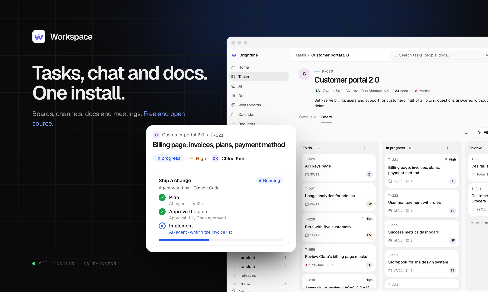

<p align="center"></p>

<h1 align="center">Workspace</h1>

<p align="center"><strong>Tareas, chat y la IA de tu empresa en una sola aplicación autoalojada. Ve quién hace qué y si la IA ayuda.</strong></p>

<p align="center"><a href="README.md">English</a> · <a href="README.vi.md">Tiếng Việt</a> · <a href="README.zh.md">中文</a></p>



Esta traducción resume [README.md](README.md); si no coinciden, manda la versión en inglés.

## Para qué sirve

Una instalación lleva el trabajo de una empresa en su propio servidor:

- **Tareas y proyectos:** tableros, listas, cronogramas, subtareas, dependencias, tareas recurrentes, objetivos.
- **Chat y reuniones:** canales, hilos, referencias a tareas, reuniones con agenda, acta y tareas pendientes.
- **Solicitudes y horario:** vacaciones, compras, pagos y viajes con aprobación; fichaje de entrada y salida; festivos
  y semana laboral por país.
- **Documentos y pizarras** con edición simultánea.
- **La IA de la empresa (opcional):** conecta una clave de API, cualquier servidor compatible con OpenAI o un modelo en
  tu propio ordenador. Pregunta por tareas, personas y vacaciones; pídele que cree y actualice tareas, resuma canales,
  lea páginas web y haga archivos de Word, Excel y PowerPoint. Cada cambio espera tu confirmación.
- **AI Insights (opcional, desactivado por defecto):** con una extensión del navegador y un aviso en cada página
  registrada, ve para qué usa la gente ChatGPT, Claude, Gemini y Copilot, qué datos sensibles se detuvieron antes de
  enviarse y si las tareas hechas con IA terminan antes.

Para el responsable: **Inicio** muestra quién está bloqueado y por qué, qué espera tu decisión y el uso de IA de esta
semana. **Avance** muestra cada persona y departamento. No se nos envía nada ni a nosotros ni a terceros; todo
funciona sin IA. En inglés, vietnamita, chino y español.

**Demo en línea: [workspace.hungga1711.dev/live-demo](https://workspace.hungga1711.dev/live-demo)** · recorre toda la aplicación en el navegador, sin registrarte. Es la interfaz real con
datos de una empresa inventada; no hay servidor detrás, así que no se guarda nada (en inglés).

https://github.com/user-attachments/assets/2c138cb5-2642-4455-aca1-fa205fef1153

## Instalación

Necesitas un ordenador o servidor siempre encendido con **2 núcleos de CPU, 2 GB de RAM y 20 GB de disco**. Para una
empresa, usa un servidor Linux (cualquier VPS) y un dominio que apunte a él. Para probarlo, basta con tu portátil.

1. **Instala Docker.** Linux: `curl -fsSL https://get.docker.com | sh`. macOS o Windows:
   [Docker Desktop](https://www.docker.com/products/docker-desktop/) (en macOS también sirve
   [OrbStack](https://orbstack.dev)). Compruébalo con `docker compose version`.
2. **Ejecuta el instalador:**

   ```bash
   curl -fsSL https://raw.githubusercontent.com/hungga1711/workspace/main/infra/production/install.sh | sh
   ```

   Pregunta cuatro cosas: el dominio (`work.tuempresa.com`, o `localhost` para probar), un dominio para archivos
   (vacío: los archivos quedan en el disco del servidor), un correo para los avisos del certificado HTTPS (vacío con
   `localhost`) y el servidor de correo SMTP (opcional; se añade después en Administración › Ajustes y funciones).
   Genera todas las contraseñas y claves en `workspace/.env`, arranca la aplicación e imprime la dirección `/setup` y
   un token.
3. **Crea tu empresa.** Abre esa dirección, introduce el token, pon el nombre de la empresa, elige su país (festivos,
   vacaciones anuales, moneda y semana laboral lo siguen) y crea la cuenta del propietario. Luego invita a la gente
   desde **Administración › Miembros**.
4. **Conecta una IA (opcional).** Todo funciona sin IA. Para usar las funciones de IA (Preguntar a la IA, flujos de
   trabajo, IA en el chat y en las tareas), conecta primero una IA en **IA › Conectar** (`/app/ai/connect`):
   1. **Conectar este ordenador.** En un ordenador con Claude Code, Codex, Gemini CLI, Ollama o LM Studio (y
      Node.js), pega la línea que muestra en la Terminal (Windows: PowerShell). Cuando diga "Connected", pulsa
      **Comprobar de nuevo**.
   2. **Elige qué IA responde,** en la tarjeta **Preguntar a la IA**:
      - **IA de la empresa, para todos.** Un administrador pulsa **Usar … para las preguntas de todos**: las preguntas
        de todos los miembros las responde la IA de ese ordenador, así que mantenlo encendido. Para usar una clave de
        API, un servidor compatible con OpenAI o un modelo en tu servidor, añádelo en **Administración › Conexiones
        de IA**.
      - **Tu propia IA.** Quien tenga su propia cuenta de IA conecta su ordenador del mismo modo y lo elige en
        **Mis preguntas van a**. Quien no conecte nada usa la IA de la empresa.

Otras formas de ejecutarlo: [plantillas para Coolify, Portainer, Railway, Unraid y CasaOS](infra/templates/README.md),
o tu propio proxy inverso ([guía de autoalojamiento](infra/production/README.md)).

## Antes de usarlo en serio

- **Primero el DNS.** Apunta el dominio al servidor y abre los puertos 80 y 443 antes de instalar; el certificado HTTPS
  se pide automáticamente y falla hasta que ambas cosas se cumplan.
- **Guarda bien `workspace/.env`.** Contiene las contraseñas de la base de datos y las claves que cifran los secretos
  guardados. Perderlo significa perder el acceso a los datos.
- **Copias de seguridad.** `workspace/backup.sh` guarda la base de datos, los archivos y `.env`; prográmalo a diario
  (por ejemplo con cron) y copia el resultado fuera del servidor. Restaura con `restore.sh`. Ver
  [copias de seguridad](docs/runbooks/backup-restore.md).
- **Actualiza** con `workspace/upgrade.sh <versión>`: hace una copia, descarga la nueva versión, migra la base de datos
  y vuelve atrás sola si la nueva versión no arranca.
- **Sin SMTP** nadie recibe correos: copia cada enlace de invitación en Administración › Miembros y envíalo tú.
- **La IA es opcional.** Sin una IA conectada, las pantallas de IA se ocultan y todo lo demás funciona. Las claves de
  IA se guardan cifradas en tu servidor.
- **AI Insights registra los prompts de las personas** solo después de que la empresa lo active y cada persona instale
  la extensión; avisa antes a tu equipo. Qué envía: [docs/extension/what-is-sent.md](docs/extension/what-is-sent.md).
- **Quita lo que no uses** con `DISABLED_FEATURES` en `.env`: `docs`, `whiteboards`, `calendar`, `time`, `ai`. Chat y
  tareas siempre están activos.
- **Las videollamadas** necesitan LiveKit y puertos adicionales (TCP 7881, UDP 50000–50100):
  `COMPOSE_PROFILES=meet` en `.env`.
- Cada ajuste está descrito en [`infra/production/.env.example`](infra/production/.env.example); la guía completa es
  [infra/production/README.md](infra/production/README.md).

## Contribuir

Se agradecen informes de errores, ideas y pull requests. Cómo ejecutarlo desde el código:
[README.md](README.md#contributing) y [CONTRIBUTING.md](CONTRIBUTING.md). Problemas de seguridad, en privado:
[SECURITY.md](SECURITY.md).

## Licencia

[MIT](LICENSE). Componentes de terceros: [NOTICE.md](NOTICE.md).
