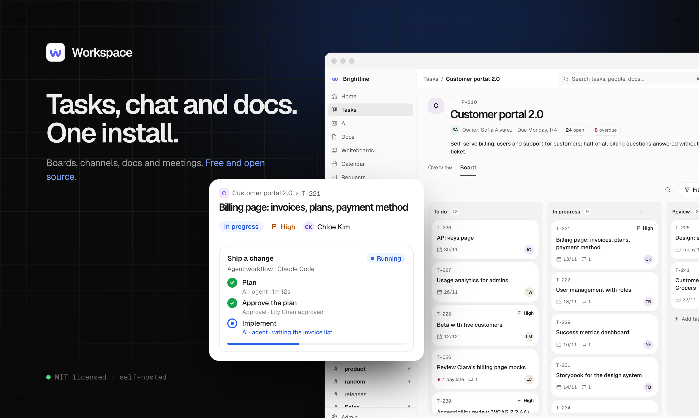

<p align="center"></p>

<h1 align="center">Workspace</h1>

<p align="center"><strong>Việc, chat và AI của công ty trong một ứng dụng tự cài. Biết ai làm gì, và AI có giúp không.</strong></p>

<p align="center"><a href="README.md">English</a> · <a href="README.zh.md">中文</a> · <a href="README.es.md">Español</a></p>



Bản dịch này tóm tắt [README.md](README.md); khi hai bản khác nhau, bản tiếng Anh là bản đúng.

## Dùng để làm gì

Mỗi bản cài chạy công việc của một công ty trên máy chủ của chính công ty đó:

- **Việc và dự án:** bảng, danh sách, timeline, việc con, phụ thuộc, việc lặp lại, mục tiêu.
- **Chat và họp:** kênh, luồng trả lời, nhắc tới việc, cuộc họp có chương trình, biên bản và việc cần làm.
- **Đơn từ và chấm công:** nghỉ phép, mua hàng, thanh toán và công tác có duyệt; chấm công vào ra; ngày lễ và tuần
  làm việc theo quốc gia.
- **Tài liệu và bảng trắng** cùng sửa trực tiếp.
- **AI của công ty (tuỳ chọn):** kết nối một API key, một máy chủ tương thích OpenAI hoặc một model chạy trên máy tính
  của bạn. Hỏi về việc, con người và nghỉ phép; nhờ nó tạo và sửa việc, tóm tắt kênh, đọc trang web, làm file Word,
  Excel và PowerPoint. Mọi thay đổi đều chờ bạn xác nhận.
- **AI Insights (tuỳ chọn, tắt mặc định):** với tiện ích trình duyệt và thông báo trên mọi trang được ghi, thấy mọi
  người dùng ChatGPT, Claude, Gemini và Copilot để làm gì, dữ liệu nhạy cảm nào đã bị chặn trước khi gửi, và việc làm
  có AI có xong nhanh hơn không.

Cho chủ doanh nghiệp: **Trang chủ** cho thấy ai đang kẹt và vì sao, việc gì chờ bạn quyết, và mức dùng AI tuần này.
**Tiến độ** cho thấy từng người và từng phòng ban. Không gì được gửi cho chúng tôi hay bên thứ ba; mọi tính năng chạy
được khi không có AI. Có tiếng Anh, tiếng Việt, tiếng Trung và tiếng Tây Ban Nha.

**Xem thử: [workspace.hungga1711.dev/live-demo](https://workspace.hungga1711.dev/live-demo)** · bấm xem toàn bộ ứng dụng ngay trên trình duyệt, không cần đăng ký. Đây là giao diện thật với
dữ liệu mẫu của một công ty hư cấu; phía sau không có máy chủ nên mọi thao tác đều không được lưu (tiếng Anh).

https://github.com/user-attachments/assets/2c138cb5-2642-4455-aca1-fa205fef1153

## Cài đặt

Cần một máy luôn bật với **2 nhân CPU, 2 GB RAM và 20 GB ổ đĩa**. Cho công ty, dùng một máy chủ Linux (VPS bất kỳ)
và một tên miền trỏ về nó. Để thử, máy tính xách tay của bạn là đủ.

1. **Cài Docker.** Linux: `curl -fsSL https://get.docker.com | sh`. macOS hoặc Windows:
   [Docker Desktop](https://www.docker.com/products/docker-desktop/) (trên macOS, [OrbStack](https://orbstack.dev)
   cũng được). Kiểm tra bằng `docker compose version`.
2. **Chạy trình cài:**

   ```bash
   curl -fsSL https://raw.githubusercontent.com/hungga1711/workspace/main/infra/production/install.sh | sh
   ```

   Nó hỏi bốn điều: tên miền (`work.congtycuaban.com`, hoặc `localhost` để thử), tên miền cho file (để trống: file
   nằm trên ổ đĩa máy chủ), email cho thông báo chứng chỉ HTTPS (để trống với `localhost`) và máy chủ mail SMTP (bỏ
   qua được, thêm sau ở Quản trị › Cài đặt & tính năng). Nó tạo mọi mật khẩu và khoá vào `workspace/.env`, khởi
   động và in ra địa chỉ `/setup` cùng một token.
3. **Tạo công ty.** Mở địa chỉ đó, nhập token, đặt tên công ty, chọn quốc gia (ngày lễ, phép năm, tiền tệ và tuần
   làm việc theo đó) và tạo tài khoản chủ. Sau đó mời mọi người ở **Quản trị › Thành viên**.
4. **Kết nối AI (không bắt buộc).** Mọi thứ chạy được khi không có AI. Muốn dùng tính năng AI (Hỏi đáp, workflow,
   AI trong chat và việc) thì kết nối AI trước ở **AI › Kết nối** (`/app/ai/connect`):
   1. **Kết nối máy này.** Trên một máy có Claude Code, Codex, Gemini CLI, Ollama hoặc LM Studio (và Node.js), dán
      dòng lệnh trang đưa vào Terminal (Windows: PowerShell). Khi nó báo "Connected", bấm **Kiểm tra lại**.
   2. **Chọn AI trả lời cho Hỏi đáp**, ở thẻ **Hỏi đáp**:
      - **AI của công ty, cho mọi người.** Quản trị viên bấm **Dùng … để trả lời cho cả công ty**: câu hỏi của mọi
        nhân viên được AI trên máy đó trả lời, nên giữ máy luôn bật. Muốn dùng API key, máy chủ tương thích OpenAI
        hoặc model chạy trên máy chủ thay vào đó, thêm ở **Quản trị › Kết nối AI**.
      - **AI của riêng bạn.** Ai có tài khoản AI riêng thì tự kết nối máy của mình theo cách trên và chọn nó ở
        **Câu hỏi của tôi dùng**. Ai không kết nối gì thì dùng AI của công ty.

Cách chạy khác: [mẫu cho Coolify, Portainer, Railway, Unraid và CasaOS](infra/templates/README.md), hoặc reverse
proxy của bạn ([hướng dẫn tự cài](infra/production/README.md)).

## Trước khi dùng thật

- **DNS trước.** Trỏ tên miền về máy chủ và mở cổng 80 và 443 trước khi cài; chứng chỉ HTTPS được xin tự động và
  thất bại cho đến khi cả hai đúng.
- **Giữ kỹ `workspace/.env`.** Nó chứa mật khẩu cơ sở dữ liệu và các khoá mã hoá bí mật đã lưu. Mất nó là mất quyền
  truy cập dữ liệu.
- **Sao lưu.** `workspace/backup.sh` lưu cơ sở dữ liệu, file và `.env`; chạy hằng ngày (ví dụ bằng cron) và chép kết
  quả ra ngoài máy chủ. Khôi phục bằng `restore.sh`. Xem [sao lưu](docs/runbooks/backup-restore.md).
- **Nâng cấp** bằng `workspace/upgrade.sh <phiên bản>`: nó sao lưu, tải bản mới, chuyển đổi cơ sở dữ liệu và tự quay
  lại nếu bản mới không khởi động được.
- **Không có SMTP** thì không ai nhận được email: chép từng link mời ở Quản trị › Thành viên và tự gửi.
- **AI là tuỳ chọn.** Không kết nối AI thì các màn hình AI ẩn đi và mọi thứ khác vẫn chạy. Khoá AI được lưu mã hoá
  trên máy chủ của bạn.
- **AI Insights ghi lại prompt của mọi người** chỉ sau khi công ty bật và từng người cài tiện ích; hãy báo nhân viên
  trước. Những gì nó gửi: [docs/extension/what-is-sent.md](docs/extension/what-is-sent.md).
- **Bỏ phần không dùng** bằng `DISABLED_FEATURES` trong `.env`: `docs`, `whiteboards`, `calendar`, `time`, `ai`.
  Chat và việc luôn bật.
- **Họp video** cần LiveKit và thêm cổng (TCP 7881, UDP 50000–50100): `COMPOSE_PROFILES=meet` trong `.env`.
- Mọi cấu hình có trong [`infra/production/.env.example`](infra/production/.env.example); hướng dẫn đầy đủ ở
  [infra/production/README.md](infra/production/README.md).

## Đóng góp

Báo lỗi, ý tưởng và pull request đều được chào đón. Cách chạy từ mã nguồn: [README.md](README.md#contributing) và
[CONTRIBUTING.md](CONTRIBUTING.md). Lỗi bảo mật, báo riêng: [SECURITY.md](SECURITY.md).

## Giấy phép

[MIT](LICENSE). Thành phần bên thứ ba: [NOTICE.md](NOTICE.md).
