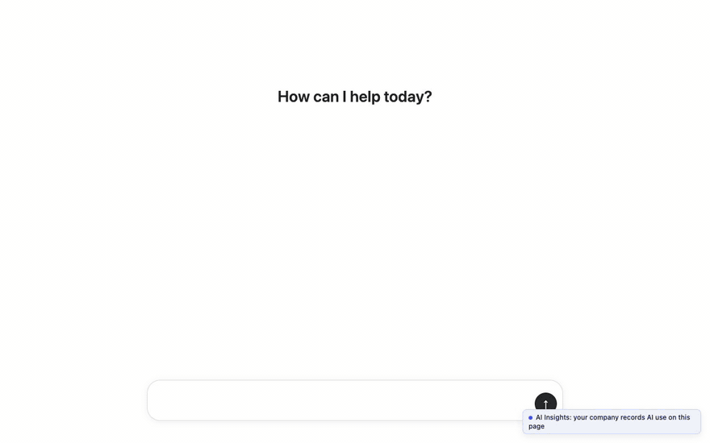

<h1 align="center">workspace</h1>

<p align="center"><strong>任务、频道和公司自己的 AI，集中在一个自托管应用里。看清谁在做什么，以及 AI 是否有帮助。</strong></p>

<p align="center"><a href="README.md">English</a> · <a href="README.vi.md">Tiếng Việt</a> · <a href="README.es.md">Español</a></p>

本译文概括 [README.md](README.md)；两者不一致时，以英文版为准。

## 用来做什么

每次安装在公司自己的服务器上运行一家公司的工作：

- **任务和项目：** 看板、列表、时间线、子任务、依赖、重复任务、目标。
- **频道和会议：** 频道、话题回复、引用任务，以及带议程、纪要和待办事项的会议。
- **审批和考勤：** 请假、采购、付款和出差审批；上下班打卡；按国家设置节假日和工作周。
- **文档和白板**，支持多人实时编辑。
- **公司自己的 AI（可选）：** 接入 API 密钥、任意兼容 OpenAI 的服务器，或在你自己电脑上运行的模型。询问任务、
  人员和请假情况；让它创建和更新任务、总结频道、阅读网页，生成 Word、Excel 和 PowerPoint 文件。每次修改都要
  你确认。
- **AI Insights（可选，默认关闭）：** 通过浏览器扩展并在每个被记录的页面上显示提示，了解大家用 ChatGPT、Claude、
  Gemini 和 Copilot 做什么、哪些敏感数据在发送前被拦下，以及借助 AI 的任务是否完成得更快。

对负责人：**首页** 显示谁卡住了及原因、等你决定的事项和本周的 AI 使用情况。**进度** 显示每个人和每个部门。
不会向我们或任何第三方发送任何数据；没有 AI 时所有功能照常可用。界面支持英语、越南语、中文和西班牙语。

[](https://workspace.hungga1711.dev/media/tour.mp4)

## 安装

需要一台常开的电脑或服务器：**2 核 CPU、2 GB 内存、20 GB 磁盘**。公司使用请准备一台 Linux 服务器（任意云 VPS）
和一个指向它的域名。只想试用，自己的笔记本电脑就够了。

1. **安装 Docker。** Linux：`curl -fsSL https://get.docker.com | sh`。macOS 或 Windows：安装
   [Docker Desktop](https://www.docker.com/products/docker-desktop/)（macOS 上也可以用 [OrbStack](https://orbstack.dev)）。
   用 `docker compose version` 检查。
2. **运行安装程序：**

   ```bash
   curl -fsSL https://raw.githubusercontent.com/hungga1711/workspace/main/infra/production/install.sh | sh
   ```

   它会问四件事：域名（`work.yourcompany.com`，试用填 `localhost`）、文件域名（留空：文件保存在服务器磁盘上）、
   用于 HTTPS 证书通知的邮箱（`localhost` 时留空）和 SMTP 邮件服务器（可跳过，之后在 管理 › 设置与功能 中添加）。
   它把所有密码和密钥生成到 `workspace/.env`，启动应用，并打印 `/setup` 地址和一个令牌。
3. **创建公司。** 打开该地址，输入令牌，填写公司名称，选择国家（节假日、年假、币种和工作周随之设置），创建
   负责人账号。然后在 **管理 › 成员** 邀请同事；需要的话在 **管理 › AI 连接** 接入 AI。

其他运行方式：[Coolify、Portainer、Railway、Unraid 和 CasaOS 模板](infra/templates/README.md)，或使用你自己的
反向代理（[自托管指南](infra/production/README.md)）。

## 正式使用前

- **先配好 DNS。** 安装前让域名指向服务器并开放 80 和 443 端口；HTTPS 证书自动申请，两者都满足前会失败。
- **妥善保管 `workspace/.env`。** 其中有数据库密码和加密已保存密钥的密钥。丢失它就无法访问数据。
- **备份。** `workspace/backup.sh` 备份数据库、文件和 `.env`；每天运行一次（例如用 cron），并把结果复制到服务器
  以外。用 `restore.sh` 恢复。见 [备份](docs/runbooks/backup-restore.md)。
- **升级** 用 `workspace/upgrade.sh <版本>`：它先备份，拉取新版本，迁移数据库；新版本无法启动时自动回滚。
- **没有 SMTP** 就没人收到邮件：在 管理 › 成员 中复制每个邀请链接并自行发送。
- **AI 是可选的。** 没有接入 AI 时，AI 页面会隐藏，其余功能照常使用。AI 密钥加密保存在你的服务器上。
- **AI Insights 会记录员工的提示词**，前提是公司开启且每个人安装了扩展；请先告知员工。它发送的内容：
  [docs/extension/what-is-sent.md](docs/extension/what-is-sent.md)。
- **不用的功能可以去掉**：在 `.env` 中设置 `DISABLED_FEATURES`：`docs`、`whiteboards`、`calendar`、`time`、`ai`。
  频道和任务始终开启。
- **视频会议** 需要 LiveKit 和额外端口（TCP 7881、UDP 50000–50100）：在 `.env` 中设置 `COMPOSE_PROFILES=meet`。
- 所有配置项见 [`infra/production/.env.example`](infra/production/.env.example)；完整指南见
  [infra/production/README.md](infra/production/README.md)。

## 参与贡献

欢迎报告问题、提出想法和提交 pull request。从源码运行：[README.md](README.md#contributing) 和
[CONTRIBUTING.md](CONTRIBUTING.md)。安全问题请私下报告：[SECURITY.md](SECURITY.md)。

## 许可证

[MIT](LICENSE)。第三方组件：[NOTICE.md](NOTICE.md)。
