# workspace — System Design

Status: current as of 2026-11-19: one server process hosting every module, no Valkey ([ADR-0021](../adr/0021-one-server-no-valkey.md)), no OpenTelemetry ([ADR-0022](../adr/0022-no-opentelemetry.md)), one workspace in the data model ([ADR-0023](../adr/0023-one-workspace-data-model.md)), deploy-time feature flags ([ADR-0026](../adr/0026-deploy-time-feature-flags.md)).
Audience: engineers who change the system, operators who run it, reviewers who audit it.
Everything below is grounded in code; paths are relative to the repository root.

Related: [overview](overview.md) (one-page entry point) · [ADRs](../adr/README.md) · [database](../database/README.md) · [events](../events/README.md) · [local development](../runbooks/local-development.md) · [operations](../runbooks/operations.md)

---

## 1. Context

workspace is a self-hosted work-management suite (chat, tasks/projects, documents, calendar and meetings, approvals, HR basics, home feed) that one company installs on its own server. Its product goal is **visibility for the business owner**:

1. **Who does what** — tasks, projects, follow-up per person and per department (`backend/server/src/modules/work/followup.ts`, `outcomes.ts`).
2. **Progress per person / department** — reporting lines and departments live in the employee module; the work module asks for them *as the caller* (in memory: every module runs in the one server process) so a manager sees only their reporting line.
3. **What staff do with AI** — both the company's own AI (Trợ lý AI on the company's keys, `backend/server/src/modules/ai/activity.ts`) and public tools (ChatGPT, Claude, Gemini, Copilot) captured by the browser extension (`frontend/browser-extension`).
4. **Is AI effective** — Công việc › AI puts each person's AI use next to their task outcomes (work module `outcomes.ts`, 8-week trend, `OUTCOME_WEEKS = 8`; ai module `TREND_WEEKS = 8`).

[Open the full-size diagram](../diagrams/system-context.html)

## 2. Goals and non-goals

**Goals**

- One installation = one company workspace, created once at `/setup` (`frontend/web/src/app/(auth)/setup/page.tsx`, `backend/server/src/modules/platform/platform.controller.ts`); in production `/setup` also asks for a setup token only the operator can read (`SETUP_TOKEN`, or one generated and printed to the log, `platform/setup-token.ts`).
- Every feature works without an AI provider; AI is optional and brought by the company.
- Module boundaries enforced by the database: each module's role reaches only its own schema.
- Runs on one server with Docker Compose (`infra/production/docker-compose.yml`: Postgres, one `app` container, Caddy), sized in `infra/production/README.md`.
- Traceable end to end: one request id across HTTP and event hops (no tracing export, [ADR-0022](../adr/0022-no-opentelemetry.md)).
- Transparent AI oversight: employees see exactly what managers see about their AI use; nobody but the person reads their prompts ([ADR-0027](../adr/0027-nobody-reads-prompts.md)).
- Chat and tasks are the product: a deployment can leave out docs, whiteboards, calendar, time (attendance and leave) and AI with `DISABLED_FEATURES` ([ADR-0026](../adr/0026-deploy-time-feature-flags.md); list and parser in `backend/packages/shared/src/deploy-features.ts`).

**Non-goals (this edition)**

- Multi-workspace SaaS, billing, plans, platform admin. There are no plans, seat limits, meeting caps or storage quotas; the only switches are the operator's `DISABLED_FEATURES` (the gateway answers 404 for those routes, `DEPLOY_ROUTES`), the admin's AI switches (`aiRouteFeature`) and the attendance module switch (`MODULE_WRITES` refuses its writes), all in `backend/server/src/modules/gateway/gateway.ts`. An installation holds exactly one workspace: setup refuses a second, the workspace table holds one row, and the gateway finds it itself (clients never name a workspace).
- Horizontal scaling: one `app` container per installation; events, caches and Socket.IO fan-out are in its memory (§15).
- Native mobile apps: the web app is a PWA. The desktop app (`frontend/desktop`, Tauri) only loads the company's server, the same web app.
- Meeting recording in production compose (LiveKit Egress exists locally under the `recording` profile only).

## 3. Quality attributes

| Attribute | Target / mechanism | Evidence |
|---|---|---|
| Self-hosted | One image; the `app` command runs the server and the web app in one container | `infra/docker/Dockerfile`, `infra/production/entrypoint.sh` |
| One workspace per install | No workspace column, no row-level security, no workspace id in requests or events ([ADR-0023](../adr/0023-one-workspace-data-model.md)); module roles (`workspace_<module>`) are not owners and reach only their own schema | `infra/local/postgres/init.sql`, `backend/server/migrations/<module>/001_baseline.sql` |
| Works without AI | the ai module reports `configured:false`; generative routes answer `503 ai_not_configured`; web hides AI UI; monitoring/oversight never gated | `backend/server/src/modules/ai/status.ts`, `app.ts` (`requireAiConfigured`) |
| Degrades instead of failing | Model gateway falls back to `local:local-extractive` by default when a hosted vendor fails | `backend/server/src/modules/ai/gateway.ts`, `.env.example` (`AI_FALLBACK`) |
| Performance | One initial-JS ceiling of 200 KB gzip for each critical route (login, setup, home, chat, work tabs, project, AI ask/progress/adoption, whiteboard); forbidden heavy libs per route; CWV in E2E: LCP < 2.5 s, CLS < 0.1, TTFB < 800 ms | `frontend/web/scripts/check-bundle-budget.mjs`, `frontend/web/e2e/perf.spec.ts` |
| Lazy heavy deps | Socket.IO, dnd-kit, the assistant UI and the whiteboard editor (Excalidraw) load on demand; the budget script forbids them on the routes that must not carry them | same as above |
| Privacy / Decree 13 transparency | AI policy `topic` or `summary` (default `summary`, responses not captured, 180-day retention); nobody but the person reads their prompts ([ADR-0027](../adr/0027-nobody-reads-prompts.md)); `GET /oversight/me` shows the person their stats, the policy and exactly what managers see; policy changes notify everyone; extension shows a notice on every monitored page and records nothing before the code is pasted | `backend/server/src/modules/ai/activity.ts`, `backend/server/migrations/ai/013_read_policy_no_full.sql`, `frontend/browser-extension/README.md` |
| Security | Tokens never in browser JS; CSRF header; CSP; signed internal principal; encrypted AI keys | §13 |
| Operability | `/health` on the server (and on each module under `/<module>/health` on the internal port), compose health checks, forward-only migrations applied at start | `infra/production/docker-compose.yml`, `backend/packages/service-kit/src/migrate.ts` |

## 4. Container view

[Open the full-size diagram](../diagrams/containers.html)

[Open the full-size diagram](../diagrams/containers-data.html)

### 4.1 The server and its modules

The backend is **one Node 22 process**, `backend/server` ([ADR-0021](../adr/0021-one-server-no-valkey.md)), hosting **modules**:

| Port | What answers |
|---|---|
| 4000 (public) | the gateway (`/api/…`, `/health`), Socket.IO (`/socket.io`, set up by the chat module), local files (`/storage/…`) |
| 4001 (internal, 127.0.0.1) | each module's own API under `/<module>/…` (identity, platform, chat, home, work, employee, ai), for tools and tests |

A module is a folder `backend/server/src/modules/<module>/` with its own NestJS app (the gateway is plain Express), its own Postgres schema and login role (`workspace_identity`, `workspace_work`, …, from `<MODULE>_DATABASE_URL`; PgBouncer is an optional profile), its own migrations (`backend/server/migrations/<module>/`, run as `workspace_owner` on start and by `migrate`, `tooling/scripts/migrate-all.mjs`), outbox relay, consumers and jobs. The web app's session store (schema `web`, role `workspace_web`) is migrated by `src/main.ts` with them. `start.ts` sets a module up and returns its HTTP handler; `backend/server/src/main.ts` only composes them (identity and platform first, then search, chat, home, employee, work, ai), starts the event bus once every consumer group has subscribed, and serves `/storage/` itself when files are on local disk. Modules never import each other's code (the ESLint rule `workspace/module-boundaries` refuses it): they call each other's HTTP API through `ServiceClient` at `<MODULE>_URL` (`moduleUrl()`), which `serviceFetch` delivers in memory with the same signed principal (`backend/packages/service-kit/src/in-process.ts`), or react to events. Ports from `tooling/scripts/dev-server.mjs` and `infra/production/entrypoint.sh`.

| Module | Path | Responsibility | Main endpoint groups (path prefix under `/api/<module>/`) | Produces (topics `workspace.<…>`) | Consumer groups |
|---|---|---|---|---|---|
| gateway `src/modules/gateway` | :4000 | Verify identity's access token (Ed25519 JWT + live session state), a `wos_` API key or an MCP OAuth token (`woa_`, `/api/mcp` only); resolve the person in the installation's one workspace to a principal; rate limit; sign the internal token; route `/api/:module/*`; refuse features left out (`DEPLOY_ROUTES`) or switched off; public routes (setup, signup, sign-in/refresh/sign-out/two-step, recovery, meet links, ICS feeds, AI-extension intake, workflow hooks) | `/api/setup`, `/api/signup`, `/api/auth/*`, `/api/me`, `/api/realtime/ticket`, `/api/meet/:code*`, `/api/calendar/:file`, `/api/hooks/:token`, `/api/ai-monitor/events`, `/api/workspace-logo`, `/api/mcp` and its OAuth routes (`oauth.ts`), `/api/docs` (`API_DOCS=1`), `/health` | — | — |
| identity `src/modules/identity` | :4001`/identity` | Sign-in (passwords, access/refresh tokens, two-step codes; `auth/`), members, roles, grants, teams, agents, API keys, MCP OAuth clients, mail settings, sign-in log, audit | `members`, `roles`, `permissions`, `teams`, `agents`, `api-keys`, `oauth`, `mcp`, `security`, `mail`, `audit`, `attention`, `me`, `workspace/owner`, `internal/*` (auth, resolve, api-keys/resolve, oauth/resolve, accounts) | `identity.member`, `identity.team` | — |
| platform `src/modules/platform` | :4001`/platform` | The workspace row and versioned config, first-run setup, master data, logo, outbound webhooks, the audit trail (`audit/`), browser error reports | `setup`, `signup`, `workspace` (config, logo, webhooks, audit), `master-data`, `audit`, `client-errors`, `attention`, `internal/workspace` | `platform.workspace` | `platform-webhooks` (`WEBHOOK_EVENTS`, `webhooks.ts`), `platform-audit` |
| chat `src/modules/chat` | :4001`/chat` | Channels, DMs, messages, threads, reactions, pins, saved, files, scheduled messages, 1:1 calls, imports, unified search endpoint; **Socket.IO realtime** and the Yjs co-editing relays for docs and whiteboards (`realtime.ts`, `collab.ts`, `whiteboard-collab.ts`) | `channels`, `messages`, `dms`, `threads`, `calls`, `files`, `search`, `scheduled`, `imports`, `presence`, `statuses`, `saved`, `mentions` | `chat.message`, `chat.channel`, `chat.user` | `chat-onboarding`, `chat-unfurl` (link previews) |
| work `src/modules/work` | :4001`/work` | Projects, tasks (blockers, custom fields, Gantt, ranks, templates, dependencies), docs/spaces (versioned), whiteboards, drive and files, calendar and meetings (agenda, minutes, action items), LiveKit rooms, approvals and request templates, decisions, goals/key results, follow-up and outcomes, handover, reports, agent workflows and runs ([agent-workflows.md](agent-workflows.md)), task sync and integrations ([hub](../integrations/hub.md)) | `projects`, `tasks`, `docs`, `spaces`, `whiteboards`, `drive`, `files`, `calendar`, `meetings`, `meet`, `approvals`, `request-templates`, `decisions`, `goals`, `key-results`, `followup`, `insights`, `reports`, `handover`, `custom-fields`, `workflows`, `runs`, `runner`, `agent-questions`, `task-sync`, `integrations`, `attention`, `internal/*` | `work.task`, `.project`, `.document`, `.whiteboard`, `.approval`, `.calendar`, `.decision`, `.delegation`, `.run`, `.knowledge` | `work-settings`, `work-ai-assists` (`ai.usage`, [ADR-0011](../adr/0011-ai-usage-linked-to-work.md)) |
| home `src/modules/home` | :4001`/home` | Home read model ("Needs you"), activity since last visit, notification inbox and settings, reminders, daily email digest, Web Push | `home`, `notifications`, `reminders`, `push`, `prefs` | — | `home-projector`: the 15 topics of `HOME_TOPICS` (`projector.ts`) |
| employee `src/modules/employee` | :4001`/employee` | Profiles, departments and reporting lines, attendance, leave, holidays, announcements, delegations, availability; master data (resynced from platform at start) | `employees`, `departments`, `attendance`, `leave`, `holidays`, `announcements`, `availability`, `handover`, `master-data`, `settings`, `me` | `employee.leave`, `.announcement`, `.attendance`, `.holiday`, `.profile` | `employee-profiles`, `employee-delegations` |
| ai `src/modules/ai` | :4001`/ai` | Model gateway and the company's connections, Trợ lý AI, @AI ask, translate, summaries, extraction, agents with tool use, MCP client ([mcp-client.md](../integrations/mcp-client.md)), people's own computers (`local-connect.ts`), usage metering with cost per model and monthly budgets, AI activity intake (extension) and oversight, AI policy and retention | `status`, `ask`, `translate`, `threads/:id/summarize`, `agents/:id/invoke`, `extract`, `usage`, `connections*`, `spend*`, `assistant/*`, `tasks/*`, `local/*`, `mcp/*`, `monitor/connection`, `oversight*`, `insights`, `policy`, `adoption`, `progress`, `internal/*` | `ai.quota`, `.agent`, `.activity`, `.usage`, `.connection` | `ai-settings`, `ai-tool-cache` (`tool-cache.ts`) |
| search `src/modules/search` | — | Events → Postgres `search` schema (full-text documents and passages, consumer group `search-indexer`); `reindex` rebuilds it from the modules' data | — | — | `search-indexer`: `INDEXED_TOPICS` (`indexer.ts`) |
| web `frontend/web` | 3000 | Next.js 15 App Router: Server Components + BFF (`/api/proxy/[...path]`, `/api/session`, `/api/ai-monitor`, `/api/rum`, `/api/client-errors`, `/api/workspace-logo`), first-run `/setup`, `/login`, `/app`, `/admin`, `/meet` | — | — | — |

Consumer groups and their topics are declared in `backend/packages/contracts/src/events/groups.ts`; event types and the topic each goes to (`topicOf`, `workspace.<aggregateType>`) in `backend/packages/contracts/src/events/`.

Event names, envelopes and the full producer/consumer matrix are documented in [docs/events/README.md](../events/README.md); table ownership in [docs/database/README.md](../database/README.md).

### 4.2 Shared packages

- `backend/packages/contracts` — `EventEnvelope` zod schema (`event-envelope.ts`), the event registry and consumer groups (`events/`), the public API schemas and OpenAPI document (`api/`).
- `backend/packages/shared` — `authorize()` and scopes (`authz.ts`), `withTransaction()` (`transaction.ts`), `appendToOutbox()` (`outbox.ts`), `recordAudit` (`audit.ts`), the deploy-time feature list (`deploy-features.ts`), ULIDs (`ids.ts`), the request context (actor and request id, AsyncLocalStorage, `context.ts`).
- `backend/packages/service-kit` — internal token sign/verify, `principalMiddleware`, `ServiceClient` and `serviceFetch` (in-memory calls), `moduleRouter` (the internal port), event bus and outbox relay (`EventBus`, `startEvents`: in-process delivery, retention) and consumers (`consumeEvents`, `startConsumer`: payload validation, idempotency, dead letters, replays), the DLQ tool (`cli/dlq.ts`), the in-memory store (`kv.ts`: caches, rate-limit windows, presence), `scheduleJob` (`jobs.ts`, one runner at a time), search (Postgres full-text documents and passages: write, query, typo correction) and re-index feed helpers, pino logger, storage (S3 `storage.ts` or local disk `local-storage.ts`), secret encryption (`secrets.ts`), mailer (SMTP), migrator, graceful shutdown (`lifecycle.ts`).
- `backend/packages/testkit` — test helpers.

### 4.3 Infrastructure

Postgres 16.4 (PgBouncer 1.23 optional), SeaweedFS 3.80 (S3 API, optional; local disk by default in production), LiveKit 1.13.7 (optional), Caddy 2.8 (reverse proxy, automatic Let's Encrypt). No message broker or cache server ([ADR-0021](../adr/0021-one-server-no-valkey.md)); the only Valkey left is the one LiveKit Egress needs, in `infra/local`'s `recording` profile. The application image is `alpine:3.21` with Alpine's Node.js 22, the server bundled by esbuild (`infra/docker/Dockerfile`, `tooling/scripts/bundle-backend.mjs`); its `app` command runs the server and the web app in one container.

## 5. Request path

[Open the full-size diagram](../diagrams/request-path.html)

Key properties:

- **Hops.** Browser → web BFF (:3000) → the gateway (:4000, same container), which verifies the token and resolves the principal and the workspace's feature switches from identity and platform, then forwards `/api/<module>/…` to the module in memory (`serviceFetch`). Each module re-verifies the signed principal. Caddy sends `/socket.io/`, `/storage/`, `/api/mcp`, `/api/docs`, the runner and hook routes, the MCP OAuth routes and any request carrying a `wos_` API key straight to :4000 (`infra/production/caddy/Caddyfile`).
- **Tokens stay server-side.** `frontend/web/src/lib/session.ts` keeps the access and refresh tokens in Postgres (schema `web`, role `workspace_web`; renewed while used, ended after 7 days idle, `SESSION_IDLE_SECONDS`; refreshed one at a time per session through `refresh_locks`); the browser holds only an opaque httpOnly session id. Client components call the same-origin proxy `frontend/web/src/app/api/proxy/[...path]/route.ts`, Server Components call the gateway directly from the server.
- **Clients never name a workspace.** The gateway resolves the signed-in person in the installation's one workspace (identity `internal/resolve`); headers a client adds are ignored downstream because modules trust only the signed principal (`backend/packages/service-kit/src/internal-token.ts`).
- **API keys** (`wos_…`) are resolved by identity to a WORKSPACE-scoped service principal, or for a personal key to its creator's own principal narrowed to the key's permissions (cached 30 s, so revocation applies within 30 s); no key reaches the account itself (`keyForbiddenPath`), and some permissions are never grantable to keys (`NOT_FOR_KEYS` in `identity/apikeys.ts`). The MCP endpoint `/api/mcp` accepts a session, an API key or an OAuth token (`woa_…`, issued to MCP clients that connect with the URL) and runs its tools through the same checks as the REST proxy (`upstream` in `gateway.ts`; [docs/integrations/mcp.md](../integrations/mcp.md)).
- **Gateway rate limits** (fixed window in the server's memory, `allow()`/`paced()`, the latter answering `RateLimit-*` headers): user/key 600 per minute (`RATE_USER_PER_MIN`; the web app's page-render reads have their own bucket, 5× that, `RATE_SSR_READS_PER_MIN`), signup 10/h/IP (`RATE_SIGNUP_PER_HOUR`), recovery 20/h/IP (`RATE_RECOVERY_PER_HOUR`) and 5 reset mails per address per hour, meet preview 120/10 min, meet join 20/10 min, ICS feeds 240/h/IP, workflow hooks 120/h/IP and 60/h per hook, AI extension 120/min per code and 600/min per IP. Sign-in and two-step routes have their own per-IP ceilings; the web BFF counts failures per IP (`LOGIN_MAX_FAILS_PER_IP=50`); identity locks an email after 5 failures (30 s doubling to 15 min, known and unknown emails alike); wrong two-step codes count toward the same lock, an attempt is counted before the slow password check (parallel guesses get no extra tries) and only a completed sign-in resets the count.
- **Body limits**: 1 MB default; 4 MB for docs; 6 MB for a whiteboard scene; 12 MB for assistant messages (attachments); 25 MB for imports; 64 KB for workflow hooks.
- **Timeouts** (gateway → module): 15 s; 60 s for the ai module and briefs; 180 s for assistant answers, task chat and AI viết (`upstream` in `gateway.ts`).
- **Idempotency**: a write with an `Idempotency-Key` header runs once; a retry within 24 h of a success gets the stored answer, a retry while the first is running gets 409, the same key on a different request 422.
- **Readable addresses.** Tasks, projects and documents are linked by their code (`/app/work/tasks/T-041`,
  `frontend/web/src/lib/links.ts`), the form people read and paste into chat; ids still open the same pages. Reads
  resolve either form in the work module (`ref.ts`, by the `code` unique index); ⌘K and Tìm kiếm open a code typed whole.
- **Module-to-module calls** use `ServiceClient` (`service-client.ts`), either forwarding the caller's principal (re-signed) or as a service principal with explicit PLATFORM grants (e.g. gateway → identity `principal.resolve`, `account.recover`). They never leave the process.

## 6. Identity and authorization

### 6.1 Authentication

The identity module authenticates people itself (`backend/server/src/modules/identity/auth/`; [ADR-0014](../adr/0014-own-authentication.md), which replaced Keycloak):

| Piece | How |
|---|---|
| Passwords | bcrypt cost 12 (async), ≤ 72 bytes, dummy-hash comparison for unknown emails; lockout per email in the server's memory (5 failures → 30 s, doubling to 15 min; wrong two-step codes count too; reset by a completed sign-in or a restart) |
| Access token | JWT EdDSA (Ed25519), 10 min, `typ: at+jwt`, claims `sub`, `sid`, `rv`, `mfa`; keys rotate every 30 days (old key verifies 1 more day), stored encrypted (`AUTH_SECRET`); JWKS at `internal/auth/jwks` |
| Refresh token | 256-bit random, SHA-256 at rest, 30 days, rotated on every use; reuse of a spent one revokes the session; sessions end after 90 days |
| Revocation | `authsess:<sid>` in the server's memory (60 s): identity overwrites it on sign-out, sign-out-everywhere, password change, offboarding and refresh reuse; the gateway fills only absent entries. A token whose `rv` is older than the account's gets `401 token_stale` and the BFF refreshes once |
| Two-step | TOTP (RFC 6238, ±1 step, each step once), 10 hashed single-use recovery codes, 5 attempts per challenge; Admin › Bảo mật can require it (`403 mfa_setup_required` until set up) |
| History | `auth_events` (90 days): Me › Bảo mật and the admin sign-in log |

Modules keep verifying the gateway-signed principal token (60 s, HMAC), which also carries the session id and where the call came from (IP, user agent, credential kind) for the audit trail. Account activation and password reset are one-time hashed tokens in identity, mailed via SMTP; a reset ends every session.

### 6.2 Authorization model

Authorization is application-owned and identical in every module (`backend/packages/shared/src/authz.ts`):

- **Principal** `{ type: user | service | agent, id, teamIds, departmentId, grants[] }`, resolved once per request by identity and carried in the internal token.
- **Grant** `{ permission, scope }`; permission names match `^[a-z_]+(\.[a-z_]+)+$`.
- **Scopes** `SELF < TEAM < DEPARTMENT < WORKSPACE < PLATFORM`. `WORKSPACE`/`PLATFORM` cover any resource; `DEPARTMENT`, `TEAM`, `SELF` require the resource's `departmentId`, `teamId` or `ownerId` to match. `PLATFORM` is for internal service principals (module-to-module calls). Scopes are not nested: grants from several roles are kept as distinct pairs (`mergeGrants` in `backend/server/src/modules/identity/catalog.ts`).
- **`authorize(principal, permission, resource)`** returns `{allowed, scope}` or a reason; modules call it through `assertAllowed` (`service-kit/src/nest.ts`).
- **Permission catalog**: 46 permissions in `backend/server/src/modules/identity/catalog.ts` (`workspace.*`, `member.*`, `role.manage`, `audit.read`, `channel.*`, `message.*`, `project.*`, `task.*`, `document.*`, `file.*`, `calendar.*`, `approval.decide`, `employee.*`, `attendance.*`, `leave.*`, `ai.use`, `ai.agent.manage`, `ai.policy.manage`, `ai.prompt.manage`, `agent.invoke`, `notification.create`, `home.read`, `announcement.publish`). Roles may grant only these.
- **Default roles** seeded at setup (`DEFAULT_ROLES`): Owner and Admin = every permission at WORKSPACE; Manager = TEAM-scoped task/project edit, approvals, leave approval, attendance read, calendar read, plus `ai.prompt.manage` for their department; Employee = WORKSPACE read/create basics plus SELF-scoped edits. Workspaces can add roles; system roles cannot be deleted.
- **Agents** (Project/Research/Meeting/Documentation templates) carry their own grants and a tool allow-list. `agentOnBehalfOf(agent, asker)` intersects grants and keeps the narrower scope, so an agent can never exceed the person who asked. The ai module (`AiController.audienceCanRead`) checks that every member of the destination channel may read every source before an AI answer is posted (E1).
- **API keys** never exceed their creator's grants; `NOT_FOR_KEYS` (`role.manage`, `member.manage`, `audit.read`, `ai.policy.manage`, `workspace.configure`, `employee.salary.read`) are never granted to keys.
- **Manager visibility** (follow-up, outcomes, AI oversight) is computed from the employee module's reporting lines fetched *as the caller*; admins see everyone. A report's private to-dos (no project, self-made) are excluded (`backend/server/src/modules/work/followup.ts`, `outcomes.ts`).

### 6.3 Boundaries (defence in depth)

One installation holds one workspace, so there is nothing to isolate between workspaces ([ADR-0023](../adr/0023-one-workspace-data-model.md)).
What keeps data where it belongs:

| Layer | Mechanism |
|---|---|
| Postgres | Each module's role can use only its own schema; jobs that need more rights than the role holds (pruning, the outbox relay) go through `SECURITY DEFINER` functions owned by `workspace_maintenance`. Safe with transaction pooling (optional PgBouncer): no session state outside a transaction. |
| Gateway | the person must be an active member; principal cache (60 s) keyed by user, evicted on member, role, team, employee and department changes (`evictAfterChange`). |
| Modules | every endpoint checks the principal's permission and scope (`assertAllowed`), and rechecks reads against memberships (channels, projects, documents). |
| Search (`search` schema) | rows carry container ids and direct-share ACLs; queries filter by the caller's current containers; the owning module rechecks top-K. |
| Socket.IO | rooms `u:{user}`, `c:{channel}`, `d:{doc}`, `w:{whiteboard}`, joined only server-side after a membership check. |
| Object storage | keys `{kind}/{fileId}` built server-side from ULIDs (`objectKey()` in `storage.ts`); access through short-lived signed URLs. |

## 7. Realtime

- Socket.IO on the server's public HTTP port, set up by the chat module (`backend/server/src/modules/chat/realtime.ts`), **WebSocket only** (no long-polling), with Socket.IO's in-memory adapter: one process holds every connection.
- **Tickets**: the browser asks `POST /api/realtime/ticket`; the gateway returns an internal token (same HS256 format, 60 s) that the socket presents in `handshake.auth.ticket`; chat verifies it with `verifyInternalToken`. Tickets exist because WebSocket upgrades cannot carry the BFF's headers.
- Rooms: user room plus channel rooms, joined server-side from the principal's memberships; typing is relayed only to joined rooms.
- Offboarding closes the person's sockets; reconnecting needs a new ticket, which the gateway refuses.
- Live document co-editing: Yjs updates kept in Postgres per doc (`collab_drafts` in the chat schema, kept a day, renewed while open) and relayed by the chat module; joining requires the work module to confirm edit permission (`collab.ts`). Whiteboards are relayed the same way (`whiteboard-collab.ts`).
- Public routing: Caddy sends `APP_DOMAIN/socket.io/*` to the server (:4000) with the WebSocket upgrade (`infra/production/caddy/Caddyfile`).
- See [ADR-0008](../adr/0008-socketio-realtime-chat-service.md).

## 8. Search

- Producers write domain events through the outbox; the **search** module consumes `INDEXED_TOPICS` and upserts rows of `search_documents` in the Postgres `search` schema ([database/search.md](../database/search.md), `backend/packages/service-kit/src/search.ts`), keyed `(type, id)`; an older event never overwrites a newer row. One event may produce several documents (a message plus attached files). People are in container `people`, visible to every member. Long texts (tasks with their comments, documents, meetings, events, files, approvals) are also cut into passages (`search_passages`, about 1,000 characters each, `splitPassages`) for the AI's retrieval; the indexer reads the text from the work module (`internal/knowledge`) when an event says it changed.
- Matching: diacritics folded (`unaccent`), no stemming, title weighted over body, the last word as a prefix, typos of unknown words corrected from the workspace vocabulary (`pg_trgm`, `levenshtein`). Ranking: the 1,000 most recent matches by `ts_rank` on title + body opening. p95 29 ms on 100k documents ([ADR 0013](../adr/0013-postgres-full-text-search.md)).
- Query path: the chat module exposes the unified search endpoint, filters on the caller's current containers, and rechecks the top-K hits against owning modules as the same user.
- The `search` schema is a **rebuildable projection**; the owning schemas are the source of truth. `reindex` rebuilds it from them (operations runbook §9).

## 9. Files

- Modules never proxy file bytes (except local-disk storage, where the server serves the signed `/storage/` URLs). work/chat authorize the request against the owning entity, then return a **presigned PUT/GET** URL (`S3Storage.presignPut/presignGet`, `@aws-sdk/s3-request-presigner`). Downloads set `Content-Disposition` (inline or attachment).
- Store (`storageDriver()` in `backend/packages/service-kit/src/storage.ts`, forced with `STORAGE_DRIVER=local|s3`): in production local disk (the `data` volume, HMAC-signed `/storage/<token>` URLs served by the server, `local-storage.ts`) unless `S3_ENDPOINT` is set; SeaweedFS (`--profile s3`, :8333, the development default) or any S3/R2 by setting `S3_*`. With S3, presigned URLs are signed for `S3_ENDPOINT`'s host, so the files domain must preserve `Host` and be reachable from both browsers and containers (Caddy network alias `FILES_DOMAIN`).
- Housekeeping jobs: incomplete uploads sweep (work 10 min `FILE_SWEEP_INTERVAL_MS`, chat 15 min), recording retention (`MEET_RECORDING_RETENTION_DAYS`, 365 by default).
- CSP `connect-src` includes `STORAGE_PUBLIC_ORIGIN`.

## 10. Meetings

- LiveKit (open-source WebRTC SFU). The work module (`backend/server/src/modules/work/rooms.ts`) keeps rooms, the guest lobby and recordings, and signs short-lived join tokens; media flows browser ⇄ SFU, never through the server.
- Guests join via unguessable codes `abc-defg-hij` on public gateway routes, rate-limited per IP; waiting guests poll `/status`.
- 1:1 calls ring through the chat module (`calls.ts`, `CALL_RING_MS`).
- Production: `--profile meet`, `LIVEKIT_URL=wss://meet…`, TCP 7881 + UDP 50000–50100 open. Recording (Egress) is local-only (`--profile recording`). See [ADR-0009](../adr/0009-livekit-meetings.md).

## 11. AI architecture

[Open the full-size diagram](../diagrams/ai-gateway.html)

[Open the full-size diagram](../diagrams/ai-oversight.html)

### 11.1 Model gateway (`backend/server/src/modules/ai/gateway.ts`)

- Callers never name a vendor: they name a **feature** (metering name, e.g. `ask`, `thread_summary`, `brief`) and a **tier** (`fast` for summaries/extraction/briefs, `smart` for Q&A and tool-using agents). A route is `provider:model`.
- Resolution: per-feature override (`AI_ROUTES` JSON, or the admin's default connection) → tier default (`AI_MODEL_FAST`/`AI_MODEL_SMART`) → on a *retriable* failure, `AI_FALLBACK` routes in order. Default fallback with a hosted vendor is `local:local-extractive`, so the user gets an extractive answer instead of an error; `AI_FALLBACK=none` disables it.
- **Circuit breaker**: a route that returned 429 or timed out is skipped (`openUntil`) for 60 s (rate-limited) or 30 s (failing), so traffic goes straight to the next route. Last success/failure per route is kept and Admin › AI shows when answers come from the fallback.
- Non-retriable (400, blocked content) errors are surfaced, not retried elsewhere.
- Provider timeouts (`connections.ts` `timeoutFor`): 45 s hosted, 120 s self-hosted (110 s for a connected computer); 120 s while streaming. The gateway gives the ai module 60 s, and 180 s for assistant answers, task chat and AI viết.
- **Streamed answers** (Hỏi đáp, `stream.ts`): `POST assistant/messages/stream` and `…/regenerate/stream` answer with Server-Sent Events (`start`, `delta`, `reset`, `done`, `error`; `done` carries the plain route's JSON). A `ModelRequest.stream` reaches the backends only on the plain chat answer, never with tools or on the workspace-data paths whose text is checked before it is shown: OpenAI-compatible servers (incl. Ollama, LM Studio) with `stream: true`, Anthropic `messages.stream`, Gemini `streamGenerateContent?alt=sse`, a connected computer through `part` (below); anything else sends the whole answer in `done`. A route that fails part-way sends `reset` before the next one writes again; after stop no other route starts. The stop button (`POST assistant/streams/:id/stop`) or the person leaving aborts the call: the backend ends with what it wrote (`stopped`, usage counted roughly) and that text is what is stored; stopped before any word, nothing is stored. The gateway and the web proxy pass event streams through unbuffered (`x-accel-buffering: no`; the module's `cache-control: no-transform` keeps compression away) and abort the module call when the browser goes.

### 11.2 Company connections (`connections.ts`, `connections.controller.ts`, `workspace-gateway.ts`; table `ai_connections`)

- Admin › AI connections: `GET/POST connections`, `DELETE connections/:id`, `POST connections/:id/default`, `POST connections/:id/test`, `POST connections/check`. Modes `key | api | selfhost | device` (`device`: an AI on a person's connected computer), vendors `openai | anthropic | gemini | openai_compatible`; one **default** connection takes every feature's route; the others appear in Trợ lý AI's model menu.
- Keys are encrypted with AES-256-GCM before reaching the DB (`secretBox` in `backend/packages/service-kit/src/secrets.ts`: `v1:` + iv + tag + ciphertext; key `AI_SECRETS_KEY`, else derived from `INTERNAL_TOKEN_SECRET`); only `…last4` is readable (`key_hint`). Admin DTOs never return the key.
- `WorkspaceGateway` builds one `AiGateway` from env vendors plus connections, cached 30 s and rebuilt only when the connections' signature changes (so circuit-breaker state survives).
- The production compose maps `host.docker.internal` into the app container for a host-local Ollama.
- **Each person's own AI** (`personal-ai.ts`, table `ai_personal_choice`): the default connection answers for everyone; a person may pick an AI found on one of their own connected computers (AI › Connect, `PUT/DELETE local/connect/personal`). A middleware after the principal one looks the choice up (cached 30 s) and, while that computer is on, keeps it for that request only (AsyncLocalStorage). `WorkspaceGateway` then lists it first in the menu (route `personal:<model>`), reports no tool support, and sends calls whose `ModelRequest.person` is that same person to the computer (`DeviceBackend`); anyone else's call, a company model picked from the menu, and every background job go to the company's AI, as does the person's own call when the computer does not answer. Usage is metered per person as always (provider `device`). Admins may turn it off (`ai_policy.allow_personal_ai`, `PUT local/connect/personal-policy`, audited).

### 11.3 Metering and budgets (`runtime.ts`, `budgets.ts`)

- Budgets (`ai_budgets`): monthly token and/or USD limits for the workspace, a department or a person, set by admins; checked before every model call (429 `ai_budget_exceeded`), warnings at 80 % and 100 % once per month. Cost comes from admin-entered prices per connection and model (`ai_usage_costed`). Each call records the work it served (task, document, meeting…); calls on tasks reach work module as `ai.usage.recorded.v1` ([ADR-0011](../adr/0011-ai-usage-linked-to-work.md)).
- Every model call goes through `meteredGenerate` and writes `ai_usage` (user, agent, feature, model, input/output tokens); `GET /usage` reports it.
- Automatic calls (`AUTOMATIC_FEATURES` in `metrics.ts`: `brief`, `ai_activity_summary`, `ai_topics`) are excluded from "someone used AI" statistics.

### 11.4 Tool use and safety (`runtime.ts`, `tools.ts`)

- The executor checks the tool's permission against the **effective principal** (agent ∩ asker), then the tool calls the owning module *as that principal*, which authorizes again (scope, membership). A tool outside the feature's allow-list is denied like a missing permission.
- All content from messages, documents and tasks is wrapped in `<untrusted_content>` and the system prompt forbids following instructions inside it. Authorization never depends on model output.
- Tests: `backend/server/test/ai/ai-security.test.ts`; offline eval harness `backend/server/evals` (`pnpm --filter @workspace/server eval`).

### 11.4a Hỏi AI về task (`task-chat.ts`, `task-brief.ts`; work `related.ts`)

- A person's private AI chat on a task, grounded in a token-budgeted brief read as the asker (task, around it,
  documents, similar finished tasks, messages naming its code) and the tools in `TASK_CHAT_TOOLS` (reads, plus
  changes such as `update_task`, `comment_on_task`, `create_task`, `split_task`); answers cite sources and every
  change is confirmed on the page before it runs. Without AI the same
  related data shows as "Liên quan" from `GET /work/tasks/:ref/related` (full-text only). Chats are in
  `ai_task_chats`, never read by oversight; usage is `task_chat` on the task. See [task-ai-chat.md](task-ai-chat.md).
- "AI viết" on a task (`task-write.ts`, `POST /ai/tasks/write`): drafts the description or rewrites title and
  description from the text on the page; the task (when given) is read as the caller, usage is `task_write` on it,
  and the page applies a proposal through the normal task update with undo. See [task-ai-write.md](task-ai-write.md).

### 11.5 Oversight, extension intake and privacy (`activity.ts`, `insight.ts`)

- **Sources** (`SOURCES` in `insight.ts`): `company` (Trợ lý AI), the AI sites the extension recognises (ChatGPT, Claude, Gemini, Copilot, Perplexity, DeepSeek and others) and `import` (vendor exports). Each conversation keeps a topic (`classifyTopic`), a one-line summary, and sensitive-data flags (`detectSensitive`, `redact`).
- **Extension intake**: person creates a connection code (`POST monitor/connection`; new code revokes the old; stored hashed in `ai_monitor_tokens`). Extension posts batches to the gateway `/api/ai-monitor/events` with `Bearer aim_…`; the gateway rate-limits and forwards to `internal/monitor/events`, which resolves the code to a person. Nothing is recorded before the code is pasted, and only on send; a notice is shown on every monitored page (`frontend/browser-extension/README.md`).
- **Policy** (`GET/PUT policy`, `ai.policy.manage`): `detail` = `topic | summary` (default `summary`; `full` was removed, [ADR-0027](../adr/0027-nobody-reads-prompts.md)), `captureResponses` (default false), `retentionDays` 7–730 (default 180), `sensitiveMode` `warn | redact | block` (default `warn`). A change is announced to everyone through `ai.policy.changed.v1`.
- **Who sees what**: admins see everyone; managers see their reporting line. Rows carry the tool, topic, counts, sensitive-data kinds and, under `summary`, only the one line the AI wrote: never a title or a prompt. Nobody but the person reads their prompts (`ai_content_views` is no longer written). `GET oversight/me` shows the person the policy, their 30-day stats, their extension status and exactly what a manager sees about them (`managerSees`); they can export their data and ask for deletion. This is the Decree 13/2023 (personal data protection) transparency posture: notice, purpose-bounded detail level, retention.
- **Retention**: hourly `ai_prune_expired(5000)` (SECURITY DEFINER) deletes conversations older than the policy's retention.
- See [ADR-0006](../adr/0006-optional-ai-company-gateway.md), [ADR-0007](../adr/0007-ai-oversight-extension-transparency.md), [ADR-0020](../adr/0020-ai-insights-principles.md) and [ADR-0027](../adr/0027-nobody-reads-prompts.md); product view in [ai-insights.md](../ai-insights.md).

## 12. Observability

- **Request id** minted by the browser `api()` or web middleware (`^[\w-]{8,64}$`), forwarded as `x-request-id`, signed into the internal token, bound in AsyncLocalStorage in every module, echoed in responses and error bodies (`requestId`).
- **Events** carry `requestId` in the envelope (it travels with the outbox row); consumers handle and log under it. An event without a request id is refused by `appendToOutbox`.
- **Logs**: pino JSON on stdout with `requestId`, `actorId`; the web app's server errors are JSON lines too (`frontend/web/src/instrumentation.ts`, by error digest). No tracing or metrics export ([ADR-0022](../adr/0022-no-opentelemetry.md)).
- **Audit trail**: who did what across every module, from where, in one append-only table (`platform.audit_trail`, fed by domain events and `recordAudit`, private content excluded), shown in Admin › Nhật ký: [audit-log.md](audit-log.md), [ADR-0025](../adr/0025-audit-trail.md).
- **Health**: `/health` on both ports; waiting dead letters with `dlq list`.
- **Browser**: `/api/rum` (web vitals) and `/api/client-errors` (grouped in the platform module, `client-errors.ts`).

## 13. Security

- **Browser**: CSP from `frontend/web/next.config.mjs` (`script-src 'self' 'unsafe-inline'`; `connect-src 'self'` + storage, chat realtime, LiveKit origins), HSTS on https, COOP same-origin, `frame-ancestors 'none'`; production origins injected at container start by `infra/production/web-config.mjs`. Verified by `frontend/web/e2e/csp.spec.ts`, `security.spec.ts`.
- **CSRF**: session cookie is SameSite=Lax; every non-GET through `/api/proxy` must carry `x-wos-csrf: 1` (custom header ⇒ CORS preflight for cross-site).
- **Sessions**: rows in `web.sessions` are keyed `sha256(SESSION_SECRET:sid)`, so a database dump does not yield usable cookies.
- **Module trust**: modules accept only `x-workspace-principal` HS256 tokens (60 s, issuer/audience checked) signed with `INTERNAL_TOKEN_SECRET`; `/health` is the only public path by default.
- **Secrets**: in `infra/production/.env` (written by `install.sh`, chmod 600); any left empty are generated once by the `init` job into the `secrets` volume (`SECRET_NAMES` in `infra/production/entrypoint.sh`). Production refuses the development defaults (`assertProductionSecrets`, `service-kit/src/production-guard.ts`). AI keys encrypted at rest (§11.2). Postgres passwords set on first start only.
- **Data**: one schema and role per module; the app roles own nothing; maintenance via SECURITY DEFINER functions.
- **Network**: only Caddy (80/443) and LiveKit media ports are public; other ports bind to `BIND_ADDRESS` (127.0.0.1), and the modules' internal port listens on the container's loopback only.
- **Outbound**: webhooks are https-only, SSRF-guarded (public addresses), HMAC-signed (`X-workspace-Signature`), disabled after 20 consecutive failures. `WEBHOOK_ALLOW_PRIVATE` is development-only.
- Reporting: `SECURITY.md`.

## 14. Data and events (summary)

One Postgres database with a schema and a login role per module ([ADR-0015](../adr/0015-single-database-schema-per-module.md)); transactional outbox (INSERT in the business transaction, NOTIFY on commit) delivered by each module's relay, inside the server process, to every consumer group of the topic `workspace.<aggregatetype>`, marked published once they all handled it and kept `EVENT_RETENTION_DAYS` (3) as the replay copy; consumer groups are registered in `@workspace/contracts`; every event type and payload is registered in `@workspace/contracts` and checked on write and read; consumers are idempotent (`processed_events`, pruned daily), retry with exponential backoff (5 attempts; waits 200, 400, 800, 1600 ms), then go to the consuming module's `dead_events` table (`dlq replay <group>` asks the running server to re-drive them); malformed or invalid events go there directly; no ordering guarantee. Details: [database](../database/README.md), [events](../events/README.md), [ADR-0023](../adr/0023-one-workspace-data-model.md), [ADR-0021](../adr/0021-one-server-no-valkey.md).

## 15. Scalability and failure modes

**Scaling levers** (none needed for the sizes measured on one node, `infra/production/README.md` §10):

- One `app` container per installation. Events, the gateway's caches and rate limits, presence and Socket.IO rooms are in the server's memory, so a second replica would split them; scaling out means reintroducing a shared bus and adapter (ADR-0021). Vertical scaling (CPU, RAM, Postgres) is the lever.
- Periodic jobs still take a Postgres advisory lock (`scheduleJob`), and relays claim outbox rows with `SKIP LOCKED`, so an overlapping restart never runs a job or delivers a row twice at once.
- Postgres `max_connections=200`; each module connects directly with a small pool (work and chat 15, the other modules 10, chat's search reader 10, the web app's session store 5); the PgBouncer profile is optional.
- A module that needs its own process again is a contained change: the code already calls it through `<MODULE>_URL`, and its events through the outbox; what would need adding is a shared event bus.

**Failure modes**

| Failure | Effect | Mitigation in code / ops |
|---|---|---|
| The server crashes (any module) | Nothing is reachable until the container restarts; caches, presence and calls in progress are lost | Compose health check and `restart: unless-stopped` (either process stopping stops the `app` container); sessions, drafts and undelivered events are in Postgres and survive |
| Consumer bug | Event retried 5×, then DLQ; other events not blocked | `"event dead-lettered"` log line, `dlq list`; `dlq show` / `dlq replay` after the fix |
| AI vendor 429/timeout/5xx | Circuit breaker skips route, fallback route or local extractive answer | Admin › AI shows fallback in use |
| AI not configured | Generative endpoints 503, UI hidden, rest unaffected | by design |
| `AI_SECRETS_KEY` / `INTERNAL_TOKEN_SECRET` changed | Stored AI keys undecryptable → connection test error; admins must re-enter keys | Set `AI_SECRETS_KEY` explicitly at install |
| S3 unreachable from containers | Presign still works but server-side reads/sweeps fail; with wrong `Host`, signature mismatch in browsers | Caddy alias; proxy must keep `Host` |
| Postgres down | Full outage | Nightly `backup.sh` (`pg_dump -Fc`, files, secrets); `restore.sh` |

## 16. Deployment topology

[Open the full-size diagram](../diagrams/deployment.html)

Notes:

- Everything is one image; `infra/production/entrypoint.sh` maps the first argument to what runs: `app` (migrations, then the server and the web app), `server`, `web` (which runs `web-config.mjs` to write public URLs and CSP before `node server.js`), `migrate`, `dlq` or `reindex`.
- Other ways to install (Coolify, Portainer, CasaOS, Unraid, Railway) are templates in `infra/templates/`.
- Start order is enforced by compose health checks and `service_completed_successfully` conditions.
- `restart: unless-stopped` on every long-running container.
- Status: what has been verified end to end is in the status note of `infra/production/README.md`.
- Operations procedures: [operations runbook](../runbooks/operations.md).

## 17. Testing strategy

| Level | What | Where / how |
|---|---|---|
| Unit | authz, internal tokens, request ids, outbox, ranks, calendar recurrence, AI gateway routing/fallback, insight classification, texts | `backend/packages/shared/src/authz.test.ts`, `backend/packages/service-kit/test/*.test.ts`, `backend/server/src/modules/*/*.test.ts`, `backend/server/test/ai/gateway.test.ts` |
| Integration with real infra | The server's tests (one directory per module under `backend/server/test/`) run against the real Postgres (each module's own role) and S3 from `infra/local`; transactions and request context (`backend/packages/shared/test/transaction.test.ts`), event pipeline e2e (relay, groups, dead letters, replay), in-process module calls (`backend/packages/service-kit/test/in-process.test.ts`), search e2e, storage e2e, AI security, connections, quota, retention | `pnpm -r test` on `workspace_test`, with a test server (`pnpm test:server`, :4100/:4101, `tooling/scripts/test-db.mjs`) for the suites that talk to the running stack (CI: `--workspace-concurrency=1`) |
| Browser E2E | 60 Playwright specs (headless Chromium, 1 worker): setup, auth, chat, work, docs, meetings, offboarding, AI extension/oversight/scope, search, ops | `frontend/web/e2e`, `playwright.config.ts` |
| Performance | Route JS budgets (fail on growth >~3 %, forbidden libs) after `next build`; CWV assertions in `perf.spec.ts`; board-scale spec | `pnpm --filter @workspace/web budget` |
| Accessibility | axe checks | `frontend/web/e2e/a11y.spec.ts` |
| Security | CSP, security headers, AI permission scope | `frontend/web/e2e/csp.spec.ts`, `security.spec.ts`, `ai-scope.spec.ts`, `backend/server/test/ai/ai-security.test.ts` |
| AI quality | Offline evals | `backend/server/evals` |
| Static | ESLint, Prettier, `tsc` | `pnpm lint`, `pnpm format:check`, `pnpm -r typecheck` |

CI (`.github/workflows/ci.yml`) runs all of the above in the `test` job: lint → format → shell scripts → `infra/local` up `--wait` → build packages → event catalog and OpenAPI in sync → typecheck → migrate → server started → tests → extension zip → web build + budget → Playwright. The `image` job builds the image, boots the production compose from empty volumes, and publishes the image on `main` and tags.

## 18. Known gaps and open questions

- Production compose not yet run on a public domain with Let's Encrypt.
- No tool to re-encrypt AI connection keys when rotating `AI_SECRETS_KEY`.
