# `ai` schema

Owner: `backend/server/src/modules/ai`. AI usage with its cost and the work it served, model prices, monthly budgets
and running spend, the audit of AI tool calls, AI activity (what people do with company AI and with external
assistants via the browser extension), the safety net and topics, the prompt library, task chats, AI on people's own
computers, the AI visibility/retention policy, and the company's AI provider and MCP connections. AI is optional: with
no connection configured these tables simply stay empty.

Schema `ai` of the `workspace` database; the server connects as `workspace_ai`. Baseline:
`backend/server/migrations/ai/001_baseline.sql`; later files `002`–`020` in the same folder (two files share the
number `008`: `008_demo_data.sql` and `008_prompt_library_original.sql`; the runner applies them by name).

## Usage, cost and budgets

There is no plan-based quota: a self-hosted company pays its AI vendor directly,
so the only limits are the budgets its admins set.

### `ai_usage`
Ledger of model calls.

| Column | Type | Null / default | Meaning |
|---|---|---|---|
| `id` | text | NOT NULL | PK |
| `user_id` | text | NOT NULL | |
| `agent_id` | text | NULL | Identity agent, when an agent acted |
| `feature` | text | NOT NULL | |
| `model` | text | NOT NULL | As the vendor answered (may be a dated name) |
| `provider` | text | NULL | Gateway backend: `c_<connection id>`, `openai`, `anthropic`, `gemini`, `local`; NULL for rows older than the gateway |
| `department_id` | text | NULL | Caller's department at call time, for department budgets and cost |
| `subject_type`, `subject_id` | text | NULL | The work the call served: `task`, `document`, `meeting`, `message`, `channel` (ADR-0011) |
| `input_tokens`, `output_tokens` | integer | NOT NULL | |
| `at` | timestamptz | NOT NULL DEFAULT now() | |

Indexes `ai_usage_at_idx (at DESC)`, `ai_usage_user_at_idx (user_id, at DESC)`,
`ai_usage_agent_idx (agent_id, at DESC)`,
`ai_usage_department_at_idx (department_id, at DESC) WHERE department_id IS NOT NULL`,
`ai_usage_subject_idx (subject_type, subject_id) WHERE subject_id IS NOT NULL`. Kept with no retention.

### `ai_usage_costed` (view)
`ai_usage` plus `cost_usd`: the longest matching price of the same provider (exact model, or a prefix followed by
`-` or `:`); 0 for self-hosted connections (`mode = 'selfhost'`), provider `local` and the offline model
`local-extractive` when unpriced; NULL for other unpriced usage. `security_invoker = true`, so it runs with the
caller's rights.

### `ai_hourly_stats`
Rollup that Công việc › AI reads its daily and weekly charts and its cost from (`hourly-stats.ts`), instead of
scanning `ai_messages` and `ai_usage`. One row per hour, person, source, feature, provider and model: a prompt sent to
any AI adds to `prompts` (`feature = ''`); a company-AI call adds to `calls`, `input_tokens`, `output_tokens` (bigint)
with `source = 'app'`. Hours, not days, so charts bucket by the workspace's zone at read time. Cost is not stored: it
is tokens × `ai_model_prices` at read time, priced like `ai_usage_costed`. PK `(hour, user_id, source, feature,
provider, model)`; indexes `ai_hourly_stats_user_idx (user_id, hour)`, `ai_hourly_stats_hour_idx (hour) WHERE
feature = ''`. Prompt hours older than the retention go with `ai_prune_expired`.

### `ai_model_prices`
USD per 1M tokens, per gateway provider and model (Admin › Kết nối AI › Chi phí & hạn mức). PK
`(provider, model)`; `input_per_mtok`, `output_per_mtok` numeric(12,4) ≥ 0; `updated_by`, `updated_at`.

### `ai_budgets`
Monthly limits. PK `(scope, scope_id)`; `scope` ∈ `workspace` (scope_id `''`, enforced by CHECK), `department`,
`person`; `monthly_tokens` bigint > 0 and/or `monthly_usd` numeric(12,2) > 0 (at least one); `updated_by`,
`updated_at`. Checked before every model call (`budgets.ts`, `assertBudget`); a call past a limit gets 429
`ai_budget_exceeded`.

### `ai_spend_month`
Running spend per budget scope, so a budget check reads three rows (workspace, person, department) instead of summing
the month. `recordUsage` (`budgets.ts`) adds each call's `tokens` (bigint) and `cost_usd` (numeric(14,6)), cost frozen
at record time. PK `(month, scope, scope_id)`; `month` date; `scope` CHECK `workspace`/`department`/`person`.

### `ai_budget_alerts`
One row per budget, month (`period` `YYYY-MM`) and threshold (80, 100), so each warning is sent once. PK
`(scope, scope_id, period, threshold)`; `at`. Raising a budget deletes the month's rows for it.

### `ai_audit`
Every tool call an AI makes, allowed or denied. `id`, `actor_id`, `agent_id`,
`tool`, `allowed` boolean, `reason`, `input` jsonb, `at`. PK `id`. Indexes `ai_audit_at_idx (at DESC)`,
`ai_audit_agent_idx (agent_id, at DESC) WHERE agent_id IS NOT NULL`, `ai_audit_prune_idx (at)`. Pruned daily by
`ai_prune_audit` (`AI_AUDIT_RETENTION_DAYS`, 365).

## AI activity aggregate

### `ai_conversations`
`source = 'company'` is the built-in assistant (Hỏi đáp); `import` rows come from a provider's usage export
(`ai_imports`); other sources are prompts captured by the company's browser extension.

| Column | Type | Null / default | Meaning |
|---|---|---|---|
| `id` | text | NOT NULL | PK |
| `user_id` | text | NOT NULL | |
| `source` | text | NOT NULL, CHECK `company`/`chatgpt`/`claude`/`gemini`/`copilot`/`perplexity`/`deepseek`/`grok`/`mistral`/`meta`/`poe`/`qwen`/`kimi`/`doubao`/`you`/`huggingchat`/`zai`/`duckai`/`import`/`other` (011) | |
| `external_key` | text | NULL | Conversation id on the external site |
| `title` | text | NOT NULL DEFAULT '' | |
| `model` | text | NOT NULL DEFAULT '' | |
| `topic` | text | NOT NULL DEFAULT `'other'` | Classified topic (`ai_topics.key`, by value) |
| `topic_by` | text | NOT NULL DEFAULT `'keywords'`, CHECK `keywords`/`model`/`person` | Who set the topic |
| `summary` | text | NOT NULL DEFAULT '' | One-line summary |
| `summary_locale` | text | NULL | Language of `summary` (010; older summaries backfilled `vi`) |
| `sensitive` | text[] | NOT NULL DEFAULT '{}' | Sensitive-data flags |
| `messages` | integer | NOT NULL DEFAULT 0 | Message count |
| `started_at`, `last_at` | timestamptz | NOT NULL DEFAULT now() | `last_at` drives retention |
| `helpful` | text | NULL, CHECK `yes`/`no`/`partly` | The person's "did AI help?" (ADR-0020) |
| `helpful_at` | timestamptz | NULL | |
| `task_id` | text | NULL | Task it helped with (work id by value) |
| `task_link` | text | NULL, CHECK `manual`/`hint`/`suggested` | How the link was made |
| `task_linked_at` | timestamptz | NULL | |
| `hint_task_id` | text | NULL | The extension's hint, until confirmed or dismissed |
| `hint_task_code` | text | NULL | A task code typed in the prompt (`T-157`), until resolved into `hint_task_id` (007) |
| `import_id` | text | NULL | `ai_imports.id` (by value) |
| `ext_tokens` | bigint | NULL | Tokens an imported row carried |
| `ext_cost_usd` | numeric(14,6) | NULL | Cost an imported row carried |

Indexes: `ai_conversations_external_idx` UNIQUE `(user_id, source, external_key) WHERE external_key
IS NOT NULL`; `ai_conversations_user_idx (user_id, last_at DESC)`; `ai_conversations_last_idx
(last_at DESC)`; `ai_conversations_last_at_idx (last_at)`; `ai_conversations_topics_due_idx (last_at) WHERE topic_by
= 'keywords'` (hourly topic batch); `ai_conversations_task_idx (task_id) WHERE task_id IS NOT NULL`;
`ai_conversations_import_idx (import_id) WHERE import_id IS NOT NULL`.

### `ai_messages`
`id`, `conversation_id`, `role` (CHECK `user`/`assistant`), `content` text, `at`. PK `id`; FK `(conversation_id) →
ai_conversations` ON DELETE CASCADE. Indexes `ai_messages_conv_idx (conversation_id, at)`, `ai_messages_at_idx (at)`.

Columns added for the company assistant, all jsonb NULL: `tool_calls` (outside MCP tools used, shown as chips; 002),
`refs` (what the question pointed at with @: `[{kind, id, label}]`; 004), `sources` (what the answer read or changed,
shown as citations; 015), `blocks` (charts and tables; 017), `tool_trace` (tools the answer ran with their input and
the start of the result, read only into the model's context for follow-ups; 018), `extras` (steps, notes, follow-up
questions; 019).

### `ai_message_files` (004_assistant_attachments.sql)
Images and files attached to a Hỏi đáp question: `id` PK, `message_id` FK → `ai_messages` ON DELETE CASCADE,
`user_id`, `name`, `content_type`, `size` integer, `kind` (CHECK `image`/`file`), `data` bytea (the downscaled image),
`text` (the text the model read from a file, DEFAULT ''), `at`. Index `ai_message_files_message_idx (message_id)`.
Only the asker reads them (`GET /assistant/files/:id`).

### `ai_task_chats` and `ai_task_chat_messages` (migration `003_task_chats.sql`)
"Hỏi AI về task": one person's private chats about one task ([task-ai-chat.md](../architecture/task-ai-chat.md)).
Kept apart from `ai_conversations` so no oversight or AI Insights query reads them; usage is still metered in
`ai_usage` (feature `task_chat`, subject `task`).

- `ai_task_chats`: `id` PK, `user_id`, `task_id`, `title`, `model`, `messages`, `started_at`, `last_at`. Index
  `ai_task_chats_user_task_idx (user_id, task_id, last_at DESC)`; the newest row is the open chat.
- `ai_task_chat_messages`: `id` PK, `chat_id` FK → `ai_task_chats` ON DELETE CASCADE, `role` (CHECK
  `user`/`assistant`), `content`, `at`, `sources` jsonb (cited task/document/message/project chips), `tool_calls`
  jsonb (outside MCP tools used). Index `ai_task_chat_messages_chat_idx (chat_id, at)`.

### `ai_content_views`
Who opened the full text of someone's AI conversation. No longer written since 2026-11-11 (migration 013,
[ADR 0027](../adr/0027-nobody-reads-prompts.md)): nobody but the person reads their prompts. The person's data export
still lists old rows, and erasing a conversation deletes its rows.
`id`, `viewer_id`, `user_id`, `conversation_id`, `at`. PK `id`; no FK. Indexes `ai_content_views_user_idx (user_id,
at DESC)`, `ai_content_views_conv_idx (conversation_id)`, `ai_content_views_at_idx (at)`. Pruned daily by
`ai_prune_views` (`AI_VIEWS_RETENTION_DAYS`, 365).

### `ai_monitor_tokens`
Browser-extension connection token per person, stored as a hash. `user_id`, `token_hash` NOT NULL UNIQUE,
`created_at`, `last_seen_at`. PK `(user_id)`. The extension's connection code is looked up by its hash.

### `ai_imports`
One row per imported provider usage/compliance export: `id` PK, `imported_by`, `filename`, `format` (CHECK
`csv`/`json`), `mapping` jsonb, `rows_total`, `rows_imported`, `rows_duplicate`, `rows_unmatched`, `rows_invalid`,
`at` (`imports.ts`). Imported rows become `ai_conversations` with `source = 'import'`.

### `ai_topics`
Company topics (`topics.ts`). `key` PK (CHECK `^[a-z][a-z0-9_]{1,39}$`), `label_vi`, `label_en`, `keywords` text[]
(≤ 60), `builtin` (relabels a built-in topic), `archived`, `updated_by`, `updated_at`. Company-defined keys are
`c_<slug>`.

## Safety net

### `ai_keywords`
The company's own words that must not leave it (client names, project codes), handled like the built-in sensitive
kinds. `id` PK, `term` (2–120 chars; unique index `ai_keywords_term_idx` on `lower(term)`), `label`, `created_by`,
`created_at`.

### `ai_safety_events`
One row per warned, redacted or blocked send; counts only, never the text. `id` PK, `user_id`, `source`, `action`
(CHECK `warn`/`redact`/`block`), `kinds` text[], `count`, `at`. Indexes `ai_safety_events_at_idx (at DESC)`,
`ai_safety_events_user_idx (user_id, at DESC)`, `ai_safety_events_prune_idx (at)`. Pruned daily by `ai_prune_safety`
(`AI_SAFETY_RETENTION_DAYS`, 365).

### `ai_erasure_requests`
A person asks for their AI data to be deleted (`me-insights.ts`). `id` PK, `user_id`, `note`, `status` (DEFAULT
`open`, CHECK `open`/`done`/`declined`), `requested_at`, `handled_by`, `handled_at`. Index
`ai_erasure_requests_user_idx (user_id, requested_at DESC)`.

## Prompt library

### `ai_prompt_library`
Prompts people chose to share, redacted before they are stored (`library.ts`).

| Column | Type | Null / default | Meaning |
|---|---|---|---|
| `id` | text | NOT NULL | PK |
| `author_id` | text | NOT NULL | |
| `conversation_id` | text | NULL | Where it came from (stays private) |
| `title` | text | NOT NULL, CHECK 1–120 chars | Redacted |
| `body` | text | NOT NULL, CHECK 1–8000 chars | Redacted |
| `description` | text | NOT NULL DEFAULT '', CHECK ≤ 300 chars | (005) |
| `original_title`, `original_body`, `original_description` | text | NULL | The author's own wording; NULL when nothing was redacted (008) |
| `topic` | text | NOT NULL DEFAULT `'other'` | |
| `uses` | integer | NOT NULL DEFAULT 0 | |
| `level` | text | NOT NULL DEFAULT `'personal'`, CHECK `company`/`personal` | (005) |
| `visibility` | text | NOT NULL DEFAULT `'everyone'`, CHECK `private`/`department`/`everyone` | Personal prompts |
| `department_id` | text | NULL | Author's department, for `department` visibility |
| `audience` | text[] | NOT NULL DEFAULT '{}' | Company prompts: departments shown to; empty = everyone |
| `status` | text | NOT NULL DEFAULT `'live'`, CHECK `live`/`proposed`/`declined` | A personal prompt proposed to the company waits as `proposed` |
| `source_id` | text | NULL | The personal prompt a proposal copies |
| `pinned` | boolean | NOT NULL DEFAULT false | |
| `reviewed_by`, `review_note` | text | NULL | |
| `created_at`, `updated_at` | timestamptz | NOT NULL DEFAULT now() | |
| `updated_by` | text | NULL | |
| `tsv` | tsvector | GENERATED from `title || ' ' || body` (`simple`) | Full-text search |

Indexes `ai_prompt_library_tsv_idx` GIN `(tsv)`, `ai_prompt_library_recent_idx (created_at DESC)`,
`ai_prompt_library_author_idx (author_id, updated_at DESC)`, `ai_prompt_library_level_idx (level, status)`,
`ai_prompt_library_source_idx (source_id) WHERE source_id IS NOT NULL`.

## AI on people's computers (006, 012, 014)

Token counts and the AI found on people's own computers, sent by the local programs
([ai-on-computers.md](../integrations/ai-on-computers.md); `local-usage.ts`, `local-connect.ts`, `personal-ai.ts`).
Never prompt text, file paths or project names.

### `ai_local_usage`
Daily totals per computer, tool and model; a sync replaces whole days. PK `(user_id, device, tool, model, day)`;
`input_tokens`, `output_tokens`, `cache_read_tokens`, `cache_write_tokens`, `reasoning_tokens` bigint, `turns`,
`sessions` integer, `updated_at`. Index `ai_local_usage_day_idx (day, user_id)`.

### `ai_local_devices`
Each connected computer. PK `(user_id, device)`; `time_zone`, `first_at`, `last_sync_at`; from 012 `last_seen_at`,
`os`, `version`, `found` jsonb (the AI found there: `[{id, name, kind, models?, cloud}]`), `state` jsonb (what the
program is doing), `prefer` (the AI picked for workflows), `key_prefix` (the personal key it signs in with, so
disconnect revokes exactly that key); `demo` boolean (008_demo_data, see `workspace_settings.demo_data`).

### `ai_local_sessions`
Coding-agent sessions that named a task: what was already reported to work as AI help, so a later sync reports only
the tokens added. PK `(user_id, session_key)` (a hash of the session id); `tool`, `task_id`, `tokens`, `first_at`,
`last_at`. Index `ai_local_sessions_task_idx (task_id)`.

### `ai_personal_choice` (014_personal_ai.sql)
Each person's own AI: one found on one of their connected computers (`ai_local_devices.found`) answers their own
questions instead of the company's default connection. Read joined to that computer's row, so forgetting the computer
drops the choice; while the computer is off, or `ai_policy.allow_personal_ai` is false, the company's AI answers.

| Column | Type | Null / default | Meaning |
|---|---|---|---|
| `user_id` | text | NOT NULL | PK |
| `device` | text | NOT NULL | The computer (`ai_local_devices.device` of the same person) |
| `ai` | text | NOT NULL | The AI's id there (`claude-code`, `ollama`…) |
| `model` | text | NOT NULL DEFAULT `''` | A model server's model; empty for a command-line agent |
| `updated_at` | timestamptz | NOT NULL DEFAULT now() | |

## Policy and connections

### `ai_policy`
One row (`singleton` PK): what managers may see, how long text is kept, and what happens to sensitive data.

| Column | Type | Null / default | Meaning |
|---|---|---|---|
| `detail` | text | NOT NULL DEFAULT `'summary'`, CHECK `topic`/`summary` (migration 013 turned `full` into `summary`) | Manager visibility level |
| `capture_responses` | boolean | NOT NULL DEFAULT false | Store assistant replies from the extension |
| `retention_days` | integer | NOT NULL DEFAULT 180, CHECK 7–730 | |
| `sensitive_mode` | text | NOT NULL DEFAULT `'warn'`, CHECK `warn`/`redact`/`block` | What a prompt with sensitive data gets |
| `allow_personal_ai` | boolean | NOT NULL DEFAULT true (migration 014) | People may answer their own questions with the AI on their own computer (`ai_personal_choice`) |
| `updated_by` | text | NULL | |
| `updated_at` | timestamptz | NOT NULL DEFAULT now() | |

Retention: `ai_prune_expired(lim)` (SECURITY DEFINER, plpgsql) deletes up to `lim`
conversations with `last_at < now() - retention_days` (180 when there is no policy row); messages and attached files
go by cascade, and prompt hours of the same age in `ai_hourly_stats` go too. The ai module calls it hourly with
`lim = 5000` (job `ai-retention`, `start.ts`).

### `ai_report_settings`
One row (`singleton` PK): the owner's AI report email (`report.ts`). `weekly_email` (DEFAULT true since 009),
`last_sent_week` date, `since` (DEFAULT now(): the first report goes 7 days after it), `first_sent_at`, `updated_by`,
`updated_at`. 009 inserts the row.

### `ai_connections`
The company's own AI providers.

| Column | Type | Null / default | Meaning |
|---|---|---|---|
| `id` | text | NOT NULL | PK |
| `mode` | text | NOT NULL, CHECK `key`/`api`/`selfhost`/`device` | Vendor key, OpenAI-compatible API, self-hosted model, or the AI on an admin's connected computer (012) |
| `vendor` | text | NOT NULL, CHECK `openai`/`anthropic`/`gemini`/`openai_compatible`/`device` | |
| `name` | text | NOT NULL | |
| `base_url` | text | NULL | For `api` / `selfhost`; `device://<user id>/<device>/<ai id>` for `device` |
| `api_key_enc` | text | NULL | Encrypted by ai module (AES-256-GCM) before storage |
| `key_hint` | text | NULL | Last 4 characters |
| `model_fast`, `model_smart` | text | NOT NULL | |
| `is_default` | boolean | NOT NULL DEFAULT false | The default connection (at most one: unique index `ai_connections_default_idx` on `(true) WHERE is_default`) |
| `enabled` | boolean | NOT NULL DEFAULT true | |
| `web_tools` | boolean | NOT NULL DEFAULT true | The AI may use its own web and cloud tools (020) |
| `tested_at` | timestamptz | NULL | |
| `test_ok` | boolean | NULL | |
| `test_error` | text | NULL | |
| `tools_ok` | boolean | NULL | Main model calls tools (connection test probe); `false` → @AI fetches data first and asks without tools |
| `created_by` | text | NOT NULL | |
| `created_at`, `updated_at` | timestamptz | NOT NULL DEFAULT now() | |

## MCP client (002_mcp_client.sql)

External MCP servers the company AI may use ([integrations/mcp-client.md](../integrations/mcp-client.md)).

| Table | What it holds |
|---|---|
| `mcp_servers` | One server: `slug` (unique tool prefix, CHECK `^[a-z0-9]{1,16}$`), `name`, `url`, `preset`, `auth` (`none`/`header`/`oauth`) with `header_name`, the header secret and OAuth client secret encrypted (`*_enc`, `secret_hint` only in clear), `oauth_client_id`, `oauth_per_user`, discovered `oauth_meta`, `audience` (`everyone`/`departments`/`admins`) with `department_ids`, `enabled`, `server_info`, the last `tools/list` (`tools`, `tools_at`), per-tool `tool_settings` (`enabled`, `confirm`), the last test. |
| `mcp_tokens` | OAuth tokens per server: the company's (`user_id = ''`) or each person's; access and refresh tokens encrypted. PK `(server_id, user_id)`; cascade on the server. |
| `mcp_oauth_states` | A sign-in in progress: `state` PK, `server_id` (FK, cascade), who started it, `for_company`, the PKCE verifier (encrypted); ten minutes. |
| `mcp_calls` | One row per tool call: user, agent, `server_id` (no FK), `server_name`, tool, feature, `outcome` (`ok`/`error`/`timeout`/`denied`/`declined`/`auth`), `ms`. Never arguments or results. Indexes `(at DESC)`, `(server_id, at DESC)`. Pruned daily with `AI_AUDIT_RETENTION_DAYS`. |
| `mcp_pending` | A Hỏi đáp or task-chat answer paused on a confirm card (`conversation_id` is the task chat's id for the latter): the loop `state` (messages so far, the queued calls), `context` (a place outside Hỏi đáp, e.g. a task's comments; 015), `card` (the card shown; 016); an hour to answer, pruned after a day. Index `(user_id, created_at DESC)`. |

`ai_messages.tool_calls` keeps the chips (server, tool, outcome, time) of an answer that used outside tools.

## Workspace settings

### `workspace_settings`
The workspace's IANA time zone, projected from platform events (`projectWorkspaceTimeZone`, shared). PK `singleton`;
`timezone`, `version`, `demo_data` boolean (008_demo_data; set by platform's demo seed: while on, the token pages leave
out `ai_local_*` rows of computers whose `demo` is false). Công việc › AI counts days and weeks in the zone; dates in
AI tool results use it. Readers fall back to `Asia/Ho_Chi_Minh` until the first event.

## Functions

All SECURITY DEFINER, owned by `workspace_maintenance`, EXECUTE granted to `workspace_ai_rw`:
`ai_prune_expired(lim)` (above); `ai_prune_views(days, lim)`, `ai_prune_safety(days, lim)`, `ai_prune_audit(days,
lim)`, run daily by job `ai-retention-daily` in batches of 5,000; plus the standard `outbox_claim`,
`outbox_mark_published`, `outbox_prune`, `outbox_waiting`, `prune_processed_events`.

## Messaging

`outbox`, `processed_events` and `dead_events` have the standard shapes ([README §4](README.md#4-outbox-and-idempotent-consumers)). The ai module consumes `workspace.platform.workspace`
(group `ai-settings`) only to keep `workspace_settings` (the workspace's time zone) current; it publishes `ai.usage.recorded.v1` for calls with a subject (work module projects AI-assisted tasks) and
`ai.quota.threshold_reached.v1` for budget warnings (home module notifies).

[Open the full-size diagram](../diagrams/db-ai.html)

Core tables for the ER diagram:

- `ai_conversations` ← `ai_messages.conversation_id` (FK, cascade) ← `ai_message_files.message_id` (FK, cascade)
- `ai_conversations` ← `ai_content_views.conversation_id` (logical)
- `ai_task_chats` ← `ai_task_chat_messages.chat_id` (FK, cascade)
- `ai_policy` (one row) → governs `ai_conversations` retention (logical)
- `ai_monitor_tokens` (1 per user; feeds non-company `ai_conversations`)
- `ai_connections` (one default)
- `ai_personal_choice` (1 per user) → `ai_local_devices` (user + device, logical)
- `ai_usage` → `ai_model_prices` (provider + model, logical) → `ai_usage_costed` (view)
- `ai_budgets` ← `ai_budget_alerts`, `ai_spend_month` (scope + scope_id, logical); `ai_usage` counted per person / department / workspace
- `mcp_servers` ← `mcp_tokens`, `mcp_oauth_states` (FKs, cascade); `mcp_calls`, `mcp_pending` (logical)
- `ai_audit`
