# `chat` schema

Owner: `backend/server/src/modules/chat`. Channels and DMs, messages with threads, reactions, pins and saves,
attachments, polls, scheduled messages, thread links and personal status.

Schema `chat` of the `workspace` database; the server connects as `workspace_chat`. Baseline:
`backend/server/migrations/chat/001_baseline.sql`; later files in the same folder.

## Channel aggregate

### `channels`

| Column | Type | Null / default | Meaning |
|---|---|---|---|
| `id` | text | NOT NULL | PK `id` |
| `kind` | text | NOT NULL, CHECK `public`/`private`/`dm`/`group` | |
| `name` | text | NULL | The handle typed after # (`ky-thuat`); unique (case-insensitive) for public/private |
| `display_name` | text | NULL, CHECK 1–80 chars | The name as people read it (`Kỹ thuật`); NULL shows the handle |
| `topic` | text | NOT NULL DEFAULT '' | |
| `dm_key` | text | NULL | Sorted member ids of a DM; UNIQUE `(dm_key)` dedupes DMs |
| `created_by` | text | NOT NULL | |
| `last_seq` | bigint | NOT NULL DEFAULT 0 | Per-channel message sequence (cursor and unread) |
| `archived` | boolean | NOT NULL DEFAULT false | |
| `created_at` | timestamptz | NOT NULL DEFAULT now() | |
| `is_default` | boolean | NOT NULL DEFAULT false | Every new member joins |
| `auto_join` | boolean | NOT NULL DEFAULT false | Public channel new members join, archivable |

Index `channels_name_uq` UNIQUE `(lower(name)) WHERE kind IN ('public','private')`.

### `channel_members`

| Column | Type | Null / default | Meaning |
|---|---|---|---|
| `channel_id`, `user_id` | text | NOT NULL | PK `(channel_id, user_id)` |
| `role` | text | NOT NULL DEFAULT `'member'`, CHECK `member`/`admin` | |
| `last_read_seq` | bigint | NOT NULL DEFAULT 0 | Unread = `channels.last_seq - last_read_seq` |
| `joined_at` | timestamptz | NOT NULL DEFAULT now() | |
| `starred` | boolean | NOT NULL DEFAULT false | |
| `muted` | boolean | NOT NULL DEFAULT false | |
| `notify` | text | NULL, CHECK `all`/`mentions`/`none` | NULL = channel default |
| `muted_until` | timestamptz | NULL | Timed mute |

FK `(channel_id) → channels` ON DELETE CASCADE. Index `channel_members_user_idx (user_id)`.

### `known_members`
Every member chat has heard of (identity and platform events are not ordered), so provisioning can add them
to default channels (`onboarding.ts`). `user_id`, `joined_at`. PK `(user_id)`.

## Message aggregate

### `messages`

| Column | Type | Null / default | Meaning |
|---|---|---|---|
| `id` | text | NOT NULL | PK `id` |
| `channel_id` | text | NOT NULL | FK `(channel_id) → channels` CASCADE |
| `seq` | bigint | NOT NULL | UNIQUE `(channel_id, seq)` |
| `thread_root_id` | text | NULL | Reply's root message (no FK) |
| `author_id` | text | NOT NULL | |
| `author_type` | text | NOT NULL, CHECK `user`/`agent`/`system`/`import` | |
| `body` | text | NOT NULL; CHECK `length(body) <= 20000 AND (length(body) >= 1 OR attachments <> '[]' OR deleted_at IS NOT NULL)` | Empty only with attachments or once deleted |
| `mentions` | text[] | NOT NULL DEFAULT '{}' | GIN index `messages_mentions_idx` |
| `attachments` | jsonb | NOT NULL DEFAULT '[]' | `[{fileId, name, contentType, ...}]` |
| `client_msg_id` | text | NULL | Client idempotency key; UNIQUE `(channel_id, client_msg_id)` |
| `reply_count` | integer | NOT NULL DEFAULT 0 | |
| `last_reply_at`, `edited_at`, `deleted_at` | timestamptz | NULL | Soft delete via `deleted_at` |
| `created_at` | timestamptz | NOT NULL DEFAULT now() | |
| `import_author` | text | NULL | Name from a Slack export |
| `forward_of` | jsonb | NULL | Origin of a forwarded message |
| `link_previews` | jsonb | NOT NULL DEFAULT '[]' | Preview cards shown under it (`[{id, url, siteName, title, description, image}]`; `unfurl.ts`) |
| `previews_hidden` | boolean | NOT NULL DEFAULT false | The author hid the cards; edits do not bring them back |

Indexes: `messages_channel_seq_idx (channel_id, seq DESC) WHERE thread_root_id IS NULL`,
`messages_thread_idx (thread_root_id, seq) WHERE thread_root_id IS NOT NULL`,
`messages_mentions_idx` GIN `(mentions)`; `messages_created_idx (created_at)` (admin
usage counts); `messages_threads_idx (last_reply_at DESC NULLS LAST) WHERE reply_count > 0 AND deleted_at IS NULL`
(threads I'm in).

### Message satellites (FK → `messages` ON DELETE CASCADE)

| Table | Key | Other columns |
|---|---|---|
| `reactions` | `(message_id, user_id, emoji)` | `emoji` CHECK length 1–32; `created_at` (who reacted, in order) |
| `saved_messages` | `(user_id, message_id)` | `saved_at` |
| `pins` | `(channel_id, message_id)` | `pinned_by`, `pinned_at`; index `pins_message_idx (message_id)` |

### `polls`, `poll_votes`
No FK to `messages`.

- `polls`: `message_id`, `question`, `options` jsonb (`[{id, text}]`), `multi` boolean DEFAULT
  false, `closed_at`. PK `(message_id)` (one poll per message).
- `poll_votes`: `message_id`, `option_id`, `user_id`, `voted_at`. PK `(message_id,
  option_id, user_id)`; index `poll_votes_message (message_id)` (a prefix of the PK, so redundant).

### `thread_links`
A thread's related project or document (work module ids by value).
`root_id`, `kind` (CHECK `project`/`document`), `ref_id`, `title`, `created_by`, `created_at`.
PK `(root_id, kind, ref_id)`.

### `chat_files`
Attachments: presigned upload, then bound to a channel and a message.

| Column | Type | Null / default | Meaning |
|---|---|---|---|
| `id` | text | NOT NULL | PK |
| `channel_id` | text | NOT NULL | (no FK) |
| `message_id` | text | NULL | Set on confirm (no FK) |
| `object_key`, `name`, `content_type` | text | NOT NULL | |
| `size` | bigint | NOT NULL | |
| `status` | text | NOT NULL, CHECK `pending`/`active`/`deleted` | |
| `owner_id` | text | NOT NULL | |
| `created_at` | timestamptz | NOT NULL DEFAULT now() | |
| `expires_at` | timestamptz | NULL | Pending deadline |

Indexes `chat_files_channel_idx (channel_id, created_at DESC) WHERE status = 'active'`,
`chat_files_pending_idx (expires_at) WHERE status = 'pending'`. Expired pending uploads are marked `deleted` and their
objects removed every 15 minutes by job `chat-file-sweep` (`files.ts`, a plain query).

### `scheduled_messages`
"Send later". `id`, `channel_id`, `author_id`, `body`, `send_at`
NOT NULL, `created_at`, `sent_at`, `failed` text. PK `id`. Index `scheduled_due (send_at) WHERE
sent_at IS NULL`. Job `scheduled-messages` (`scheduled.ts`) sends due rows every 20 seconds with a plain query;
`failed` is set when the author is no longer a member.

## Presence

### `user_status`
Custom status and Do-not-disturb. `user_id`, `emoji` DEFAULT '',
`text` DEFAULT '', `clear_at`, `dnd_until`, `updated_at`. PK `(user_id)`.

## Link previews

### `link_previews`
Pages fetched for preview cards, once per installation (`unfurl.ts`, consumer `chat-unfurl`).
`url` (≤ 2048), `id` (the card's id, UNIQUE), `ok` (false: nothing to show, cached 1 h),
`site_name`, `title`, `description`, `image` bytea (≤ 256 KB) and `image_type` (PNG, JPEG, WebP or GIF only),
`fetched_at` (a hit is fresh for 24 h; index `link_previews_fetched_idx`). PK `(url)`. Thumbnails are served by
`GET /chat/messages/:id/previews/:previewId/image` to people who can read that message, never hotlinked. Rows
unused for 30 days go daily via `chat_link_previews_prune(lim)` (SECURITY DEFINER, job `link-previews-prune`).

## Co-editing drafts

### `collab_drafts`, `collab_updates`
Live co-editing drafts of docs pages (`collab.ts`). `collab_drafts`: `doc_id`,
`base_version` (the page version the draft started from), `expires_at` (a day after the last activity; index
`collab_drafts_expires_idx`). PK `(doc_id)`. `collab_updates`: one Yjs update per row (`seq` identity, `u` bytea), FK to the draft,
cascade. Expired drafts are removed hourly by `chat_collab_prune(lim)` (SECURITY DEFINER, job
`collab-prune`). Presence and live calls are in-memory only (service-kit `kv`).

### `whiteboard_drafts`, `whiteboard_updates`
Live whiteboard sessions (`whiteboard-collab.ts`, [ADR-0024](../adr/0024-whiteboards.md)).
`whiteboard_drafts`: `board_id` (PK), `expires_at` (a day after the last activity; index
`whiteboard_drafts_expires_idx`). `whiteboard_updates`: one Yjs
update per row (`seq` identity, `u` bytea), FK to the draft, cascade. No base version: the board's snapshot lives in
work (`whiteboards.scene`) and clients merge the two by element version. Expired drafts are deleted by the same
`collab-prune` job (a plain batched DELETE; boards still open are renewed first).

## Workspace settings

### `workspace_settings`
The workspace's time zone, projected from platform events by the `chat-onboarding` consumer
(`projectWorkspaceTimeZone`), for day boundaries in usage statistics. PK `singleton`; `timezone`, `version`.

## Functions

SECURITY DEFINER, owned by `workspace_maintenance`, EXECUTE granted to `workspace_chat_rw`: `chat_collab_prune(lim)`,
`chat_link_previews_prune(lim)`, and the standard `outbox_claim`, `outbox_mark_published`, `outbox_prune`,
`outbox_waiting`, `prune_processed_events`.

## Messaging

`outbox`, `processed_events` and `dead_events` have the standard shapes ([README §4](README.md#4-outbox-and-idempotent-consumers)). Message, channel and member
events feed the search indexer (topics `workspace.chat.message`, `workspace.chat.channel`).

[Open the full-size diagram](../diagrams/db-chat.html)

Core tables for the ER diagram:

- `channels` ← `channel_members.channel_id` (FK, cascade)
- `channels` ← `messages.channel_id` (FK, cascade); `messages.thread_root_id` → `messages` (logical)
- `messages` ← `reactions`, `saved_messages`, `pins` (FKs, cascade)
- `messages` ← `polls.message_id` (logical) ← `poll_votes`
- `chat_files` → `channels`, `messages` (logical)
- `scheduled_messages` → `channels` (logical)
- `collab_drafts` ← `collab_updates`, `whiteboard_drafts` ← `whiteboard_updates` (FKs, cascade)
- `known_members` (workspace roster; logical link to `channel_members.user_id`)
