# `employee` schema

Owner: `backend/server/src/modules/employee`. Employee profiles and departments, compensation, attendance, leave,
holidays, people settings and company announcements, plus projections of platform master data and of
work module approval delegations.

Schema `employee` of the `workspace` database; the server connects as `workspace_employee`. Baseline:
`backend/server/migrations/employee/001_baseline.sql`; later files in the same folder.

The module's "today" (check-in, leave year,
reports) uses the workspace's zone from `workspace_settings` (projected from platform events), cached a
minute (`time-zone.ts`).

## People aggregate

### `employees`
One profile per member (created on join by an identity event; consumer `employee-profiles`, `profiles.ts`).

| Column | Type | Null / default | Meaning |
|---|---|---|---|
| `user_id` | text | NOT NULL | PK `(user_id)` |
| `code` | text | NOT NULL | Employee code; UNIQUE `(code)` |
| `display_name` | text | NOT NULL | |
| `title` | text | NOT NULL DEFAULT '' | |
| `department_id` | text | NULL | → `departments.id` (no FK) |
| `manager_id` | text | NULL, CHECK `manager_id <> user_id` | Reporting line (no FK) |
| `job_level` | text | NULL | Master data `job_level` code |
| `hire_date` | date | NULL | |
| `location`, `phone` | text | NOT NULL DEFAULT '' | |
| `active` | boolean | NOT NULL DEFAULT true | |
| `version` | integer | NOT NULL DEFAULT 1 | |

Indexes `employees_manager_idx (manager_id)`, `employees_department_idx (department_id) WHERE department_id IS NOT
NULL`.

### `departments`
`id`, `name` (UNIQUE), `head_id` (no FK). PK `id`.

### `code_counters`
`entity`, `value` bigint. PK `(entity)` (no period column,
unlike work's).

### `compensation`
Sensitive salary history; readable only with `employee.salary.read` (`http/compensation.controller.ts`).
`user_id`, `base_salary` numeric(14,2) CHECK ≥ 0, `currency` (master data code),
`effective_from` date. PK `(user_id, effective_from)`.

## Time aggregate

### `attendance`
One row per check-in: a day may hold several, and a night shift ends the next day.

| Column | Type | Null / default | Meaning |
|---|---|---|---|
| `id` | text | NOT NULL | PK |
| `user_id` | text | NOT NULL | |
| `day` | date | NOT NULL | Local day of the check-in |
| `check_in` | timestamptz | NOT NULL | |
| `check_out` | timestamptz | NULL, CHECK `>= check_in` | NULL while open |
| `source` | text | NOT NULL DEFAULT `'web'`, CHECK `web`/`mobile`/`admin` | |
| `late_minutes` | integer | NOT NULL DEFAULT 0 | Lateness against `employee_settings` |
| `missed_checkout` | boolean | NOT NULL DEFAULT false | An entry left open past a shift, closed with `check_out = check_in` (002) |
| `corrected_by` | text | NULL | |
| `corrected_at` | timestamptz | NULL | |
| `correction_note` | text | NULL | |

Indexes `attendance_open_idx` UNIQUE `(user_id) WHERE check_out IS NULL` (one open check-in per person),
`attendance_user_day_idx (user_id, day)`.

### `attendance_corrections`
Self-service corrections of a check-in, decided by the person's manager. `id` PK, `user_id`, `day`, `check_in`,
`check_out` (CHECK `>= check_in`), `reason` (1–300 chars), `status` (DEFAULT `pending`, CHECK
`pending`/`approved`/`rejected`/`cancelled`), `approver_id`, `decided_by`, `decided_at`, `created_at`. Indexes
`attendance_corrections_approver_idx (approver_id, status)`, `attendance_corrections_user_idx (user_id, created_at
DESC)`.

### `leave_balances`
`user_id`, `leave_type` (`leave_types.code`, by value), `year` integer,
`entitled_days` numeric(5,1), `used_days` numeric(5,1) DEFAULT 0, CHECK `used_days <= entitled_days`.
PK `(user_id, leave_type, year)`.

### `leave_requests`

| Column | Type | Null / default | Meaning |
|---|---|---|---|
| `id` | text | NOT NULL | PK |
| `user_id` | text | NOT NULL | Requester |
| `leave_type` | text | NOT NULL | `leave_types.code` (by value) |
| `start_date`, `end_date` | date | NOT NULL, CHECK `end_date >= start_date` | |
| `days` | numeric(5,1) | NOT NULL, CHECK > 0 | |
| `reason` | text | NOT NULL DEFAULT '' | |
| `status` | text | NOT NULL DEFAULT `'pending'`, CHECK `pending`/`approved`/`rejected`/`cancelled` | |
| `approver_id` | text | NULL | |
| `decided_at` | timestamptz | NULL | |
| `created_at` | timestamptz | NOT NULL DEFAULT now() | |
| `on_behalf_of` | text | NULL | Manager the request was for, when routed to a delegate |
| `decided_by` | text | NULL | Who decided (the approver, or HR from Admin › Nghỉ phép › Đơn nghỉ) |
| `decision_note` | text | NULL | The decider's note, if any |

Indexes `leave_requests_approver_idx (approver_id, status)`, `leave_requests_user_idx (user_id)`.

### `leave_types`
The workspace's own leave types (`settings.ts`, `http/leave.controller.ts`). The built-ins (`annual`, `sick`,
`unpaid`) are written the first time anyone reads them; an admin can rename or retire them. `code` PK (CHECK
`^[a-z][a-z0-9_]{0,29}$`), `name_vi`, `name_en` (1–60 chars), `paid`, `requires_balance` (DEFAULT true), `color`,
`active`, `sort` (DEFAULT 100).

### `holidays`
`day` date, `name` (CHECK length 1–100). PK `(day)`.

### `delegations`
Projection of work module `approval_delegations` (`work.delegation.*` events, consumer `employee-delegations`,
`delegations.ts`).
`user_id`, `delegate_id`, `until_date` date. PK `(user_id)`.

### `employee_settings`
One row (`singleton` PK): work week, shift, lateness and the start-of-year leave grant (`settings.ts`,
`leave-grant.ts`). `work_week` smallint[] DEFAULT `{1,2,3,4,5}`, `shift_start`, `shift_end` time, `late_after_min`
(0–240, DEFAULT 0), `leave_auto_grant` (DEFAULT false), `leave_type_code` (DEFAULT `annual`), `leave_default_days`
numeric(5,1) DEFAULT 12, `leave_prorate` (DEFAULT true), `leave_seniority` (DEFAULT false), `leave_carry_over_max`
numeric(5,1) DEFAULT 0, `leave_last_granted_year` (makes job `leave-yearly-grant` idempotent per year), `updated_at`.

## Announcements

### `announcements`

| Column | Type | Null / default | Meaning |
|---|---|---|---|
| `id` | text | NOT NULL | PK |
| `title` | text | NOT NULL | |
| `body` | text | NOT NULL DEFAULT '' | |
| `category` | text | NOT NULL DEFAULT `'general'`, CHECK `general`/`event`/`policy`/`learning`/`wellness`/`celebration`/`program` | |
| `author_id` | text | NOT NULL | |
| `department_ids` | text[] | NOT NULL DEFAULT '{}' | Audience; empty = everyone |
| `pinned` | boolean | NOT NULL DEFAULT false | |
| `event_at` | timestamptz | NULL | For events |
| `link_url` | text | NULL | External registration page |
| `publish_at` | timestamptz | NOT NULL DEFAULT now() | |
| `expires_at`, `deleted_at` | timestamptz | NULL | Soft delete |
| `created_at`, `updated_at` | timestamptz | NOT NULL DEFAULT now() | |

Index `announcements_feed_idx (publish_at DESC) WHERE deleted_at IS NULL`.

### `announcement_reads`
`announcement_id`, `user_id`, `read_at`. PK
`(announcement_id, user_id)`. No FK to `announcements`.

## Master data projection

Filled from the platform module over HTTP at every start (`masterdata.ts`, kinds `leave_type`, `job_level`,
`department_type`; master data only changes with platform migrations); a snapshot with a newer version replaces the
kind, an older one is ignored.

- `master_data`: `kind`, `code`, `label` jsonb, `active` boolean DEFAULT true. PK `(kind, code)`.
- `master_data_versions`: `kind` PK, `version` integer, `synced_at` timestamptz DEFAULT now().

## Workspace settings

### `workspace_settings`
The workspace's time zone, projected from platform events (consumer `employee-profiles`). PK `singleton`; `timezone`,
`version`.

## Messaging

`outbox`, `processed_events` and `dead_events` have the standard shapes ([README §4](README.md#4-outbox-and-idempotent-consumers)).

[Open the full-size diagram](../diagrams/db-employee.html)

Core tables for the ER diagram:

- `departments` ← `employees.department_id` (logical); `departments.head_id` → `employees` (logical)
- `employees.manager_id` → `employees` (logical, self)
- `employees` ← `compensation`, `attendance`, `attendance_corrections`, `leave_balances`, `leave_requests` (by `user_id`, logical)
- `leave_types` ← `leave_balances.leave_type`, `leave_requests.leave_type` (logical)
- `announcements` ← `announcement_reads.announcement_id` (logical)
