# `home` schema

Owner: `backend/server/src/modules/home`. A per-user read model built from other modules' events (Needs You items,
"while you were away" activity), the notification inbox, Web Push, email digest, reminders and user
preferences.

Schema `home` of the `workspace` database; the server connects as `workspace_home`. Baseline:
`backend/server/migrations/home/001_baseline.sql`; later files in the same folder.

Background jobs find their work, and the daily retention job deletes old rows, through the SQL functions listed at
the end. Rows here are rebuildable projections except
`user_prefs`, `push_subscriptions` and `reminders`, which are user-entered.

## Read model

### `home_items`
One row per thing that matters to a user.

| Column | Type | Null / default | Meaning |
|---|---|---|---|
| `user_id` | text | NOT NULL | |
| `kind` | text | NOT NULL, CHECK `task`/`approval`/`mention`/`dm`/`meeting`/`deadline`/`decision`/`blocker` | |
| `ref_id` | text | NOT NULL | Id of the source entity in its module |
| `title` | text | NOT NULL | |
| `subtitle` | text | NOT NULL DEFAULT '' | |
| `url` | text | NOT NULL | Deep link |
| `due_at`, `starts_at` | timestamptz | NULL | |
| `needs_action` | boolean | NOT NULL | |
| `priority` | text | NULL | |
| `source_version` | bigint | NOT NULL DEFAULT 0 | Older events never overwrite newer state |
| `resolved_at` | timestamptz | NULL | |
| `updated_at` | timestamptz | NOT NULL DEFAULT now() | |
| `reminded_due` | timestamptz | NULL | Due date last reminded |

PK `(user_id, kind, ref_id)`. Indexes `home_items_open_idx (user_id, needs_action, due_at)
WHERE resolved_at IS NULL`, `home_items_kind_ref_idx (kind, ref_id)` (the projector resolves every member's copy),
`home_items_due_task_idx (due_at) WHERE kind = 'task' AND resolved_at IS NULL AND needs_action` (`due_reminders`),
`home_items_resolved_idx (resolved_at) WHERE resolved_at IS NOT NULL` (retention: resolved items go after
`HOME_ITEMS_RETENTION_DAYS`, 180).

### `activity`
"While you were away" feed; one row per (user, key) so repeated edits collapse.

| Column | Type | Null / default | Meaning |
|---|---|---|---|
| `user_id` | text | NOT NULL | `'*'` = visible to everyone in the workspace |
| `key` | text | NOT NULL | Collapse key |
| `kind` | text | NOT NULL, CHECK `ai_task`/`extracted_task`/`decision`/`doc_change`/`agent_result`/`task_done` | |
| `title` | text | NOT NULL | |
| `body` | text | NOT NULL DEFAULT '' | |
| `url` | text | NOT NULL | |
| `actor_id` | text | NOT NULL | |
| `count` | int | NOT NULL DEFAULT 1 | Collapsed occurrences |
| `created_at` | timestamptz | NOT NULL DEFAULT now() | |

PK `(user_id, key)`. Indexes `activity_user_idx (user_id, created_at DESC)`, `activity_created_idx (created_at)`
(retention: `ACTIVITY_RETENTION_DAYS`, 365).

### `brief_cache`
Lazily generated daily brief. `user_id`, `day` date, `content` jsonb,
`created_at`. PK `(user_id, day)`. Old days are never deleted (no retention function covers it).

## Notifications

### `notifications`
In-app inbox.

| Column | Type | Null / default | Meaning |
|---|---|---|---|
| `user_id`, `id` | text | NOT NULL | PK `(user_id, id)` |
| `grp` | text | NOT NULL, CHECK `action`/`update` | Inbox group |
| `kind` | text | NOT NULL | |
| `title` | text | NOT NULL | Fallback text for rows the 002–004 backfills could not rebuild |
| `body` | text | NOT NULL DEFAULT '' | Fallback, as `title` |
| `title_msg`, `body_msg` | jsonb | NULL | Text key plus arguments, rendered in the reader's language when read (`texts.ts`; 002) |
| `actor_id` | text | NULL | Who caused it (002) |
| `group_key` | text | NULL | Collapses a burst into one inbox line (`notifications.ts` `groupKeyOf`; 002, 005) |
| `params` | jsonb | NOT NULL DEFAULT '{}' | Small parameters for the grouped line (task code, page title) (002) |
| `gone_at` | timestamptz | NULL | Its task or page was deleted: readable, without a link (002) |
| `url` | text | NOT NULL | |
| `ref_id` | text | NULL | |
| `read_at` | timestamptz | NULL | |
| `created_at` | timestamptz | NOT NULL DEFAULT now() | |

Indexes `notifications_user_idx (user_id, created_at DESC)`, `notifications_unread_action_idx (user_id) WHERE grp =
'action' AND read_at IS NULL` (the top bar's badge), `notifications_group_unread_idx (user_id, group_key) WHERE read_at
IS NULL AND group_key IS NOT NULL`, `notifications_url_idx (url)` (tombstoning), and `notifications_created_idx`,
`notifications_read_created_idx`, `notifications_unread_created_idx` on `(created_at)` for retention (read after
`NOTIFICATIONS_READ_RETENTION_DAYS`, 90; unread after `NOTIFICATIONS_UNREAD_RETENTION_DAYS`, 180).

### `push_subscriptions`
Web Push endpoints; dead ones (404/410) are deleted. `user_id`, `endpoint`,
`p256dh`, `auth`, `created_at`. PK `(endpoint)`. Index `push_subscriptions_user_idx (user_id)` (the
`push_candidates` join).

### `push_outbox`
Queue of instant pushes, written in the same transaction as the inbox notice.
`id`, `user_id`, `title`, `url`, `created_at`, `ref` (jsonb, null; a waiting agent run the push is about:
`{ runId, waitId | questionId }`, so the push job can ask the work module for buttons). PK `id`. Index
`push_outbox_created (created_at)`. Drained by `claim_instant_pushes(lim)` (job `instant-push`).

### `push_recent`
DM push throttle (at most once per conversation per 10 minutes). `user_id`,
`key`, `at`. PK `(user_id, key)`; index `push_recent_at_idx (at)` (retention: `PUSH_RECENT_RETENTION_DAYS`, 30).

### `reminders`
"Remind me" items. `id`, `user_id`, `remind_at` NOT NULL, `title`,
`url`, `created_at`, `sent_at`. PK `id`. Indexes `reminders_due (remind_at) WHERE sent_at IS NULL`,
`reminders_user (user_id, remind_at)`.

## Preferences

### `user_prefs`

| Column | Type | Null / default | Meaning |
|---|---|---|---|
| `user_id` | text | NOT NULL | PK |
| `timezone` | text | NULL | The person's own zone; NULL follows the workspace's (`workspace_settings`). Job functions resolve `coalesce(u.timezone, w.timezone, 'Asia/Ho_Chi_Minh')` |
| `push_enabled` | boolean | NOT NULL DEFAULT true | |
| `quick_actions` | boolean | NOT NULL DEFAULT false | Pushes about an agent run that waits for the person carry buttons (Approve, an either/or answer) and name the task; off unless they turn it on (007) |
| `last_push_date` | date | NULL | Last morning push (local date) |
| `caught_up_at` | timestamptz | NULL | |
| `email` | text | NULL | Digest address |
| `email_digest` | boolean | NOT NULL DEFAULT true | |
| `digest_hour` | smallint | NOT NULL DEFAULT 8, CHECK 0–23 | |
| `last_digest_date` | date | NULL | |
| `muted` | text[] | NOT NULL DEFAULT '{}' | Muted categories |
| `quiet_start`, `quiet_end` | smallint | NULL, CHECK 0–23 | Quiet hours |
| `locale` | text | NULL, CHECK `vi`/`en`/`zh`/`es` (002) | UI language last used; NULL falls back to `workspace_settings.locale` |
| `dnd_until` | timestamptz | NULL | Do not disturb (the projector skips queuing pushes while it lasts) |

### `workspace_settings`
The workspace's time zone and language, projected from platform events (`projector.ts`): new `user_prefs` rows and
texts for people who never opened the app follow them. PK `singleton`; `timezone`, `version`, `locale` (DEFAULT
`'vi'`).

Telegram and Zalo channels (`notify_channels`, `notify_links`, `notify_link_codes`) were dropped in
`006_drop_chat_notify.sql`.

## Job functions

Plain SQL functions run as `workspace_home` (EXECUTE granted to `workspace_home_rw`).

| Function | Reads |
|---|---|
| `push_candidates(lim)` | `user_prefs` ⋈ `push_subscriptions`: push on, not pushed today, local hour ≥ 8, outside quiet hours |
| `digest_candidates(lim)` | `user_prefs`: digest on, email set, local hour ≥ `digest_hour`, not sent today |
| `claim_instant_pushes(lim)` | Deletes up to `lim` `push_outbox` rows (`FOR UPDATE SKIP LOCKED`), returns those < 30 min old for users with push on, outside quiet hours, with each row's `ref` and the person's `quick_actions` (007: whether the push may carry buttons) |
| `due_reminders(lim)` | `home_items` task rows due in the next 24 h not yet reminded for that due date, not muted |
| `due_personal_reminders(lim)` | `reminders` due and unsent |

`push_candidates`, `digest_candidates` and `due_reminders` resolve the zone as `coalesce(u.timezone, w.timezone,
'Asia/Ho_Chi_Minh')`; `claim_instant_pushes` uses `u.timezone` as is, so for a person with quiet hours set and no
zone of their own the test is NULL and the claimed rows are dropped unsent. `dnd_until` is not referenced by these SQL functions.

Retention functions, SECURITY DEFINER and owned by `workspace_maintenance`, called daily by job `home-retention`
(`retention.ts`) in batches of 20,000: `home_notifications_prune(read_days, unread_days, lim)`,
`home_items_prune(days, lim)`, `home_activity_prune(days, lim)`, `home_push_recent_prune(days, lim)`. The standard
`outbox_*` and `prune_processed_events` functions are there too.

## Messaging

`outbox`, `processed_events` and `dead_events` have the standard shapes ([README §4](README.md#4-outbox-and-idempotent-consumers)).

[Open the full-size diagram](../diagrams/db-home.html)

Core tables for the ER diagram (all keyed by `(user_id, …)`; no declared FKs in this schema):

- `user_prefs` (one per user) — hub
- `user_prefs` ↔ `push_subscriptions` (by user_id)
- `home_items` (by user; `ref_id` points to other modules)
- `notifications` → `push_outbox` (queued in the same transaction, by user)
- `activity` (by user, `'*'` = everyone)
- `reminders` (by user)
- `brief_cache` (by user and day)
