# `identity` schema

Owner: `backend/server/src/modules/identity`. Membership, roles and permissions, teams, AI agent principals, API keys,
accounts and sign-in, OAuth for MCP clients, the SMTP settings and identity's admin audit log.

Schema `identity` of the `workspace` database; the server connects as `workspace_identity` (`IDENTITY_DATABASE_URL`,
pool of 10, `backend/server/src/modules/identity/app.ts`). Baseline:
`backend/server/migrations/identity/001_baseline.sql`; later files in the same folder (`002_mcp_oauth.sql`,
`003_audit_trail_backfill.sql`, `004_ai_prompt_manage.sql`, `005_mail_settings.sql`, `006_drop_sso_scim.sql`).

One workspace ([README §2](README.md#2-one-workspace)): membership is a row in `members`; API keys are read
directly from their table.

Single sign-on and SCIM were removed in `006_drop_sso_scim.sql`: `sso_configs`, `sso_states` and `user_identities`
are dropped, as are `members.external_id` (and its unique index), `users.sso_only`, `auth_sessions.idp` and the
`member.provision` permission. People sign in with email and password only.

## Membership aggregate

### `members`
A person's membership in the workspace.

| Column | Type | Null / default | Meaning |
|---|---|---|---|
| `user_id` | text | NOT NULL | `users.id` (no FK) |
| `email` | text | NOT NULL | Unique (case-sensitive; `users` is unique on `lower(email)`) |
| `display_name` | text | NOT NULL | |
| `status` | text | NOT NULL, CHECK `invited`/`active`/`disabled` | |
| `department_id` | text | NULL | Department (employee module id, by value) |
| `is_owner` | boolean | NOT NULL DEFAULT false | Workspace owner |
| `avatar_version` | integer | NOT NULL DEFAULT 0 | 0 = no photo; otherwise changed with each new photo and put in its URL (`members/:id/avatar?v=`) so caches never serve a stale one |
| `created_at` | timestamptz | NOT NULL DEFAULT now() | |
| `updated_at` | timestamptz | NOT NULL DEFAULT now() | |
| `last_seen_at` | timestamptz | NULL | Last use, updated at most every 5 min (`repo.ts`) |

PK `(user_id)`; UNIQUE `(email)`.

### `member_avatars`
A member's profile photo, set in Của tôi › Hồ sơ. `user_id` (FK → `members`, ON DELETE CASCADE), `content_type`
(CHECK `image/webp`/`image/jpeg`/`image/png`), `image` bytea (CHECK 1 B–64 KB; the browser crops and resizes to
256 px, the server checks the file signature against the type), `updated_at`. PK `(user_id)`.
Kept in the database, not object storage: photos are tiny and drawn on every screen, so they are served from a
stable, versioned URL instead of short-lived signed links.

### `workspace_settings`
The workspace's name and sign-in policy, local to identity (one row, `singleton` key). There is no seat limit.

| Column | Type | Null / default | Meaning |
|---|---|---|---|
| `singleton` | boolean | PK, DEFAULT true, CHECK true | One row |
| `workspace_name` | text | NULL | Shown in emails |
| `require_mfa` | boolean | NOT NULL DEFAULT false | Admin › Bảo mật › require two-step sign-in |

### `teams`, `team_members`

`teams`: `id` text NOT NULL, `name` text NOT NULL. PK `id`.

`team_members`: `team_id`, `user_id` (all text NOT NULL). PK `(team_id, user_id)`.
FK `(team_id) → teams` ON DELETE CASCADE; FK `(user_id) → members` ON DELETE CASCADE.

## Authorization aggregate (roles and grants)

### `roles`

| Column | Type | Null / default | Meaning |
|---|---|---|---|
| `id` | text | NOT NULL | |
| `name` | text | NOT NULL | Unique (e.g. `Owner`, `Admin`, `Manager`, `Employee`) |
| `system` | boolean | NOT NULL DEFAULT false | Built-in role |

PK `id`; UNIQUE `(name)`. The system roles and their grants are seeded at first-run setup from
`backend/server/src/modules/identity/catalog.ts`, not by a migration.

### `role_grants`
A permission a role holds, at a scope.

| Column | Type | Null / default | Meaning |
|---|---|---|---|
| `role_id` | text | NOT NULL | |
| `permission` | text | NOT NULL | e.g. `announcement.publish`, `audit.read` |
| `scope` | text | NOT NULL, CHECK `SELF`/`TEAM`/`DEPARTMENT`/`WORKSPACE`/`PLATFORM` | |

PK `(role_id, permission)`; FK `(role_id) → roles` ON DELETE CASCADE.
Data migrations: `004_ai_prompt_manage.sql` gives `ai.prompt.manage` to every role that holds `ai.policy.manage`
(same scope) and to the system `Manager` role at `DEPARTMENT`; `006_drop_sso_scim.sql` deletes `member.provision`
from every role, agent and API key.

### `member_roles`
Columns `user_id`, `role_id` (text NOT NULL).
PK `(user_id, role_id)`; FK `(user_id) → members` CASCADE; FK `(role_id) → roles` CASCADE.
Index `member_roles_role_idx (role_id)`.

## Agents aggregate (AI principals)

### `agents`

| Column | Type | Null / default | Meaning |
|---|---|---|---|
| `id` | text | NOT NULL | |
| `name` | text | NOT NULL | Unique |
| `owner_user_id` | text | NOT NULL | Member responsible for the agent |
| `status` | text | NOT NULL, CHECK `active`/`disabled` | |
| `monthly_budget_tokens` | bigint | NOT NULL DEFAULT 0 | |
| `allowed_tools` | text[] | NOT NULL DEFAULT '{}' | Tool allowlist; empty = default set |
| `description` | text | NOT NULL DEFAULT '' | |

PK `id`; UNIQUE `(name)`. `owner_user_id` has no FK.

### `agent_grants`
`agent_id`, `permission` (text NOT NULL), `scope` text NOT NULL CHECK
`SELF`/`TEAM`/`DEPARTMENT`/`WORKSPACE` (no `PLATFORM`). PK `(agent_id, permission)`;
FK `(agent_id) → agents` CASCADE.

## API keys

### `api_keys`
Workspace keys are service principals with a fixed permission list; personal keys (`personal`) act as their creator
within the creator's scopes, narrowed to `permissions`, and stop working once the creator is no longer an active
member. Keys look like `wos_<prefix>_<secret>`; only the SHA-256 of the key is stored.

| Column | Type | Null / default | Meaning |
|---|---|---|---|
| `id` | text | NOT NULL | |
| `name` | text | NOT NULL | |
| `prefix` | text | NOT NULL | Visible key prefix |
| `key_hash` | text | NOT NULL UNIQUE | SHA-256 of the key |
| `permissions` | text[] | NOT NULL | Workspace key: granted at WORKSPACE scope. Personal key: the creator's grants kept |
| `personal` | boolean | NOT NULL DEFAULT false | Acts as `created_by` (MCP clients, scripts) |
| `created_by` | text | NOT NULL | |
| `created_at` | timestamptz | NOT NULL DEFAULT now() | |
| `expires_at` | timestamptz | NULL | |
| `last_used_at` | timestamptz | NULL | |
| `revoked_at` | timestamptz | NULL | |

PK `id`. Index `api_keys_creator_idx (created_by) WHERE personal`. Looked up by `key_hash` (the gateway,
`internal/api-keys/resolve` in `apikeys.ts`). `revoke_personal_api_keys(uid)` (SECURITY DEFINER, owned by
`workspace_maintenance`, which may update only `revoked_at`) ends a person's personal keys with their sessions
(password reset, sign out everywhere, an admin's sign-out or two-step reset, disabling).

## MCP OAuth and activity (`002_mcp_oauth.sql`)

OAuth 2.1 for remote MCP clients ([docs/integrations/mcp.md](../integrations/mcp.md)); code in `identity/oauth.ts`
and `identity/oauth-store.ts`. Codes and tokens are stored as SHA-256 hashes only.

- **`oauth_clients`**: dynamically registered clients (RFC 7591). `id` PK (`woc_…`, the client_id), `name`,
  `redirect_uris` text[], `client_uri`, `auth_method` (DEFAULT `none`, CHECK `none` | `client_secret_post` |
  `client_secret_basic`), `secret_hash` (SHA-256, confidential clients only), `software_id`, `software_version`,
  `created_at`, `last_used_at`. Clients without a grant are pruned 30 days after registering.
- **`oauth_grants`**: a person's approval of a client: `id` PK, `client_id` → `oauth_clients` CASCADE, `user_id`,
  `permissions` text[] (narrowed to what the person holds at every call, like a personal key), `resource`,
  `created_at`, `last_used_at`, `revoked_at`. Index `oauth_grants_user_idx (user_id) WHERE revoked_at IS NULL`.
  One live grant per person and client (approving again revokes the old one; kept by the code, no unique index).
  Ended with the person's sessions (logout everywhere, reset, disabled); revoked grants are deleted after 90 days.
- **`oauth_codes`**: `code_hash` PK, `grant_id` → `oauth_grants` CASCADE, `redirect_uri`, `code_challenge` (S256),
  `expires_at` (10 min), `used_at` (a replay ends the grant).
- **`oauth_tokens`**: `token_hash` PK, `grant_id` → `oauth_grants` CASCADE, `kind` (CHECK `access` 1 h | `refresh`
  30 days, rotated: `used_at` set on use; a reuse ends the grant), `expires_at`, `created_at`. Indexes
  `oauth_tokens_grant_idx (grant_id)`, `oauth_tokens_expires_idx (expires_at)`.
- **`mcp_calls`**: one row per MCP tool call: `id` PK, `at`, `user_id` (null for a workspace key), `via` (CHECK
  `oauth` | `personal_key` | `workspace_key` | `session`), `credential_id` (grant or key id), `client_name`, `tool`,
  `ok`, `error` (a short reason such as `not_allowed`), `duration_ms` (DEFAULT 0). Never arguments or answers.
  Indexes `mcp_calls_at_idx (at DESC)`, `mcp_calls_user_idx (user_id, at DESC)`. Kept 180 days.

`auth-prune` (below) also runs `pruneOAuth()`: spent codes and tokens a day after expiry or use, revoked grants
after 90 days, unused clients after 30, `mcp_calls` after 180.

## Accounts

### `account_tokens`
One-time password-reset / invite-activation tokens. Only the SHA-256 is stored.

| Column | Type | Null / default | Meaning |
|---|---|---|---|
| `token_hash` | text | PK | SHA-256 of the token |
| `user_id` | text | NOT NULL | |
| `email` | text | NOT NULL | |
| `purpose` | text | NOT NULL, CHECK `reset`/`activate` | |
| `expires_at` | timestamptz | NOT NULL | |
| `used_at` | timestamptz | NULL | |
| `created_at` | timestamptz | NOT NULL DEFAULT now() | |

Index `account_tokens_user_idx (user_id, purpose) WHERE used_at IS NULL`.

## Sign-in

The identity module authenticates people itself ([ADR-0014](../adr/0014-own-authentication.md)); code in
`identity/auth/`. These tables hold accounts and sign-ins; only the identity module reads them. Secrets are hashed
(bcrypt cost 12 for passwords, `auth/passwords.ts`; SHA-256 for 256-bit tokens and recovery codes) or encrypted
(AES-256-GCM, key `AUTH_SECRET` or derived from `INTERNAL_TOKEN_SECRET`: `v1.<iv>.<tag>.<data>`, `auth/crypto.ts`).

| Table | Key | Holds |
|---|---|---|
| `users` | `id`, unique index `users_email_idx (lower(email))` | `email`, `given_name`, `family_name` (DEFAULT ''), `password_hash` (bcrypt, NULL until set), `password_changed_at`, `password_must_change` (a password someone else set must be replaced first; the gateway allows only the change-password screen), `enabled`, `auth_version` (DEFAULT 1, the `rv` claim; bumped by password change and sign-out-everywhere), `totp_secret_enc`, `totp_pending_enc`, `totp_enabled`, `totp_last_step` (replay guard), `created_at`, `updated_at` |
| `auth_sessions` | `id` (the `sid` claim) | one sign-in on one device: `user_id` → `users` CASCADE, `method` (CHECK `password`), `mfa`, `ip`, `user_agent`, `created_at`, `last_seen_at`, absolute `expires_at` (`AUTH_SESSION_MAX_DAYS`, default 90), `revoked_at` + `revoke_reason`. Index `auth_sessions_user_idx (user_id) WHERE revoked_at IS NULL` |
| `auth_refresh_tokens` | `token_hash` | refresh tokens of a session: `session_id` → `auth_sessions` CASCADE, `created_at`, `expires_at` (`AUTH_REFRESH_DAYS`, default 30), `used_at` once rotated; a used one presented again revokes the session. Index `auth_refresh_tokens_session_idx (session_id)` |
| `auth_challenges` | `token_hash` | pending two-step sign-ins: `user_id` → `users` CASCADE, `ip`, `user_agent`, `attempts` (DEFAULT 0), `created_at`, `expires_at`, `used_at`; 5 minutes, 5 attempts, single use |
| `auth_recovery_codes` | (`user_id`, `code_hash`) | ten single-use recovery codes, `user_id` → `users` CASCADE, `used_at` |
| `auth_keys` | `kid` | Ed25519 signing keys: `private_enc`, `public_jwk` jsonb, `created_at`, `retires_at` (one day after the next key; rotated every `AUTH_KEY_ROTATE_DAYS`, default 30) |
| `auth_events` | `id` bigint (sequence `auth_events_id_seq`) | sign-in history, 90 days: `at`, `type` (`LOGIN`, `LOGIN_ERROR`, `LOGOUT`, `UPDATE_PASSWORD`, `RESET_PASSWORD`, `MFA_ENABLED`, `MFA_DISABLED`, `REFRESH_TOKEN_REUSED`; not CHECKed), `user_id`, `email`, `ip`, `user_agent`, `error`. Indexes `(at DESC)`, `(lower(email), at DESC)`, `(user_id, at DESC)` |

Also part of sign-in: `workspace_settings.require_mfa` (Admin › Bảo mật › require two-step). The job `auth-prune`
(every 6 h, `identity/start.ts`) deletes events older than 90 days, challenges a day after expiry, sessions 30 days
after revocation or expiry, and spent refresh tokens (`AuthService.prune()`, `auth/sessions.ts`). Lockout counters
live in the server's memory (`authlock:<sha256(email)>`, the shared `kv` of `service-kit/src/kv.ts`; a restart
resets them), and so does the gateway's session-state cache (`authsess:<sid>`).

## Email settings

### `mail_settings` (`005_mail_settings.sql`)
SMTP settings entered in Admin › Settings › Email, so email works without editing `.env`. One row, keyed by
`id smallint PRIMARY KEY DEFAULT 1 CHECK (id = 1)` (not the `singleton` convention).

| Column | Type | Null / default | Meaning |
|---|---|---|---|
| `id` | smallint | PK, DEFAULT 1, CHECK `id = 1` | One row |
| `provider` | text | NOT NULL DEFAULT 'custom' | |
| `host` | text | NOT NULL | |
| `port` | integer | NOT NULL, CHECK 1–65535 | |
| `security` | text | NOT NULL, CHECK `tls`/`starttls`/`none` | |
| `username` | text | NULL | |
| `password_enc` | text | NULL | AES-256-GCM (`secretBox("mail-smtp", "MAIL_SECRET_KEY")`, `identity/mail-settings.ts`) |
| `from_address` | text | NOT NULL | |
| `from_name` | text | NULL | |
| `updated_by` | text | NULL | |
| `updated_at` | timestamptz | NOT NULL DEFAULT now() | |

## Audit and messaging

### `audit_log`

| Column | Type | Null / default | Meaning |
|---|---|---|---|
| `id` | text | PK | ULID |
| `actor` | text | NOT NULL | |
| `action` | text | NOT NULL | |
| `resource` | text | NOT NULL | |
| `resource_id` | text | NOT NULL | |
| `source` | text | NOT NULL | |
| `metadata` | jsonb | NOT NULL DEFAULT '{}' | |
| `at` | timestamptz | NOT NULL DEFAULT now() | |

PK `id`. Index `audit_log_at_idx (at DESC)`. No retention. New entries also go to platform's `audit_trail` as
`audit.entry.recorded.v1` events (`repo.ts` `audit()`); `003_audit_trail_backfill.sql` put the earlier entries in
the outbox once, keyed by the entry id.

### `outbox`, `processed_events`, `dead_events`
Standard shapes ([README §4](README.md#4-outbox-and-idempotent-consumers)). Identity's relay publishes its events;
its one consumer group (`identity-org`, department mirror) dedupes in `processed_events` and dead-letters into
`dead_events`. Unlike the other schemas, `processed_events` has no index on `processed_at`.

## Notes

- Enforced FKs (all inside identity, ON DELETE CASCADE): `team_members` → `teams`, `members`; `member_roles` →
  `members`, `roles`; `role_grants` → `roles`; `agent_grants` → `agents`; `member_avatars` → `members`;
  `auth_sessions`, `auth_challenges`, `auth_recovery_codes` → `users`; `auth_refresh_tokens` → `auth_sessions`;
  `oauth_grants` → `oauth_clients`; `oauth_codes`, `oauth_tokens` → `oauth_grants`.
- Unenforced (by value): `members.user_id` → `users.id`, `agents.owner_user_id`, `api_keys.created_by`,
  `account_tokens.user_id`, `oauth_grants.user_id`, `mcp_calls.user_id`, `members.department_id` (employee).
- No secondary index on `team_members (user_id)`, `auth_challenges (user_id)`, `oauth_grants (client_id)` or
  `oauth_codes (grant_id)`; lookups and cascades through them scan the table (small).

[Open the full-size diagram](../diagrams/db-identity.html)

Core tables for the ER diagram:

- `members` (PK user_id) → `users.id` (logical) ← `member_avatars`
- `teams` ← `team_members` → `members`
- `roles` ← `role_grants`
- `roles` ← `member_roles` → `members`
- `agents` ← `agent_grants`
- `users` ← `auth_sessions` ← `auth_refresh_tokens`; `users` ← `auth_challenges`, `auth_recovery_codes`
- `oauth_clients` ← `oauth_grants` ← `oauth_codes`, `oauth_tokens`
- `api_keys`, `account_tokens`, `mcp_calls`, `mail_settings`, `workspace_settings`, `audit_log` (standalone)
