# `platform` schema

Owner: `backend/server/src/modules/platform`. The control plane: the workspace row, its configuration
(modules, branding, code formats, time zone), platform master data, outbound webhooks, the platform audit log, and the browser errors the web app reports.

Schema `platform` of the `workspace` database; the server connects as `workspace_platform` (`PLATFORM_DATABASE_URL`,
pool of 10, `backend/server/src/modules/platform/app.ts`). Baseline:
`backend/server/migrations/platform/001_baseline.sql`; later files in the same folder (`002_audit_trail.sql`,
`003_client_errors.sql`, `004_demo_clock.sql`, `005_client_error_groups.sql`, `006_no_jit.sql`).

`006_no_jit.sql` runs `ALTER DATABASE <db> SET jit = off` (JIT compile time dominated report queries). Only the
database's owner may do that: production's `workspace` database is owned by `workspace_owner`, so it applies there;
on a database someone else owns (local development, where the `postgres` superuser created it) it is skipped with a
notice.

## Workspace aggregate

`workspace`, `workspace_config` and `workspace_logo` hold one row each (the `singleton` key,
[README §2](README.md#2-one-workspace)); the first two are created at first-run setup.

### `workspace`
The installation's workspace.

| Column | Type | Null / default | Meaning |
|---|---|---|---|
| `singleton` | boolean | PK, DEFAULT true, CHECK true | One row |
| `name` | text | NOT NULL | Workspace name |
| `status` | text | NOT NULL, CHECK `provisioning`/`active`/`suspended` | `provisioning` until identity bootstraps the owner |
| `created_at` | timestamptz | NOT NULL DEFAULT now() | |

Signup inserts it `ON CONFLICT DO NOTHING`: a second setup finds it there and is refused (`already_set_up`).

### `workspace_logo`
The company logo (Admin › Cài đặt), at most one row. PNG, JPEG, WebP or SVG up to 256 KB (size checked by `logo.ts`).

| Column | Type | Null / default | Meaning |
|---|---|---|---|
| `singleton` | boolean | PK, DEFAULT true, CHECK true | One row |
| `content_type` | text | NOT NULL, CHECK (`workspace_logo_type`) `image/png`/`image/jpeg`/`image/webp`/`image/svg+xml` | |
| `image` | bytea | NOT NULL | |
| `version` | integer | NOT NULL | Upload time in seconds, never reused; `config.branding.logoUrl` is `/api/workspace-logo?v=<version>` |
| `updated_at` | timestamptz | NOT NULL DEFAULT now() | |

Served without sign-in by the gateway's `GET /api/workspace-logo` (the sign-in page shows it), sandboxed by CSP.

### `workspace_config`
Versioned workspace configuration (modules, branding, code formats, time zone, ...).

| Column | Type | Null / default | Meaning |
|---|---|---|---|
| `singleton` | boolean | PK, DEFAULT true, CHECK true, FK → `workspace(singleton)` | One row |
| `version` | integer | NOT NULL | Monotonic; consumers ignore older versions |
| `config` | jsonb | NOT NULL | Shape in `config.ts` (`workspaceConfigSchema`); `timezone` defaults to `DEFAULT_TIME_ZONE` (`Asia/Ho_Chi_Minh`) and must be a known IANA zone |
| `updated_at` | timestamptz | NOT NULL DEFAULT now() | |

`timezone` is projected into chat, home, employee, ai and work (`workspace_settings`) from
`platform.workspace.created.v1` / `platform.workspace.config_changed.v1`, and returned by the public `GET /setup`
for the web's date formatting. The gateway reads name, status and the module switches through
`GET internal/workspace`.

## Reference data

### `master_data`, `master_data_versions`
Platform-owned reference lists, labels in `{"en","vi"}`. The baseline seeds version 1 of eight kinds: `currency`
(VND, USD, SGD), `country` (VN, SG, TH), `timezone`, `language`, `leave_type` (annual, sick, unpaid), `job_level`
(L1–L3), `industry`, `notification_type`.

`master_data`: `kind` text, `code` text, `label` jsonb NOT NULL, `active` boolean NOT NULL DEFAULT true,
`version` integer NOT NULL. PK `(kind, code)`.

`master_data_versions`: `kind` text PK, `version` integer NOT NULL (the max version per kind). No FK between the two.

Projected into the employee module (see [employee.md](employee.md)).

## Browser errors

### `client_errors`
What the web app's error screen reports (003). The screen shows the person a code (`C-XXXXXXXX`); the admin pastes it
in Admin › Lỗi trình duyệt. The web resolves the minified stack against the build's source maps before posting, so
the row carries readable frames. Written as the signed-in person (the gateway's principal), read by holders of
`workspace.configure`. The retention job deletes rows after `CLIENT_ERRORS_RETENTION_DAYS` (default 30).

| Column | Type | Null / default | Meaning |
|---|---|---|---|
| `id` | text | PK | ULID |
| `code` | text | NOT NULL | The reference shown on the error screen |
| `kind` | text | NOT NULL, CHECK `boundary`/`uncaught` | An error screen was shown, or the page kept running |
| `message` | text | NOT NULL | |
| `group_key` | text | NOT NULL | Hash of the message with ids, numbers and quoted text removed: one group per kind of error |
| `stack` | text | | The browser's stack, as printed |
| `frames` | jsonb | NOT NULL DEFAULT `[]` | `[{ file, line, col, name, raw? }]`, source positions when the maps were found |
| `route` | text | | Route template (`/app/work/tasks/[id]`) |
| `path` | text | | The real path |
| `user_id` | text | | The reporter; null for API callers |
| `user_agent` | text | | |
| `created_at` | timestamptz | NOT NULL DEFAULT now() | |

Indexes: `client_errors_code_idx (code)`, `client_errors_at_idx (created_at DESC)`, `client_errors_group_idx (group_key, created_at DESC)`.
Deleted by the module's own role (`pruneClientErrors`, `client-errors.ts`), not a definer function.

### `client_error_groups`
An admin marked a kind of error as handled (`005_client_error_groups.sql`): `group_key` text PK (no FK to
`client_errors`), `resolved_at` timestamptz, `resolved_by` text. A group counts as resolved while no occurrence came
after `resolved_at`; a later one reopens it. Rows are not pruned.

## Demo data

### `demo_clock`

One row on a workspace the demo seed made (`tooling/scripts/seed-demo.mjs`; `004_demo_clock.sql`): `singleton` PK
(DEFAULT true, CHECK true), `anchor` timestamptz NOT NULL, the moment the demo data is true for, `refreshed_at` the
last time it was moved. `demo_refresh(p_now DEFAULT now())` (SECURITY DEFINER with `search_path = pg_catalog`, owned by
`workspace_owner`, not `workspace_maintenance`, so it can write every module's schema; `EXECUTE` granted to
`workspace_platform_rw`, though no server code calls it) shifts every date the demo wrote by the whole days since `anchor` (calendar events and leave by
whole weeks), only on rows made at or before it, draws the seeded attendance again for the last four weeks, sets
`ai.workspace_settings.demo_data` and moves `anchor` forward. `demo_shift_plan()` lists the tables and columns it
moves (also granted to `workspace_platform_rw`). Run by `pnpm demo:refresh` (`tooling/scripts/demo-refresh.mjs`, as the
owner) and the public demo's hourly reset (`infra/demo/reset.sh`).

## Webhooks aggregate

### `webhooks`
Outbound webhook subscriptions.

| Column | Type | Null / default | Meaning |
|---|---|---|---|
| `id` | text | NOT NULL | |
| `url` | text | NOT NULL | |
| `description` | text | NOT NULL DEFAULT '' | |
| `events` | text[] | NOT NULL | Subscribed event types |
| `secret` | text | NOT NULL | HMAC-SHA256 signing secret `whsec_…` (stored in plain text) |
| `active` | boolean | NOT NULL DEFAULT true | |
| `failure_count` | integer | NOT NULL DEFAULT 0 | Reset on success; the hook is disabled (`disabled_reason = 'auto_disabled_failures'`) after repeated failures |
| `disabled_reason` | text | NULL | |
| `created_by` | text | NOT NULL | |
| `created_at` | timestamptz | NOT NULL DEFAULT now() | |

PK `id`.

### `webhook_deliveries`
One delivery of one event to one webhook, retried with backoff.

| Column | Type | Null / default | Meaning |
|---|---|---|---|
| `id` | text | NOT NULL | |
| `webhook_id` | text | NOT NULL | → `webhooks.id` (no FK) |
| `event_id` | text | NOT NULL | |
| `event_type` | text | NOT NULL | |
| `body` | jsonb | NOT NULL | |
| `status` | text | NOT NULL DEFAULT `'pending'`, CHECK `pending`/`succeeded`/`failed` | |
| `attempts` | integer | NOT NULL DEFAULT 0 | |
| `response_status` | integer | NULL | |
| `error` | text | NULL | |
| `next_attempt_at` | timestamptz | NOT NULL DEFAULT now() | Also the 2-minute lease |
| `created_at` | timestamptz | NOT NULL DEFAULT now() | |
| `delivered_at` | timestamptz | NULL | |

PK `id`; UNIQUE `(webhook_id, event_id)` (one delivery per event per hook).
Indexes: `webhook_deliveries_due_idx (next_attempt_at) WHERE status = 'pending'`,
`webhook_deliveries_hook_idx (webhook_id, created_at DESC)`, `webhook_deliveries_settled_idx (created_at) WHERE status <> 'pending'`.
Claimed by `claim_webhook_deliveries(lim)` (SECURITY DEFINER, returns the leased ids); settled rows pruned by
`webhook_deliveries_prune(days, lim)`, which keeps each webhook's newest delivery.

## Audit and messaging

### `audit_log`
Same columns as identity's `audit_log` (`id` PK, `actor`, `action`,
`resource`, `resource_id`, `source`, `metadata` jsonb DEFAULT '{}', `at`). Index `audit_log_at_idx (at)` (ascending;
identity's is `DESC`). Pruned by `audit_log_prune(days, lim)` (`AUDIT_LOG_RETENTION_DAYS`, default 730).

Legacy since the audit trail (below); its endpoint still answers. `002_audit_trail.sql` copied its rows into the trail.

### `audit_trail`
The workspace's audit trail (`002_audit_trail.sql`, [ADR-0025](../adr/0025-audit-trail.md), [audit-log.md](../architecture/audit-log.md)),
written by the `platform-audit` consumer (`platform/audit/trail.ts`) and platform's own admin actions:
`id` PK (the event id, or a ULID), `at` NOT NULL (no default), `actor_type` (`user` | `agent` | `apikey` | `system` |
`anonymous`), `actor_id` (`''` for system/anonymous), `via` (`session` | `personal_key` | `workspace_key` | `oauth`,
NULL for background work), `ip`, `user_agent`, `module`, `action` (`module.entity.verb`), `target_type`, `target_id`,
`target_label`, `outcome` (DEFAULT `success`, CHECK `success` | `failure` | `denied`), `request_id`, `changes` jsonb,
`meta` jsonb (both DEFAULT '{}'). Only `outcome` is CHECKed; the other value lists are kept by the code.
Append-only for `workspace_platform_rw` (SELECT, INSERT); pruned by `audit_trail_prune(days, lim)`
(`AUDIT_TRAIL_RETENTION_DAYS`, default 365). Indexes `audit_trail_at_idx (at DESC, id DESC)`,
`audit_trail_actor_idx (actor_id, at DESC)`, `audit_trail_target_idx (target_type, target_id, at DESC)`,
`audit_trail_action_idx (action, at DESC)`, `audit_trail_request_idx (request_id) WHERE request_id IS NOT NULL`.

### `audit_subjects`
The last audited state of a task, project, page, whiteboard, channel, profile or meeting: `type`, `id` (PK together),
`version` integer NULL, `state` jsonb DEFAULT '{}' (private fields as fingerprints), `updated_at`. Turns an `updated`
event into field changes.

### `outbox`, `processed_events`, `dead_events`
Standard shapes ([README §4](README.md#4-outbox-and-idempotent-consumers)); consumer groups `platform-webhooks` and
`platform-audit`.

[Open the full-size diagram](../diagrams/db-platform.html)

Core tables for the ER diagram:

- `workspace` ← `workspace_config.singleton` (FK, 1:1)
- `workspace_logo`, `demo_clock` (one row each, no FK)
- `master_data` / `master_data_versions` (by `kind`, no FK)
- `webhooks` ← `webhook_deliveries.webhook_id` (logical, no FK)
- `client_errors` / `client_error_groups` (by `group_key`, no FK)
- `audit_log`, `audit_trail`, `audit_subjects`
- `outbox` (event emission)
