# `work` schema

Owner: `backend/server/src/modules/work`. Projects and Kanban boards, tasks, documentation (spaces and pages), Drive and
files, whiteboards, calendar and video meetings, approvals (requests), decisions, goals (OKR), agent workflows, task
sync and the integrations hub.

Schema `work` of the `workspace` database; the server connects as `workspace_work`. Baseline:
`backend/server/migrations/work/001_baseline.sql`; later files in the same folder (`002`–`018`; two files share the
number `007`, see [Migrations](#migrations)). Every table added after the baseline is granted
`SELECT, INSERT, UPDATE, DELETE` to `workspace_work_rw` (explicit `GRANT` in each file, and the baseline's
`ALTER DEFAULT PRIVILEGES`).

One workspace ([README §2](README.md#2-one-workspace)): the jobs and the public meeting and calendar routes read
their tables directly.

## Settings and codes

### `workspace_settings`
Local projection of the platform workspace config (one row, `singleton` key).

| Column | Type | Null / default | Meaning |
|---|---|---|---|
| `singleton` | boolean | PK, DEFAULT true, CHECK `singleton` | One row |
| `code_formats` | jsonb | NOT NULL | e.g. `{"task":"T-{seq3}","project":"P-{seq3}","document":"D-{seq3}"}` |
| `timezone` | text | NOT NULL DEFAULT `'Asia/Ho_Chi_Minh'` | Workspace time zone; queries read it through `TZ_SQL` / `workspaceTimeZone()` (`settings.ts`) |
| `locale` | text | NULL | Workspace language (`vi`/`en`) for text written with no request behind it, e.g. the calendar feed (`workspaceLocale()`) |
| `version` | integer | NOT NULL | Platform config version; older events ignored (`settings.ts`) |

### `code_counters`
Transactional counters for human-readable codes (`nextCode`, `codes.ts`).
`entity` text (`CodeEntity`: `task`, `project`, `document`, `employee`, `request`, `meeting`, `whiteboard`), `period`
text (`''` or the year when the format has `{yyyy}`), `value` bigint. PK `(entity, period)`.

## Project / board aggregate

### `projects`

| Column | Type | Null / default | Meaning |
|---|---|---|---|
| `id` | text | NOT NULL | PK |
| `code` | text | NOT NULL | UNIQUE `(code)` |
| `name` | text | NOT NULL | |
| `description` | text | NOT NULL DEFAULT '' | |
| `owner_id` | text | NOT NULL | |
| `team_id` | text | NULL | identity team (by value) |
| `status` | text | NOT NULL DEFAULT `'active'`, CHECK `active`/`archived` | Projects are archived, never deleted |
| `due_at` | timestamptz | NULL | |
| `version` | integer | NOT NULL DEFAULT 1 | Optimistic concurrency |
| `created_at`, `updated_at` | timestamptz | NOT NULL DEFAULT now() | |
| `done_count`, `total_count` | integer | NOT NULL DEFAULT 0 | Done and non-cancelled tasks, kept by the `tasks_project_counts` trigger (baseline) |
| `last_task_at` | timestamptz | NULL | Latest task change, same trigger |

Trigger `tasks_project_counts` (AFTER INSERT OR DELETE OR UPDATE OF status, project_id, updated_at ON `tasks`) runs
`projects_task_counts()`: it subtracts the old row from its project and adds the new one.

### `project_updates`
A project's weekly status update (`009_task_flow_velocity.sql`, `project-updates.ts`): two lines and a health call
from whoever leads it; the latest row is the project's current status. It replaced the per-task check-in prompts.
`id` PK, `project_id` (FK → `projects` ON DELETE CASCADE), `author_id`, `health` (CHECK
`on_track`/`at_risk`/`off_track`), `body` (CHECK length 1–2000), `suggested` boolean DEFAULT false (text started as the
AI's draft), `created_at`. Index `project_updates_project_idx (project_id, created_at DESC)`.

### `board_columns`
Kanban columns of a project.

| Column | Type | Null / default | Meaning |
|---|---|---|---|
| `id` | text | NOT NULL | PK `id` |
| `project_id` | text | NOT NULL | FK `(project_id) → projects` ON DELETE CASCADE |
| `name` | text | NOT NULL | |
| `status` | text | NOT NULL, CHECK in (`todo`, `in_progress`, `review`, `done`) | The status the column stands for |
| `position` | integer | NOT NULL | Order |
| `wip_limit` | integer | NULL, CHECK > 0 | |

Each column stands for one status (`007_board_column_status.sql`, reversing the free lanes of `003`, which had
dropped `status` and the sync). The trigger `tasks_column_sync` keeps them in step (see [`tasks`](#tasks)). A new
column without a status gets the one its name or position says (`columnStatusFor`, `projects.ts`); changing a
column's status re-statuses its cards. `work_repair_column_drift()` (out `by_column`, `by_status`) repaired the
free-lanes drift once (whichever of column move and status change came last wins) and can be rerun; it is tested in
`backend/server/test/work/work.test.ts`. `work_column_for(project, status)` picks the leftmost column of a status
(review falls back to in progress, cancelled to done, anything else to the first to-do column). Index
`board_columns_project (project_id, position)`.

### `custom_field_defs`
Workspace-defined fields; values live in `tasks.custom_fields`.
`entity` (CHECK `task`/`project`), `key` (CHECK `^[a-z][a-z0-9_]{0,39}$`), `label`, `type`
(CHECK `text`/`number`/`date`/`select`/`boolean`), `options` text[] DEFAULT '{}', `required` boolean DEFAULT
false. PK `(entity, key)`.

## Task aggregate

### `tasks`

| Column | Type | Null / default | Meaning |
|---|---|---|---|
| `id` | text | NOT NULL | PK |
| `code` | text | NOT NULL | UNIQUE `(code)` |
| `title` | text | NOT NULL, CHECK length 1–300 | |
| `description` | text | NOT NULL DEFAULT '' | |
| `owner_id` | text | NOT NULL | Who created/assigned it |
| `assignee_id` | text | NULL | |
| `project_id` | text | NULL | FK `(project_id) → projects` ON DELETE SET NULL (project_id) |
| `team_id` | text | NULL | |
| `status` | text | NOT NULL DEFAULT `'todo'`, CHECK `todo`/`in_progress`/`review`/`done`/`cancelled` | |
| `priority` | text | NOT NULL DEFAULT `'medium'`, CHECK `low`/`medium`/`high`/`urgent` | |
| `due_at` | timestamptz | NULL | |
| `labels` | text[] | NOT NULL DEFAULT '{}' | |
| `custom_fields` | jsonb | NOT NULL DEFAULT '{}' | Validated against `custom_field_defs` |
| `rank` | text | NOT NULL | Lexicographic order within a column |
| `parent_id` | text | NULL | Subtasks; FK `(parent_id) → tasks` ON DELETE CASCADE (`011_subtask_parent_cascade.sql`, which first deleted the orphans) |
| `source` | jsonb | NULL | Traceability, e.g. `{"type":"chat.message",...}`, `{"type":"meeting","eventId":...}`, `{"type":"sync",...}` |
| `completed_at` | timestamptz | NULL | Set and cleared by `tasks_column_sync` with the status |
| `version` | integer | NOT NULL DEFAULT 1 | |
| `created_at`, `updated_at` | timestamptz | NOT NULL DEFAULT now() | |
| `blocked_reason` | text | NULL | Blocker flag; cleared when the task is done or cancelled |
| `recurrence` | text | NULL, CHECK `daily`/`weekdays`/`weekly`/`biweekly`/`monthly` | |
| `progress` | smallint | NULL, CHECK 0–100 | Check-in |
| `eta_at`, `checkin_at` | timestamptz | NULL | Check-in |
| `checkin_prompted_at` | timestamptz | NULL | Unused: the automatic check-in prompts were replaced by `project_updates` |
| `column_id` | text | NULL | Board column (no FK) |
| `start_at` | timestamptz | NULL | Gantt start |
| `workflow_id` | text | NULL | FK `→ agent_workflows` ON DELETE SET NULL (002): the workflow the task is handed to |
| `status_changed_at` | timestamptz | NULL | Last status change (009; "stuck for 7 days") |
| `started_at` | timestamptz | NULL | First time it left `todo` (009; cycle time = `completed_at - started_at`) |

Indexes: `tasks_assignee_idx (assignee_id, status, due_at)`, `tasks_project_status_rank_idx (project_id, status, rank)`,
`tasks_owner_idx (owner_id)`, `tasks_created_idx (created_at DESC)`, `tasks_updated_idx (updated_at DESC)`,
`tasks_completed_idx (completed_at DESC) WHERE status = 'done'`, `tasks_parent_idx (parent_id) WHERE parent_id IS NOT
NULL`, `tasks_column_rank (column_id, rank) WHERE parent_id IS NULL`,
`tasks_source_event_idx ((source->>'eventId')) WHERE source->>'type' = 'meeting'`,
`tasks_checkin_due_idx (COALESCE(checkin_at, updated_at)) WHERE status IN (in_progress, review) AND assignee_id IS NOT
NULL` (left from the check-in prompts); from 009 `tasks_open_status_changed_idx (status_changed_at) WHERE status IN
(in_progress, review)`, `tasks_project_created_idx (project_id, created_at)`, `tasks_project_completed_idx (project_id,
completed_at) WHERE status = 'done'`; from 012 `tasks_sync_key_idx ((source->>'key')) WHERE source->>'type' = 'sync'`.

Triggers (BEFORE triggers run in name order):

- `tasks_column_sync` (BEFORE INSERT OR UPDATE OF status, column_id, project_id, parent_id) runs
  `work_task_column_sync()` (`007_board_column_status.sql`). Subtasks and tasks without a project get
  `column_id = NULL`. A card moved to another column of its project takes the column's status (a cancelled task keeps
  `cancelled`); a column of another project is replaced by `work_column_for`. Otherwise a status or project change
  moves the card to `work_column_for(project, status)` unless its current column already has that status (a
  cancelled card stays). `completed_at` is set when the status is `done` (kept if already set) and cleared otherwise;
  `blocked_reason` is cleared for `done`/`cancelled`.
- `tasks_status_flow` (BEFORE INSERT OR UPDATE OF status) runs `work_task_flow_stamp()` (009): stamps
  `status_changed_at`, and `started_at` the first time the status is `in_progress` or `review`. Named after
  `tasks_column_sync` so it sees the status that trigger settles on.
- `tasks_project_counts` (AFTER, above under `projects`).

### `task_comments`
`id`, `task_id`, `author_id`, `body` (CHECK length 1–10000), `created_at`, `edited_at` (set when the author
edits it), `agent` text NULL (CHECK length 1–200; `010_comment_agent.sql`: the workflow that wrote it; `author_id`
stays the person who started the run). Deleting removes the row; the task's `activity` keeps a `comment_deleted` line
(who, whose). PK `id`; FK `(task_id) → tasks` ON DELETE CASCADE. Index `task_comments_task_idx (task_id, created_at)`.

### `task_dependencies`
Finish-to-start dependencies for Gantt.
`id`, `predecessor_id`, `successor_id`, `created_by`, `created_at`. PK `id`;
UNIQUE `(predecessor_id, successor_id)`; CHECK `predecessor_id <> successor_id`; FKs both →
`tasks` ON DELETE CASCADE. Index `task_dependencies_successor (successor_id)`.

### `task_watchers`, `task_templates`
`008_task_watchers_templates.sql`.

- `task_watchers`: people who follow a task without owning or doing it (they hear about comments and completion).
  `task_id` (FK → `tasks` ON DELETE CASCADE), `user_id`, `created_at`. PK `(task_id, user_id)`; index
  `task_watchers_user_idx (user_id)`.
- `task_templates`: a task's shape saved to start new tasks from. `id` PK, `name` (CHECK length 1–120), `project_id`
  (NULL: offered everywhere; FK → `projects` ON DELETE CASCADE), `created_by`, `payload` jsonb NOT NULL
  (`{ title, description, priority, labels, subtasks: [title] }`), `created_at`. Index
  `task_templates_project_idx (project_id)`.

### `activity`
Change history of work entities. `id`, `entity_type`, `entity_id`, `actor`, `action`, `changes` jsonb DEFAULT '{}',
`at`. PK `id`. Indexes `activity_entity_idx (entity_type, entity_id, at DESC)`, `activity_at_idx (at)`. The daily job
deletes rows older than a year (`TASK_ACTIVITY_RETENTION_DAYS`, `start.ts`) through `work_activity_prune(days, lim)`
(SECURITY DEFINER; `workspace_maintenance` has `SELECT, DELETE` on the table).

### `task_ai_assists`
In the baseline ([ADR-0011](../adr/0011-ai-usage-linked-to-work.md)). `task_id`, `first_at`, `last_at` timestamptz,
`calls` int DEFAULT 1, `tokens` bigint DEFAULT 0, `people` text[] (who used AI on the task). PK `(task_id)`; no FK.
Projection of ai module's `ai.usage.recorded.v1` (consumer group `work-ai-assists`, `ai-assists.ts`) for subject
`task`; rows only for tasks that exist. Outcomes (`outcomes.ts`) count a finished task as AI-assisted when
`first_at <= completed_at`.

## Documentation aggregate (spaces and pages)

### `spaces`

| Column | Type | Null / default | Meaning |
|---|---|---|---|
| `id` | text | NOT NULL | PK |
| `key` | text | NOT NULL, CHECK `^[A-Z][A-Z0-9]{1,9}$` | UNIQUE `(key)` |
| `name` | text | NOT NULL, CHECK length 1–120 | |
| `description`, `icon` | text | NOT NULL DEFAULT '' | |
| `visibility` | text | NOT NULL DEFAULT `'workspace'`, CHECK `workspace`/`restricted` | |
| `members` | text[] | NOT NULL DEFAULT '{}' | Members of a restricted space |
| `home_id` | text | NULL | Home page (document id, no FK) |
| `created_by` | text | NOT NULL | |
| `archived` | boolean | NOT NULL DEFAULT false | |
| `created_at` | timestamptz | NOT NULL DEFAULT now() | |

### `documents`
Pages.

| Column | Type | Null / default | Meaning |
|---|---|---|---|
| `id` | text | NOT NULL | PK |
| `code` | text | NOT NULL | UNIQUE `(code)` |
| `title` | text | NOT NULL, CHECK `length(title) <= 300 AND (length(title) >= 1 OR NOT published)` | A draft may have an empty title |
| `owner_id` | text | NOT NULL | |
| `project_id` | text | NULL | (no FK) |
| `visibility` | text | NOT NULL DEFAULT `'private'`, CHECK `private`/`project`/`workspace`/`space` | |
| `shared_with` | text[] | NOT NULL DEFAULT '{}' | |
| `current_version` | integer | NOT NULL DEFAULT 1 | |
| `created_at`, `updated_at` | timestamptz | NOT NULL DEFAULT now() | |
| `space_id` | text | NULL | No FK |
| `parent_id` | text | NULL | Page tree (no FK) |
| `position` | double precision | NOT NULL DEFAULT 0 | Order among siblings |
| `labels` | text[] | NOT NULL DEFAULT '{}' | |
| `emoji` | text | NOT NULL DEFAULT '' | |
| `format` | text | NOT NULL DEFAULT `'markdown'`, CHECK `markdown`/`html` | |
| `last_editor_id` | text | NULL | |
| `published` | boolean | NOT NULL DEFAULT true | `007_doc_drafts.sql`: false while a new page is a draft, readable by its owner only (`canReadDoc`, `documents.ts`) |

Indexes: `documents_space_tree (space_id, parent_id, position)`, `documents_labels` GIN `(labels)`,
`documents_owner_idx (owner_id)`, `documents_last_editor_idx (last_editor_id)`, `documents_updated_idx (updated_at DESC)`.

### `document_versions`
`document_id`, `version` integer, `content` text
(Markdown or sanitized HTML), `author_id`, `created_at`, `format` text NOT NULL DEFAULT `'markdown'`.
PK `(document_id, version)`; FK `(document_id) → documents` ON DELETE CASCADE.

### Page satellites
All keyed by `(document_id, user_id)` unless noted; none has an FK to `documents`.

| Table | Columns beyond the key | Purpose |
|---|---|---|
| `doc_comments` | PK `id`; `document_id`, `parent_id`, `author_id`, `body` (1–10000), `quote`, `resolved_at`, `resolved_by`, `created_at`; index `doc_comments_doc (document_id, created_at)` | Page and inline comments |
| `doc_stars` | `created_at` | Starred pages |
| `doc_views` | `views` integer DEFAULT 1, `viewed_at`; index `doc_views_recent (user_id, viewed_at DESC)` | Recently viewed |
| `doc_watchers` | `created_at` | Change notifications |
| `doc_presence` | `editing` boolean DEFAULT false, `seen_at` | Who has the editor open (heartbeat, stale after 45 s; `http/docs.controller.ts`) |

## Files and Drive

### `files`
Uploaded objects (rows exist from presign time).

| Column | Type | Null / default | Meaning |
|---|---|---|---|
| `id` | text | NOT NULL | PK |
| `object_key` | text | NOT NULL | S3 key |
| `name`, `content_type` | text | NOT NULL | |
| `size` | bigint | NOT NULL | |
| `status` | text | NOT NULL, CHECK `pending`/`active`/`deleted` | |
| `owner_id` | text | NOT NULL | |
| `attached_type` | text | NULL, CHECK `document`/`task`/`chat`/`drive`/`whiteboard`/`workflow` | `whiteboard`: images on a board; `workflow` (013): a workflow's reference files, `attached_id` the workflow or `draft:<user>` until it is saved |
| `attached_id` | text | NULL | Polymorphic owner |
| `expires_at` | timestamptz | NULL | Pending upload deadline |
| `created_at` | timestamptz | NOT NULL DEFAULT now() | |

Index `files_pending_idx (expires_at) WHERE status = 'pending'`; swept by the pending-files job (`sweepPendingFiles`,
`files.ts`).

### `file_texts`
`014_file_texts.sql`: what the background job (`readFileTexts`, `knowledge.ts`, every minute, a few files a run) read
from a Drive file or an attachment of a task or page. `file_id` PK, FK → `files` ON DELETE CASCADE; `status` (CHECK
`done` with `text` / `none` when the file has no words to read, e.g. an image / `failed` while a read is retried);
`text` NULL; `chars` integer DEFAULT 0; `attempts` integer DEFAULT 1 (a failed read is retried up to a limit);
`updated_at`. Search cuts the text into passages ([search.md](search.md#passages-ai-retrieval)).

### `drive_items`, `drive_stars`

`drive_items`: `id`, `kind` (CHECK `folder`/`file`), `name` (1–255), `parent_id` (NULL = owner's
My Drive root), `owner_id`, `file_id` (→ `files.id` for kind `file`, no FK), `size` bigint DEFAULT 0,
`content_type` DEFAULT '', `visibility` (DEFAULT `private`, CHECK `private`/`workspace`), `shared_with` text[],
`editors` text[], `trashed_at`, `created_at`, `updated_at`. PK `id`. Indexes
`drive_items_parent (parent_id, kind, name)`, `drive_items_owner (owner_id, updated_at DESC)`, `drive_items_kind_idx (kind)`.

`drive_stars`: `item_id`, `user_id`. PK `(item_id, user_id)`; no FK.

## Whiteboards

Boards drawn with Excalidraw, edited live through chat's relay and saved here as snapshots
([ADR-0024](../adr/0024-whiteboards.md); `whiteboards.ts`, `whiteboard-scene.ts`). Boards sit in nested folders and
carry grants (migration `004_whiteboard_folders.sql`; `whiteboard-access.ts`, `whiteboard-folders.ts`).

### `whiteboards`

| Column | Type | Null / default | Meaning |
|---|---|---|---|
| `id` | text | NOT NULL | PK (ULID) |
| `code` | text | NOT NULL, UNIQUE | `W-001` (code format `whiteboard`, default `W-{seq3}`) |
| `title` | text | NOT NULL, CHECK 1–200 chars | |
| `project_id` | text | NULL, FK `projects` (no ON DELETE action) | The board's project (projects are archived, never deleted) |
| `owner_id` | text | NOT NULL | Creator; always reads, edits and manages |
| `folder_id` | text | NULL, FK `whiteboard_folders` (no ON DELETE action) | Its folder; NULL at the top level (004) |
| `inherit` | boolean | NOT NULL DEFAULT true | Receives its folder's grants (on top of its own); false: only its own (004) |
| `template` | text | NULL | Template it started from (`blank`, `brainstorm`, `retro`, `kanban`, `flowchart`, `user-journey`, `swot`, `meeting`) |
| `scene` | jsonb | NOT NULL DEFAULT `{"elements": [], "appState": {}, "files": {}}` | `{elements: [...], appState: {viewBackgroundColor, gridModeEnabled}, files: {id: {id, mimeType, fileId}}}`: Excalidraw elements as data (≤ 5 MB, ≤ 5,000 live elements, ≤ 5,000 tombstones); image bytes are `files` rows attached to the board |
| `scene_version` | integer | NOT NULL DEFAULT 1 | Bumped by each save that changed something |
| `text` | text | NOT NULL DEFAULT '' | Every element's text in reading order (≤ 200,000 chars), derived on save; search and AI read it |
| `thumbnail` | text | NULL | SVG preview (≤ 200 KB, no scripts) sent by the editor |
| `created_at`, `updated_at` | timestamptz | NOT NULL DEFAULT now() | |
| `updated_by` | text | NULL | Last saver |
| `archived_at` | timestamptz | NULL | Deleted (archived): hidden everywhere |

Saves merge per element (`mergeScenes`): the higher `version` wins, then the lower `versionNonce`; deletions arrive as
`isDeleted: true` and merge the same way. Indexes: `whiteboards_updated_idx (updated_at DESC) WHERE archived_at IS NULL`,
`whiteboards_project_idx (project_id) WHERE project_id IS NOT NULL`, `whiteboards_owner_idx (owner_id)`,
`whiteboards_folder_idx (folder_id) WHERE folder_id IS NOT NULL`. The baseline's `visibility` column (and its checks)
was dropped by 004 after being turned into grants (below).

### `whiteboard_folders`
`id` PK, `name` (CHECK 1–120 chars), `parent_id` (FK self, no ON DELETE action, NULL at the top level; CHECK
`parent_id IS DISTINCT FROM id`), `owner_id` (creator: manages the folder and everything inheriting from it),
`inherit` boolean DEFAULT true (receives the parent folder's grants), `position` double precision DEFAULT 0,
`created_at`, `updated_at`. Index `whiteboard_folders_parent_idx (parent_id)`. Deleting a folder (`whiteboard-folders.ts`)
moves its boards and folders up one level and copies its grants (and its creator as a manager) onto the children that
inherited them, so nothing changes hands.

### `whiteboard_grants`
Who may view, edit or manage a board or folder: `target_type` (CHECK `folder`/`board`), `target_id`, `subject_type`
(CHECK `everyone`/`department`/`user`), `subject_id` DEFAULT '' ('' exactly when `everyone`, else the department or
user id), `role` (CHECK `view`/`edit`/`manage`), `created_at`. PK `(target_type, target_id, subject_type, subject_id)`;
no FK (`target_id` points at either table). A board or folder with no grant (own or inherited) and no other folder
creator above it is private to its creator; admins (`document.edit` for everyone) manage anything shared. Grants
count only with `document.read`, edit/manage only with `document.create`. A board linked to a project also lets the
project's editors manage it and the people working on it edit it, once they can view it. Before folders, `visibility`
said this: `workspace` became an `everyone`/`edit` grant, `project` an `everyone`/`view` grant, `private` no grant
with `inherit` off.

### `whiteboard_task_links`
Sticky notes turned into tasks. `whiteboard_id` (FK, cascade), `element_id` (the note's Excalidraw id), `task_id` (FK
`tasks`, cascade: a deleted task drops its link), `created_by`, `created_at`. PK `(whiteboard_id, element_id)`; index
`whiteboard_task_links_task_idx (task_id)`. The task's `source` is `{type: "whiteboard", whiteboardId, code, elementId}`.

## Calendar and meetings aggregate

### `calendar_events`

| Column | Type | Null / default | Meaning |
|---|---|---|---|
| `id` | text | NOT NULL | PK |
| `title` | text | NOT NULL | |
| `code` | text | NULL; UNIQUE index `calendar_events_code_key (code)` | A meeting's readable code, `H-012`; a recurring series shares the number and numbers its occurrences (`H-012-3`). NULL for deadlines and events |
| `kind` | text | NOT NULL, CHECK `meeting`/`deadline`/`event` | |
| `starts_at`, `ends_at` | timestamptz | NOT NULL, CHECK `ends_at >= starts_at` | |
| `organizer_id` | text | NOT NULL | |
| `location` | text | NOT NULL DEFAULT '' | |
| `project_id` | text | NULL | (no FK) |
| `created_at` | timestamptz | NOT NULL DEFAULT now() | |
| `agenda`, `notes` | text | NOT NULL DEFAULT '' | Meeting agenda and minutes |
| `updated_at` | timestamptz | NOT NULL DEFAULT now() | |
| `version` | integer | NOT NULL DEFAULT 1 | |
| `series_id` | text | NULL | Recurring series |
| `recurrence` | text | NULL, CHECK `daily`/`weekdays`/`weekly`/`biweekly`/`monthly` | |

Indexes `calendar_events_starts_idx (starts_at)`, `calendar_events_series (series_id, starts_at) WHERE series_id IS NOT
NULL`. Occurrences of a series are stored as ordinary rows.

### `event_attendees`
`event_id`, `user_id`, `response` (DEFAULT `pending`, CHECK
`pending`/`accepted`/`declined`). PK `(event_id, user_id)`; FK `(event_id) →
calendar_events` CASCADE. Index `event_attendees_user_idx (user_id)`.

### `calendar_feeds`
Private iCal subscription link per person, stored as a hash.
`user_id`, `token_hash` NOT NULL UNIQUE, `created_at`. PK `(user_id)`. The ICS feed (`feeds.ts`) looks the token up by
`token_hash`.

### `meeting_rooms`
LiveKit video rooms.

| Column | Type | Null / default | Meaning |
|---|---|---|---|
| `id` | text | NOT NULL | PK |
| `code` | text | NOT NULL UNIQUE | Share-link code (`/meet/abc-defg-hij`) |
| `title` | text | NOT NULL | |
| `event_id` | text | NULL | Calendar meeting; partial UNIQUE `meeting_rooms_event (event_id) WHERE event_id IS NOT NULL` |
| `created_by` | text | NOT NULL | |
| `guest_access` | text | NOT NULL DEFAULT `'lobby'`, CHECK `open`/`lobby`/`off` | |
| `created_at`, `last_used_at` | timestamptz | NOT NULL DEFAULT now() | |
| `channel_id` | text | NULL | Chat conversation the call started from |

Indexes: `meeting_rooms_creator (created_by, last_used_at DESC)`,
`meeting_rooms_channel (channel_id, created_at DESC) WHERE channel_id IS NOT NULL`. Guests reach a room by its `code`.

### `meeting_guests`, `meeting_recordings`, `meeting_participants`
None has an FK to `meeting_rooms`.

- `meeting_guests`: lobby requests. `id`, `room_id`, `name`, `secret_hash` (SHA-256 of
  the guest's poll secret), `status` (DEFAULT `waiting`, CHECK `waiting`/`admitted`/`denied`), `decided_by`,
  `created_at`. PK `id`; index `meeting_guests_room (room_id, status, created_at)`.
- `meeting_recordings`: `id`, `room_id`, `egress_id`, `object_key`, `status` (DEFAULT
  `recording`, CHECK `recording`/`ready`/`failed`), `started_by`, `started_at`, `ended_at`. PK `id`;
  index `meeting_recordings_room (room_id, started_at DESC)`. Objects at `recordings/<id>.mp4`; the daily
  retention job (`sweepRecordings`, `rooms.ts`) deletes object and row.
- `meeting_participants`: `room_id`, `user_id`, `first_joined_at`. PK `(room_id, user_id)`.

## Requests (approvals)

### `approvals`
A typed request waiting for one approver.

| Column | Type | Null / default | Meaning |
|---|---|---|---|
| `id` | text | NOT NULL | PK |
| `code` | text | NULL; UNIQUE index `approvals_code_key (code)` | Readable code, `YC-007` (format `codeFormats.request`) |
| `title` | text | NOT NULL | |
| `details` | text | NOT NULL DEFAULT '' | |
| `requester_id`, `approver_id` | text | NOT NULL | |
| `status` | text | NOT NULL DEFAULT `'pending'`, CHECK `pending`/`approved`/`rejected`/`cancelled` | |
| `decided_at` | timestamptz | NULL | |
| `comment` | text | NULL | |
| `created_at` | timestamptz | NOT NULL DEFAULT now() | |
| `on_behalf_of` | text | NULL | Original approver when delegated |
| `kind` | text | NOT NULL DEFAULT `'other'`, CHECK `purchase`/`payment`/`advance`/`trip`/`other` | |
| `amount` | numeric(18,2) | NULL, CHECK ≥ 0 | Money asked for |
| `currency` | char(3) | NULL, CHECK `^[A-Z]{3}$` (ISO 4217 shape) | |
| `fields` | jsonb | NOT NULL DEFAULT '{}' | Template field values |
| `template_id` | text | NULL | → `request_templates` (no FK) |

Indexes `approvals_approver_idx (approver_id, status)`, `approvals_approver_status_created_idx (approver_id, status,
created_at DESC)`, `approvals_requester_idx (requester_id, status)`.

### `approval_events`
Comments and forwards on a request. `id`, `approval_id`, `actor_id`,
`kind` (CHECK `comment`/`forwarded`), `body` DEFAULT '', `target_id`, `created_at`. PK `id`; index
`approval_events_by_approval (approval_id, created_at)`.

### `approval_delegations`
Out-of-office delegate. `user_id`, `delegate_id`, `until_date` date,
`created_at`. PK `(user_id)`; CHECK `user_id <> delegate_id`. Projected to employee module as
`delegations`.

### `request_templates`
Company-defined request types. `id`, `name`, `icon` DEFAULT `'📝'`,
`description` DEFAULT '', `fields` jsonb DEFAULT '[]', `money` boolean DEFAULT false, `approver_id` NULL, `archived`
boolean DEFAULT false, `created_by`, `created_at`. PK `id`.

### `decisions`

`id`, `title`, `details` DEFAULT '', `decided_by` (nullable; written alongside `decider_id`, `approvals.ts`),
`project_id`, `source` jsonb (nullable), `created_at`, `status` (DEFAULT `decided`, CHECK
`proposed`/`decided`/`withdrawn`), `decider_id`, `proposed_by`, `decided_at`. PK `id`; indexes
`decisions_decider_idx (decider_id, status)`, `decisions_project_idx (project_id)`.

## Goals (OKR)

- `goals`: `id`, `title`, `owner_id`, `department`, `period` text, `starts_on`/`ends_on` date
  (CHECK `ends_on > starts_on`), `archived`, `created_by`, `created_at`, `updated_at`. PK `id`;
  index `goals_period_idx (ends_on DESC)`.
- `key_results`: `id`, `goal_id`, `title`, `kind` (CHECK `number`/`project`), `start_value` (DEFAULT 0),
  `target` (DEFAULT 100), `current` (DEFAULT 0) numeric, `unit` DEFAULT '', `project_id` (CHECK: required when kind =
  `project`; no FK), `position`, `updated_at`, `direction` text NULL (CHECK `up`/`down`; NULL reads it from the
  numbers, a target below the start is lower-is-better: `krDirection`, `goal-health.ts`). PK `id`; FK
  `(goal_id) → goals` CASCADE; CHECK `kind <> 'number' OR target <> start_value`. Index
  `key_results_goal_idx (goal_id, position)`.

## Agent workflows

`002_agent_workflows.sql`, `005_agent_questions.sql`, `006_agent_run_pause.sql`, `013_workflow_harness.sql`,
`015_agent_run_events.sql`, `017_agent_quick_actions.sql`, `018_workflow_triggers.sql`. See
[architecture/agent-workflows.md](../architecture/agent-workflows.md) for how it works; code in `workflows.ts`,
`workflows/`, `workflow-triggers.ts`, `quick-actions.ts`.

### `agent_workflows`
A harness around the AI. Archived, never deleted, so old runs keep their name.

| Column | Type | Null / default | Meaning |
|---|---|---|---|
| `id` | text | NOT NULL | PK |
| `name` | text | NOT NULL, CHECK length 1–120 | |
| `description` | text | NOT NULL DEFAULT '' | |
| `category` | text | NOT NULL DEFAULT `'other'`, CHECK `coding`/`product`/`marketing`/`sales`/`support`/`hr`/`finance`/`legal`/`operations`/`creative`/`research`/`other` (013) | The department |
| `runner` | text | NOT NULL DEFAULT `'server'`, CHECK `server`/`local` | How a run is driven, derived from `config.environment.kind`: `server` (the company's AI) or `local` (a runner: a sandbox, or the assignee's computer) |
| `steps` | jsonb | NOT NULL DEFAULT '[]' | `[{ key, title, kind: ai \| command \| check \| approval \| status, … }]` |
| `config` | jsonb | NOT NULL DEFAULT '{}' (013) | `{ inputs, environment, resources, guardrails, output, autoStart, triggers }`; shape and defaults in `workflows/model.ts` |
| `template` | text | NULL | Template it started from |
| `created_by` | text | NOT NULL | |
| `created_at`, `updated_at` | timestamptz | NOT NULL DEFAULT now() | |
| `archived` | boolean | NOT NULL DEFAULT false | |
| `triggered` | boolean | NOT NULL DEFAULT false (018) | `config.triggers` is not empty |

Index `agent_workflows_triggered_idx (id) WHERE triggered AND NOT archived` (018: a task change costs one small read
when no workflow has triggers). `tasks.workflow_id` points here.

### `task_agent_runs`
One run, with its own copy of the steps (state, input, output, log, verdicts, a history of every attempt) and of the
config, so editing the workflow never rewrites history.

| Column | Type | Null / default | Meaning |
|---|---|---|---|
| `id` | text | NOT NULL | PK |
| `task_id` | text | NOT NULL | FK → `tasks` ON DELETE CASCADE |
| `workflow_id` | text | NULL | The workflow (no FK) |
| `workflow_name` | text | NOT NULL | Its name at start |
| `runner` | text | NOT NULL | `server`/`local` (no CHECK) |
| `status` | text | NOT NULL DEFAULT `'queued'`, CHECK `queued`/`running`/`waiting_approval`/`waiting_input`/`paused`/`done`/`failed`/`cancelled` | `queued → running → (waiting_approval \| waiting_input \| paused →) done \| failed \| cancelled`; a failed run can go again from the step that failed |
| `current_step` | integer | NOT NULL DEFAULT 0 | |
| `steps` | jsonb | NOT NULL DEFAULT '[]' | The run's copy of the steps |
| `error` | text | NULL | |
| `started_by` | text | NOT NULL | Server runs are picked up again after a restart, as this person (`resumeServerRuns`) |
| `claimed_by` | text | NULL | The runner that took a local run |
| `created_at`, `updated_at` | timestamptz | NOT NULL DEFAULT now() | |
| `finished_at` | timestamptz | NULL | |
| `inputs` | jsonb | NOT NULL DEFAULT '{}' (013) | What the person starting it filled in |
| `config` | jsonb | NOT NULL DEFAULT '{}' (013) | The workflow's config at start |
| `env` | jsonb | NULL (013) | What its runner prepared (folder or container, image, network, log) |
| `artifacts` | jsonb | NOT NULL DEFAULT '[]' (013) | What it handed back (`file` attached to the task, `doc` the page it saved, `subtasks` created) |
| `usage` | jsonb | NOT NULL DEFAULT '{}' (013) | Tokens spent |
| `host` | text | NOT NULL DEFAULT `'person'`, CHECK `person`/`company` (013) | Whose runner takes a local run: the starter's, or a shared one |
| `heartbeat_at` | timestamptz | NULL (013) | A runner that goes silent gives the run back… |
| `requeues` | integer | NOT NULL DEFAULT 0 (013) | …twice at most |
| `trigger` | jsonb | NULL (018) | What started a run nobody started by hand: `{ kind, id, depth, origin?, detail?, payload? }` |

`waiting_input` (005): the current AI step asked the people on the task something; the step itself is `waiting` (an
AI step only waits for answers, an approval step for approval). `paused` (006): held by a person; the step in
progress finishes, then nothing runs until Continue; paused runs survive a restart.

Indexes: `task_agent_runs_task_idx (task_id, created_at DESC)`, `task_agent_runs_local_queue_idx (started_by,
created_at) WHERE runner = 'local' AND status = 'queued'`, `task_agent_runs_company_queue_idx (created_at) WHERE
runner = 'local' AND status = 'queued' AND host = 'company'`, `task_agent_runs_in_flight_idx (updated_at) WHERE status
IN (queued, running)` (the watchdog).

### `task_agent_run_questions`
`005_agent_questions.sql`: one round of questions on one step of a run, at most three rounds per step. See
[agent questions](../architecture/agent-questions.md).
`id` PK; `run_id` (FK → `task_agent_runs` ON DELETE CASCADE); `task_id` (FK → `tasks` ON DELETE CASCADE; copied from
the run for the visibility check); `step_index`, `round` integer, UNIQUE `(run_id, step_index, round)`; `questions`
jsonb NOT NULL (`[{ id, text, kind: text | choice, options?, required? }]`); `answers` jsonb (`{ questionId: text }`);
`outcome` (NULL or CHECK `answered`/`skipped`/`cancelled`: `skipped` is "let the AI decide", `cancelled` goes with the
run); `asked_at`, `answered_by`, `answered_at`, `closed_at` (open while NULL). Index
`task_agent_run_questions_open_idx (asked_at) WHERE closed_at IS NULL`. No chat rows: the chat sidebar's temporary
"AI is asking" item is derived from the open rounds.

### `task_agent_run_events`
`015_agent_run_events.sql`: what the agent does inside a step, a row per line. `id` bigint GENERATED ALWAYS AS
IDENTITY (PK; lines are read in `id` order), `run_id` (FK → `task_agent_runs` ON DELETE CASCADE), `step` integer (the
step's index), `at`, `kind` (CHECK `start` an attempt begins / `say` the agent's words / `tool` an action / `result`,
`error` how it ended / `note` / `draft` the answer being written: one row per step, replaced as it grows, deleted when
the step ends), `tool` (the action's name), `text` DEFAULT '' (what it acts on), `detail` (what it printed). Index
`task_agent_run_events_step_idx (run_id, step, id)`. The latest 1,500 rows per step are kept (`STEP_MAX`,
`workflows/activity.ts`).

### `agent_quick_actions`
`017_agent_quick_actions.sql`: the buttons of a push about a waiting run (`quick-actions.ts`), one row per button.
`token_hash` (SHA-256 of the token, PK), `user_id` (the one person it is for), `run_id` (FK → `task_agent_runs` ON
DELETE CASCADE), `wait_id` (the approval step's `waitId`, or the round of questions), `action` (CHECK
`approve`/`answer`), `answer` jsonb (what an answer button answers; NULL for an approval), `created_at`, `expires_at`
(an hour), `used_at`. Indexes `agent_quick_actions_wait_idx (user_id, wait_id)`, `agent_quick_actions_expires_idx
(expires_at)`. Making new buttons deletes the person's unused ones for that wait and every row expired over a day ago.

### `workflow_trigger_fires`, `workflow_hooks`
`018_workflow_triggers.sql` (`workflows/triggers.ts`, `workflow-triggers.ts`).

- `workflow_trigger_fires`: one row per time a trigger fired. `id` PK, `workflow_id` (FK → `agent_workflows` ON DELETE
  CASCADE), `trigger_id`, `kind` (CHECK `task`/`schedule`/`hook`/`linked`), `task_id` (no FK), `status` (DEFAULT
  `pending`, CHECK `pending`/`started`/`refused`): written `pending` in the transaction that caused it, then taken by
  the trigger job, `started` (with `run_id`, no FK) or `refused` (with `reason`); `detail`, `payload` text;
  `origin_workflow_id` and `depth` integer DEFAULT 0 say whose task change caused it (loop guard); `slot` makes a
  schedule fire once a day and a linked-work event once per link; `created_at`, `done_at`. Indexes: UNIQUE
  `workflow_trigger_fires_slot_key (workflow_id, trigger_id, slot) WHERE slot IS NOT NULL`,
  `workflow_trigger_fires_pending_idx (created_at) WHERE status = 'pending'`, `workflow_trigger_fires_workflow_idx
  (workflow_id, created_at DESC)`. Rows go after 90 days.
- `workflow_hooks`: the secret address of a "from another system" trigger. PK `(workflow_id, trigger_id)`; FK
  `workflow_id` → `agent_workflows` ON DELETE CASCADE; `token_hash` (SHA-256, UNIQUE; the token is shown once),
  `hint` (its last four characters), `created_by`, `created_at`, `last_used_at`.

### `agent_runners`
`013_workflow_harness.sql`: the computers that take runs. `id` PK, `user_id`, `device`, `shared` boolean (a company
runner), UNIQUE `agent_runners_device_key (user_id, device, shared)`; what they can do: `docker` boolean, `agent`
text; `os`, `version` text DEFAULT ''; `last_seen_at` (connected while under 45 seconds old), `created_at`.

## Integrations hub

`016_integrations_hub.sql`. See [integrations/hub.md](../integrations/hub.md). An integration itself is code
(`integrations/`, contract in `integrations/define.ts`); these hold what a company does with one.

- `integration_connections`: the company's connection to one integration on one site. `id` PK; `provider`,
  `web_base` (the site people open), UNIQUE `integration_connections_site_key (provider, web_base)`; `api_base` (its
  API); `private_network` boolean DEFAULT false (the admin said a self-hosted address is inside the company's
  network); `account` DEFAULT '' (whose token it is); `secret_enc` (the token, AES-256-GCM, `secretBox("integrations/v1")`
  in `integrations/hub.ts`, never returned); `repos` text[] DEFAULT '{}' (repositories looked through for pull and
  merge requests naming a task code, from `scan_cursor_at` on); `enabled` DEFAULT true; `last_ok_at`, `last_error`
  (what the admin sees on the tile); `created_by`, `created_at`, `updated_at`.
- `task_work_links`: one piece of linked work on a task. `id` PK; `task_id` (FK → `tasks` ON DELETE CASCADE),
  `provider`, `ref_key`, UNIQUE `task_work_links_ref_key (task_id, provider, ref_key)`; `url`; `ref` jsonb DEFAULT '{}'
  (what the provider needs to read it again); `kind` (its card kind); `source` (DEFAULT `manual`, CHECK
  `manual` someone pasted it / `found` its address is in the description or a comment / `scan` it names the task's
  code); `dismissed` boolean DEFAULT false (a found or scanned link someone removed, kept so it does not come back);
  `card` jsonb (what was last read, `Card` in `integrations/define.ts`) at `card_at`; `error` (why the latest read
  failed; the card stays); `thumbnail` (a small preview as a data URL); `added_by`, `created_at`. `provider` is not a
  FK to `integration_connections`: a link outlives its connection.

## Task sync

`012_task_sync.sql`: read-only tasks from Asana, ClickUp, Linear and Jira Cloud
([docs/integrations/task-sync.md](../integrations/task-sync.md); code in `task-sync/`).

| Table | Holds |
| --- | --- |
| `sync_connections` | One connection: `id` PK, `provider` (CHECK `asana`/`clickup`/`linear`/`jira`), `name` (CHECK length 1–120), Jira `site` and `account_email` (NULL elsewhere), `secret_enc` (the token, AES-256-GCM, `secretBox("task-sync/v1")` in `task-sync/sync.ts`), `scope` text[] (the chosen external project ids), `enabled`, `created_by`, `created_at`, `updated_at`, `cursor_at` (incremental cursor), `last_run_at`, `last_ok_at`, `last_error`, `stats` jsonb (last run and running totals) |
| `sync_projects` | External project/list/team → our project: PK `(connection_id, external_id)`, `connection_id` FK → `sync_connections` ON DELETE CASCADE, `project_id` (no FK), `name` |
| `sync_items` | External task → our task: PK `(connection_id, external_id)`, `connection_id` FK → `sync_connections` ON DELETE CASCADE, `task_id` UNIQUE (no FK), `external_updated_at` (unchanged tasks are skipped) |

A synced task has `source = {type: "sync", system, connectionId, externalId, key, url}`; `tasks_sync_key_idx` finds it
by its source key. Edits are refused while the connection exists (`assertNotSynced`, `tasks.ts`); disconnecting turns
`source.type` into `import` and the tasks become editable.

## Messaging

`outbox`, `processed_events` and `dead_events`: standard shapes, with the `outbox_notify` statement trigger and the
`SECURITY DEFINER` functions `outbox_claim`, `outbox_mark_published`, `outbox_prune`, `outbox_waiting`,
`prune_processed_events`. See [README §4](README.md#4-outbox-and-idempotent-consumers).

## Functions

| Function | Kind | Purpose |
|---|---|---|
| `outbox_claim`, `outbox_mark_published`, `outbox_prune`, `outbox_waiting`, `prune_processed_events` | SECURITY DEFINER, owned by `workspace_maintenance`, `EXECUTE` to `workspace_work_rw` only | Outbox relay and dedupe retention ([README §6](README.md#6-security-definer-functions)) |
| `work_activity_prune(days, lim)` | same | `activity` retention, in batches |
| `outbox_notify()` | trigger | `NOTIFY workspace_outbox_<schema>` after an outbox insert |
| `projects_task_counts()` | trigger | `tasks_project_counts` |
| `work_task_column_sync()` | trigger | `tasks_column_sync` |
| `work_task_flow_stamp()` | trigger | `tasks_status_flow` |
| `work_column_for(p_project text, p_status text)` | SQL, STABLE | The column a status lands in |
| `work_repair_column_drift(OUT by_column int, OUT by_status int)` | plpgsql | One-off column/status repair, rerunnable |

## Migrations

`backend/packages/service-kit/src/migrate.ts` applies the `.sql` files of `backend/server/migrations/work/` in
file-name order, one transaction each, and records each full file name in `work.schema_migrations (name, applied_at)`.
The server runs it at start (`start.ts`); `tooling/scripts/migrate-all.mjs` runs it for every schema. Two files are
numbered `007` (`007_board_column_status.sql`, `007_doc_drafts.sql`); both run, in that order, because the record is
the file name, not the number.

## Notes

- Enforced FKs: `board_columns → projects`, `tasks.project_id → projects` (set null), `tasks.parent_id → tasks`
  (cascade), `tasks.workflow_id → agent_workflows` (set null), `task_comments → tasks`, `task_dependencies → tasks`
  (×2), `task_watchers → tasks`, `task_templates → projects`, `project_updates → projects`,
  `document_versions → documents`, `file_texts → files`, `event_attendees → calendar_events`, `key_results → goals`,
  `whiteboards.project_id → projects`, `whiteboards.folder_id → whiteboard_folders`, `whiteboard_folders.parent_id →
  whiteboard_folders`, `whiteboard_task_links → whiteboards, tasks`, `task_agent_runs → tasks`,
  `task_agent_run_questions → task_agent_runs, tasks`, `task_agent_run_events → task_agent_runs`,
  `agent_quick_actions → task_agent_runs`, `workflow_trigger_fires → agent_workflows`, `workflow_hooks →
  agent_workflows`, `task_work_links → tasks`, `sync_projects`/`sync_items → sync_connections`. All cascade on delete
  unless noted; the three whiteboard-folder/project FKs have no action (the code moves children before deleting a
  folder). All other references (`tasks.column_id`, `documents.space_id/parent_id/project_id`, doc satellites,
  `drive_items.parent_id/file_id`, `drive_stars`, meeting satellites → rooms, `approvals.template_id`,
  `approval_events.approval_id`, `key_results.project_id`, `task_agent_runs.workflow_id`,
  `workflow_trigger_fires.task_id/run_id`, `sync_projects.project_id`, `sync_items.task_id`, `whiteboard_grants`) are
  logical only.
- Day boundaries (delegations still active, on-time and weekly outcomes, recurring tasks and events, the admin
  activity chart, schedule triggers) use `workspace_settings.timezone`.

[Open the full-size diagram](../diagrams/db-work.html)

[Open the full-size diagram](../diagrams/db-work-docs.html)

Core tables for the ER diagram:

- `projects` ← `board_columns.project_id` (FK, cascade); `projects` ← `project_updates.project_id`, `task_templates.project_id` (FK, cascade)
- `projects` ← `tasks.project_id` (FK, set null); `tasks.column_id` → `board_columns` (logical); `tasks.parent_id` → `tasks` (FK, cascade)
- `tasks` ← `task_comments.task_id`, `task_watchers.task_id` (FK); `tasks` ← `task_dependencies` (predecessor_id, successor_id; FKs)
- `spaces` ← `documents.space_id` (logical); `documents.parent_id` → `documents` (logical)
- `documents` ← `document_versions.document_id` (FK)
- `files` ← `file_texts.file_id` (FK, cascade)
- `calendar_events` ← `event_attendees.event_id` (FK); `meeting_rooms.event_id` → `calendar_events` (logical)
- `approvals` ← `approval_events.approval_id` (logical); `approvals.template_id` → `request_templates` (logical)
- `goals` ← `key_results.goal_id` (FK); `key_results.project_id` → `projects` (logical)
- `whiteboard_folders` ← `whiteboards.folder_id`, `whiteboard_folders.parent_id` (FK); `projects` ← `whiteboards.project_id` (FK); `whiteboards`, `tasks` ← `whiteboard_task_links` (FK, cascade)
- `agent_workflows` ← `tasks.workflow_id` (FK, set null); `task_agent_runs.workflow_id` → `agent_workflows` (logical); `task_agent_runs.task_id` → `tasks` (FK, cascade)
- `task_agent_runs` ← `task_agent_run_questions.run_id` (FK, cascade); `task_agent_run_questions.task_id` → `tasks` (FK, cascade)
- `task_agent_runs` ← `task_agent_run_events.run_id` (FK, cascade)
- `agent_workflows` ← `workflow_trigger_fires.workflow_id`, `workflow_hooks.workflow_id` (FK, cascade)
- `task_agent_runs` ← `agent_quick_actions.run_id` (FK, cascade)
- `tasks` ← `task_work_links.task_id` (FK, cascade); `task_work_links.provider` → `integration_connections.provider` (logical: a link outlives its connection)
- `sync_connections` ← `sync_projects.connection_id`, `sync_items.connection_id` (FK, cascade); `sync_items.task_id` → `tasks`, `sync_projects.project_id` → `projects` (logical)
