# Event-driven architecture

How domain events move between workspace modules: from a database transaction, through each module's outbox relay,
to idempotent consumers in the same server process. Everything here is taken from the code; the file
references are the source of truth if this page drifts. Decision record:
[ADR-0021](../adr/0021-one-server-no-valkey.md) (which replaced the Valkey Streams of
[ADR-0012](../adr/0012-valkey-streams-events.md)).

- Full list of event types, topics, payloads, producers and consumers: [catalog.md](catalog.md) (generated from
  the registry in `@workspace/contracts`)
- Socket.IO realtime (chat module to browser, not domain events): [realtime.md](realtime.md)

## TL;DR

```
module handler ──BEGIN──► business rows + appendToOutbox() (INSERT outbox) ──COMMIT──► NOTIFY workspace_outbox_<schema>
  outbox relay (same module) ──► BEGIN; outbox_claim (SKIP LOCKED) ──► EventBus.dispatch to every group of the topic
     ──► each group: BEGIN; INSERT processed_events; handle(); COMMIT (or retries ──► dead_events)
  ──► outbox_mark_published; COMMIT
```

- **Transactional outbox, no dual writes.** An event exists only if the business transaction commits.
- **No broker.** Every module runs in one process ([ADR-0021](../adr/0021-one-server-no-valkey.md)); the relay hands
  rows to the consumer groups through the process's `EventBus`, and marks them published once every group has
  handled or dead-lettered them.
- **One topic per aggregate type** (`workspace.work.task`, `workspace.identity.member`, ...), not per event type.
- **At-least-once delivery, effectively-once database effects** via `processed_events` dedupe in the consumer's transaction.
- **No ordering between topics.** A group's events are handled one after another; projections that care are
  version-gated anyway.
- **No workspace id in events.** An installation has one workspace ([ADR-0023](../adr/0023-one-workspace-data-model.md)); consumers run each event inside `runWithContext` (actor, request id) + `withTransaction`.
- **Every event type and payload is registered** in `@workspace/contracts`; producers cannot publish anything
  else and consumers validate before handling. **Every consumer group is registered** too (`CONSUMER_GROUPS`), and
  the server refuses to start if one has no handler.
- **The outbox is the durable copy**, kept `EVENT_RETENTION_DAYS` (default 3) after delivery and the source for
  replays; the search index is rebuilt from the modules' data (`reindex`).

## Components

| Piece | Where | Role |
|---|---|---|
| `EventEnvelope` (zod) | `backend/packages/contracts/src/event-envelope.ts` | Wire format of every event; validated on write and on read |
| Event registry `EVENTS` | `backend/packages/contracts/src/events/` (one file per domain, `registry.ts`) | Type → topic, summary, intent, payload schema; `checkEvent`, `asKnown`, `payloadOf` |
| `CONSUMER_GROUPS` | `backend/packages/contracts/src/events/groups.ts` | Every consumer group and the topics it reads; the server checks each has subscribed before delivering anything |
| `appendToOutbox` | `backend/packages/shared/src/outbox.ts` | Validates against the registry, writes the event in the caller's transaction |
| `outbox` table | each module's `migrations/<module>/001_baseline.sql` | `created_at`, `published_at`, NOTIFY trigger, `outbox_claim` / `outbox_mark_published` / `outbox_prune` / `outbox_waiting` (SECURITY DEFINER) |
| `EventBus` | `backend/packages/service-kit/src/events.ts` (`eventBus()`) | The process's bus: groups subscribe, relays dispatch; a start gate opens once every module has subscribed (`src/main.ts`) |
| Outbox relay | `backend/packages/service-kit/src/outbox-relay.ts` (`startEvents`, `startOutboxRelay`) | Claims committed rows, dispatches them, marks them published; hourly prune |
| `consumeEvents` / `startConsumer` | `backend/packages/service-kit/src/events.ts` | The one consumer pipeline: envelope + payload validation, request context, one entry at a time per group, retry, dead letters |
| `processed_events` | each consuming module's migrations (e.g. `backend/server/migrations/home/001_baseline.sql`); pruned daily (`prune_processed_events()`) | Dedupe ledger keyed `(consumer, event_id)` |
| `dead_events` | each consuming module's migrations (baseline plus its replay migration) | Events a group gave up on; app role may only insert; `replay_requested_at` marks a replay the CLI asked for |
| Replays | `backend/packages/service-kit/src/dead-letters.ts` | The server performs the replays `dlq` requests (a job, as `workspace_maintenance`) |
| search module | `backend/server/src/modules/search/indexer.ts` | Events to the Postgres `search` schema on `consumeEvents` (no `processed_events` ledger: upserts are idempotent) |
| Ops tool | `backend/packages/service-kit/src/ops/dlq.ts`, `cli/dlq.ts` | `dlq list / show / replay / outbox-replay` |
| Search rebuild | `backend/server/src/modules/search/reindex.ts`, `<module>/search-feed.ts` | Rebuilds the search schema from the owning modules |
| Catalog generator | `tooling/scripts/events-catalog.mjs` | Writes `catalog.md`; `--check` in CI |

## 1. The envelope

`backend/packages/contracts/src/event-envelope.ts:12`

| Field | Type / rule | Notes |
|---|---|---|
| `eventId` | ULID (`/^[0-9A-HJKMNP-TV-Z]{26}$/`) | Outbox row id, dedupe key |
| `eventType` | `EVENT_TYPE_PATTERN = /^[a-z]+(\.[a-z_]+)+\.v\d+$/` (line 4) | Convention `domain.entity.event.vN`, e.g. `work.task.created.v1` |
| `version` | positive int | Must equal the `.vN` suffix of `eventType` (checked) |
| `aggregateType` | non-empty string | Chooses the topic: `workspace.<aggregateType>` |
| `aggregateId` | 1–128 chars | The entity the event is about (no transport meaning) |
| `actorId` | non-empty | `user:<id>`, `agent:<id>`, `signup:<email>` (platform setup) or a bare id |
| `occurredAt` | ISO datetime | When it happened (consumers order and display by it) |
| `requestId` | optional, `/^[\w-]{8,64}$/` | Request that caused the event. Always set by `appendToOutbox` (throws `MissingRequestIdError` otherwise) |
| `payload` | object | Checked against the event's schema in the registry, on write and on read |
| `origin` | optional `{ ip?, userAgent?, via? }` | Where the request came from (signed by the gateway, copied by `appendToOutbox` from the request context); the audit trail stores it ([ADR-0025](../adr/0025-audit-trail.md)) |

The outbox row's `payload` holds the whole envelope; that JSON is what each group receives (entry id = the row id).

### Versioning rule

- The version is part of the name: `.vN` suffix, enforced by `EVENT_TYPE_PATTERN`. The envelope test
  rejects `task.created`, `Work.task.created.v1` and `work.task.created.1`
  (`event-envelope.test.ts`).
- A breaking payload change means a **new event type** (`work.task.created.v2`), published alongside
  `.v1` until every consumer has moved; consumers `switch` on the full `eventType` string, so an
  unknown version is ignored, not misread (`backend/server/src/modules/home/projector.ts`, `default: return`).
- Additive, optional payload fields keep the same version (consumers read `payload` defensively, e.g.
  `p.source?.type`, `p.seriesIndex`).
- The numeric `version` field must equal the suffix (the envelope schema refuses a mismatch).
- The payload schema in the registry is the contract. Objects are not strict: a new optional field is a
  compatible change (unknown fields pass through to consumers); removing or retyping a field is a new version.
- Envelope fields themselves evolve additively: `requestId` is optional so events written before it existed
  still parse, and fields no longer used (`traceparent`, from when the stack used OpenTelemetry) are dropped when read (`event-envelope.test.ts`, "still reads events published before requestId existed").

## 2. Producing: the transactional outbox

`appendToOutbox(client, event)` (`backend/packages/shared/src/outbox.ts`):

1. Fills `requestId` from the request context (`currentRequestId`).
2. `checkEvent`: the type must be registered, `aggregateType` must be the registered one, and the payload must
   match its schema; the payload is stored in wire form (timestamps as ISO strings, a Postgres `date` as its day).
   Then the whole envelope is validated. A bad event fails the request that produced it, never a consumer.
3. `INSERT INTO outbox (id, aggregatetype, aggregateid, type, payload)` where `payload` is the
   **entire envelope** as JSON, not just the business payload. A statement trigger `NOTIFY`s
   `workspace_outbox_<schema>`; Postgres delivers it on commit, and a rollback emits nothing.

Every module wraps this in a small `emit()` helper that stamps `eventId = newId()`, `version: 1`,
`occurredAt = now` and takes `actorId` from `getRequestContext()`. The helpers are generic over the
event type, so the compiler checks each payload against the registry (`EventPayloadInput<T>`):

| Module | Helper | Notes |
|---|---|---|
| identity | `backend/server/src/modules/identity/repo.ts` | |
| platform | `backend/server/src/modules/platform/common.ts` | aggregateType hard-coded to `platform.workspace`, aggregateId `workspace` |
| chat | `backend/server/src/modules/chat/domain.ts` | |
| work | `backend/server/src/modules/work/common.ts` | |
| employee | `backend/server/src/modules/employee/http/common.ts`, `announcements.ts` | announcements fix aggregateType `employee.announcement` |
| ai | inline `appendToOutbox` calls (typed the same way) | |
| home | none | has an `outbox` table but never produces, so it runs no relay |

Callers must already be inside `withTransaction(pool, fn)` (`backend/packages/shared/src/transaction.ts`), so
the event commits with the rows it describes.

## 3. Relay: outbox to the consumer groups

Every producing module calls `startEvents({ pool, bus, listenUrl, retentionDays })` in its `start.ts`
(`backend/packages/service-kit/src/outbox-relay.ts`). It:

1. Waits for the bus's start gate: `src/main.ts` opens it once every module has started and subscribed its groups
   (`bus.start({ requireAllGroups: true })` refuses to run if a group of `CONSUMER_GROUPS` has no handler), so no
   group misses an event another module's relay hands out first.
2. Runs the relay. Each round, in one transaction: `outbox_claim(100)` (oldest unpublished rows,
   `FOR UPDATE SKIP LOCKED`, so an overlapping restart never takes the same rows) → `bus.dispatch` each row to every
   group reading `workspace.<aggregatetype>`, and waits until each group has handled or dead-lettered it →
   `outbox_mark_published(ids)` → `COMMIT`. A crash before the commit delivers the rows again (consumers dedupe).
   The claim's transaction stays open while the batch is handled, which is why the batch is small.
3. Wakes on the trigger's `NOTIFY workspace_outbox_<schema>` (each module its own channel, as every module
   shares the one database) over a **direct** connection (`OWNER_DATABASE_URL`: `LISTEN` does not survive a
   transaction pooler such as the optional PgBouncer) and polls every second as a fallback (every 250 ms without `LISTEN`).
4. Rows of topics no group reads are just marked.
5. Prunes published rows older than `EVENT_RETENTION_DAYS` (default 3) every hour (`outbox_prune`, advisory lock).
   Unpublished rows always stay.

### Topics

`topic = "workspace." + aggregateType`. So `emit(c, "work.task.created.v1", "work.task", id, ...)`
lands on `workspace.work.task`. The event type does **not** influence routing: several event types share a
topic (all task events, all `platform.workspace` events, all `ai.activity` events...).

Topics in use (producers and consumers per topic in [catalog.md](catalog.md)):

```
workspace.identity.member      workspace.identity.team        workspace.platform.workspace
workspace.ops.probe (tests, health checks)
workspace.chat.channel         workspace.chat.message         workspace.chat.user
workspace.work.task            workspace.work.project         workspace.work.document
workspace.work.approval        workspace.work.decision        workspace.work.delegation
workspace.work.calendar        workspace.work.whiteboard      workspace.work.run
workspace.work.knowledge (text for search and AI retrieval changed: search/indexer.ts reads it back from work)
workspace.employee.profile     workspace.employee.leave       workspace.employee.holiday
workspace.employee.attendance  workspace.employee.announcement
workspace.ai.activity          workspace.ai.quota             workspace.ai.agent             workspace.ai.connection
workspace.ai.usage
workspace.audit.entry
```

Topics no group reads are kept in the outboxes only (for the record, webhooks added later and replays).

## 4. Consuming: `consumeEvents` and `startConsumer`

`backend/packages/service-kit/src/events.ts`. `consumeEvents` subscribes a group on the bus and runs the pipeline
every consumer shares; `startConsumer` adds the transaction and the dedupe (steps 3–5) for modules with a
schema. A group's entries run one after another (projections update shared workspace-wide rows, and concurrent
transactions on them deadlock). Per entry:

1. **Parse**: `eventEnvelopeSchema.parse(JSON.parse(e))`. Malformed → dead letter (`malformed: ...`).
   **Validate**: a registered type's payload is checked against its schema (`checkEvent`); a mismatch is
   dead-lettered (`invalid: ...`). A type this build does not know (a newer producer during a rolling
   upgrade) is handed over unchecked; handlers ignore types they do not switch on.
2. **Request context**: `runWithContext({ actorId, requestId: eventRequestId(e) })` makes logs,
   follow-up module calls and any events the handler emits carry the original request id.
3. **Transaction**: `withTransaction(pool, ...)` → `BEGIN`.
4. **Dedupe**: `INSERT INTO processed_events (consumer, event_id) ... ON CONFLICT DO NOTHING`.
   `rowCount = 0` → duplicate, skip.
5. **Handle**: `opts.handle(event, client)` in the same transaction, then `COMMIT`.
6. **Retry**: on error, up to `maxAttempts` (default 5) in-process, backoff `100 * 2^attempt` ms
   (200, 400, 800, 1600 ms).
7. **Dead letter**: after the last attempt the entry is written to the module's `dead_events` table (consumer,
   topic, entry id = the outbox row id, event id/type, reason, the raw envelope), and an `error` log
   (`"event dead-lettered"`) names the event. If that insert fails too (the database is down), the error is
   logged and the event stays in the producer's outbox for `dlq outbox-replay`.
8. **Done**: the group resolves the dispatch once the entry is handled, skipped as a duplicate or dead-lettered;
   the relay marks the row published when every group has.

A process that dies mid-batch leaves the claimed rows unpublished: the next start delivers them again, and
`processed_events` turns the repeats into no-ops. A crash loop on one event ends in its dead letter after 5 attempts
per start.

Handlers narrow with `asKnown(e)` (a discriminated union on `eventType`) or `payloadOf(e, type)` and get typed
payloads; Home's projector still reads `e.payload` loosely, which is safe because it was validated in step 1.

Failures are log lines: `"event handling failed"` per retry and `"event dead-lettered"` at the end, under the
event's request id, with `consumer` and `eventId`.

### Consumer groups

Registered in `backend/packages/contracts/src/events/groups.ts`; `consumeEvents` refuses to start a registered
group with a different topic set.

| Group id | Module | Topics | Handler |
|---|---|---|---|
| `home-projector` | home | `HOME_TOPICS` (15 topics) | `project`, `backend/server/src/modules/home/projector.ts` |
| `chat-unfurl` | chat | `workspace.chat.message` | `handleUnfurlEvent`, `backend/server/src/modules/chat/unfurl.ts`: link previews for posted and edited messages, pushed as `message.previews` |
| `chat-onboarding` | chat | `workspace.platform.workspace`, `workspace.identity.member` | `handleOnboardingEvent`, `backend/server/src/modules/chat/onboarding.ts`, plus `realtime.disconnectUser` on `identity.member.disabled.v1` (`backend/server/src/modules/chat/start.ts`) |
| `employee-profiles` | employee | `workspace.identity.member`, `workspace.platform.workspace` | `ensureProfile`, `backend/server/src/modules/employee/profiles.ts` (and the workspace time zone) |
| `employee-delegations` | employee | `workspace.work.delegation` | `handleDelegation`, `backend/server/src/modules/employee/delegations.ts` |
| `platform-webhooks` | platform | `WEBHOOK_TOPICS` (derived from `WEBHOOK_EVENTS`) | `enqueueWebhookDeliveries`, `backend/server/src/modules/platform/webhooks.ts` |
| `work-settings` | work | `workspace.platform.workspace` | `applySettingsEvent`, `backend/server/src/modules/work/settings.ts` |
| `work-ai-assists` | work | `workspace.ai.usage` | `applyAiUsageEvent`, `backend/server/src/modules/work/ai-assists.ts` |
| `ai-settings` | ai | `workspace.platform.workspace` | `projectWorkspaceTimeZone`, `backend/packages/shared/src/time-zone.ts` |
| `platform-audit` | platform | every topic an admin may trace (19), incl. `workspace.audit.entry` | `auditEvent`, `backend/server/src/modules/platform/audit/trail.ts`: the audit trail ([audit-log.md](../architecture/audit-log.md)); like search, no `processed_events` row (the event id is the trail's key) |
| `ai-tool-cache` | ai | 13 work, chat, employee and identity topics | `clearToolCache`, `backend/server/src/modules/ai/tool-cache.ts`: any change clears the AI's recent tool results; memory only, no `processed_events` row |
| `search-indexer` | search | `INDEXED_TOPICS` (10 topics) | `applyActions` / `toActions`, `backend/server/src/modules/search/indexer.ts` |

A group added later receives events from its first start on; earlier ones come from the outbox
(`dlq outbox-replay`, §8).

The **search module** runs `consumeEvents` without a `processed_events` ledger: its writes to the `search`
schema are upserts keyed by `(type, id)` that never replace a newer `updated_at`, so redelivered and
reordered events are harmless. Retries, validation and dead letters are the same as everywhere else.

### Projection rules worth knowing

- **Out-of-order safety**: Home task items carry `source_version` from the task's `version`; the upsert
  only applies when `home_items.source_version <= EXCLUDED.source_version` (`projector.ts`), so a late
  `created` never reopens a done task.
- **Version-gated snapshots**: work-settings (`settings.ts`, `WHERE workspace_settings.version < EXCLUDED.version`)
  and employee master data (`masterdata.ts`, `applySnapshot`) ignore older state.
- **Startup resync**: employee pulls master data from platform's internal API at boot (`masterdata.ts`,
  `backend/server/src/modules/employee/start.ts`). Master data ships with platform migrations and only changes on upgrade, which
  restarts employee module, so no event exists for it.

## 5. Ordering

None is promised. Within a group one workspace's events run in the order they are dispatched, but relays of
different modules run independently, a batch's rows are dispatched together and redeliveries come late. Every
projection is written for that: version-gated upserts where the state matters (Home tasks, settings, master data),
idempotent inserts elsewhere, and handlers that never assume a "created" arrived before an "updated".

## 6. Delivery guarantees

| Stage | Guarantee | Mechanism |
|---|---|---|
| Producer → outbox | Exactly the committed events | Same Postgres transaction |
| Outbox → handler | At-least-once | Row marked published only after every group handled or dead-lettered it, in the claim's transaction; a crash in between delivers it again |
| Handler DB effects | Effectively once per `(groupId, eventId)` | `processed_events` insert in the handler's transaction |
| Handler non-DB effects | At-least-once | e.g. chat `realtime.disconnectUser` (`backend/server/src/modules/chat/start.ts`) runs after the handler, outside the dedupe; webhook HTTP delivery is a separate retried job (`webhooks.ts`) |
| Search schema | At-least-once, idempotent upsert | Row key `(type, id)`; older `updated_at` never wins |

Handlers must therefore be **idempotent on non-DB side effects** and **tolerant of any order**.

## 7. How to add a new event

1. **Name it** `domain.entity.event.v1` (lowercase, underscores allowed in segments). Check it against
   `EVENT_TYPE_PATTERN`. Keep the first two segments equal to the aggregate type
   (the webhook topic derivation in `backend/server/src/modules/platform/webhooks.ts` assumes it).
2. **Pick the aggregate type** = topic suffix. Reuse an existing one when the event is about the same
   entity; a new aggregate type creates a new topic `workspace.<aggregateType>`.
3. **Emit inside the business transaction** via the module's `emit()` helper (or `appendToOutbox`),
   inside `withTransaction`, after the rows it describes are written. Never emit outside a transaction or
   after `COMMIT`.
4. **Keep the payload self-contained**: consumers must not need to call back the producer. Include ids
   plus display fields consumers render (title, code), recipients lists, and a monotonic `version` if
   consumers must drop stale updates. No secrets or amounts (see `employee.compensation.changed.v1`,
   "no amounts in events").
5. **Register it** in `backend/packages/contracts/src/events/<domain>.ts`: aggregate type, a one-line summary,
   intent (`projection` if another module acts on it, `audit` if it is published for the record and
   integrations) and the payload schema. Then `pnpm build:packages && pnpm events:catalog` regenerates
   [catalog.md](catalog.md); CI fails if it is stale, if the type is never produced, or if a projection event
   has no reader.
6. **Consume it**: add the topic to the module's topic list (`HOME_TOPICS`, `ONBOARDING_TOPICS`,
   `PROFILE_TOPICS`, ...) **and** to the group in `CONSUMER_GROUPS`, and handle it after `const e = asKnown(event)`
   with `if (e?.eventType === "<type>")` (typed payload) or a `case "<type>":`. Handlers receive the transaction
   client of the event's transaction; do DB work through it only.
7. **New consuming module?** Add `processed_events` (copy it with `prune_processed_events()` from a
   consuming module's baseline, e.g. `backend/server/migrations/home/001_baseline.sql`) and `dead_events` (with
   `replay_requested_at`, as in that baseline and its replay migration), grant them as there, register the group in
   `CONSUMER_GROUPS` with a new, stable id.
8. **New producing module?** Give it an `outbox` table and the relay functions (copy them from a producing module's
   baseline) and call `startEvents` in its `start.ts`.
9. **Webhooks?** Add the type to `WEBHOOK_EVENTS` (`backend/server/src/modules/platform/webhooks.ts`) only if it is safe to
   send outside; `text` fields are stripped (`DROP_FIELDS`). Add its topic to `platform-webhooks` in `CONSUMER_GROUPS`.
10. **Search?** If the entity should be findable, map it in the indexer's `toAction` and add a feed to the
    owning module's `search-feed.ts` so `reindex` rebuilds it too.
11. **Test**: unit-test the handler with a hand-built envelope; `backend/packages/service-kit/test/events.e2e.test.ts`
    shows the end-to-end harness (on the registered `ops.probe.sent.v1`), and `publishEvents` hands an envelope to
    the bus's groups directly.

## 8. Replay and debugging

```sh
pnpm ops:dlq list                                      # dead letters per schema and group (exit 1 if any wait)
pnpm ops:dlq show home-projector [--all]               # what is waiting and why
pnpm ops:dlq replay home-projector [--dry-run]         # the running server delivers them again, to that group only
pnpm ops:dlq outbox-replay work home-projector --since 2026-10-14T00:00:00Z [--type work.task.updated.v1]
```

In production the same commands are `docker compose exec app /app/infra/production/entrypoint.sh dlq …` (the image's
`dlq` command). The tool connects as the owner role (`MIGRATE_DATABASE_URL`, else `OWNER_DATABASE_URL`) and works as
`workspace_maintenance`. It only writes replay requests: the running server delivers them within seconds, because the
consumers live in its process.

Tracing an action end to end: every event carries the HTTP request's `requestId`, and consumers log under it
(`requestId`, with `consumer` and `eventId` on failures), so one `grep` on the id follows the chain.

**Replay and rebuild** (commands: [operations runbook §9](../runbooks/operations.md#9-events-and-background-jobs)):

- **Re-drive dead letters**: `dlq list`, `dlq show <group>`, fix the cause, `dlq replay <group>`. Each row is marked
  for replay; the server hands it to that group only and stamps it replayed. A failure again is a new dead letter.
- **Search index**: `reindex` rebuilds it from the modules' data (any age).
- **Rebuild another projection**: delete that group's rows from `processed_events` (`WHERE consumer = '<group>'`),
  then `dlq outbox-replay <producer schema> <group> --since …` for each producing module it reads. Only the last
  `EVENT_RETENTION_DAYS` are available; older state comes from the source of truth by hand.

## 9. Failure modes

| Failure | Symptom | Effect / mitigation |
|---|---|---|
| Server down or restarting | Nothing is delivered meanwhile | Writes need the server too; rows claimed but not marked are delivered again at the next start (consumers dedupe). |
| Postgres down | Relays and consumers fail their rounds and retry | Nothing is lost: undelivered rows stay in the outboxes. A dead letter that cannot be written is logged and left to `dlq outbox-replay`. |
| A group's handler slow | Its module's relay waits for the batch | Other modules' relays carry on; the batch is 100 rows. |
| Poison / malformed entry, or payload not matching its schema | Dead letter immediately | The group continues. |
| Handler bug / dependency down | 5 attempts (~3 s), then dead letter | Waits in `dead_events`: `dlq list` and the `"event dead-lettered"` log line, then `dlq replay` after the fix. |
| Duplicate delivery | Same `eventId` twice | Skipped by `processed_events` per group. |
| Reordering | Projection briefly inconsistent | Version-gated upserts where it matters (Home tasks, settings, master data). |
| `processed_events` growth | Bounded | Pruned daily past `PROCESSED_EVENTS_RETENTION_DAYS` (default 30, minimum 8). |
| Two server processes at once (an overlapping restart) | Both relays run | Rows are claimed with `SKIP LOCKED`, so each goes to one process; every periodic job holds a Postgres advisory lock (`scheduleJob`). Two long-running replicas are not supported (ADR-0021). |
| `appendToOutbox` outside a request context | `MissingRequestIdError` | Background jobs must run inside `runWithContext`/`runWithRequestId` (e.g. `followup.ts` check-in prompts). |

## 10. Catalog decisions

What a review of every produced and consumed event decided. The catalog generator enforces the rules that came out of
it (registered, produced, projection events read).

**Produced, nobody in this repository reads them: kept as `audit`.** They record business facts that matter for an
audit trail and for integrations (webhooks, a future data export), cost nothing while unread, and removing them would
lose history for consumers added later:
`identity.member.roles_changed`, `chat.channel.member_added` / `member_removed` (live sockets join and leave
synchronously, see [realtime.md](realtime.md)), `work.event.scheduled`
(deadlines and other non-meeting entries; Home shows meetings only), every `employee.*` org/HR record
(`profile.updated`, `compensation.changed`, `holiday.set` / `removed`, `attendance.corrected`,
`leave.balances_granted`, `announcement.deleted`) and `ai.connection.*` (the ai
module re-reads connections within 30 s, so nothing needs the event).

**Consumed, nobody produces them: consumer removed.**

- `platform.master_data.updated.v1` (group `employee-master-data`): platform has no way to edit master data at
  runtime; it ships with migrations, and the employee module resyncs it from platform's internal API at every start. Group and topic
  `workspace.platform.master_data` are gone.
- The plan-change and AI-token top-up events of the platform (group `ai-quota`): billing leftovers;
  the group went with the plan machinery.

**Removed with the feature.** `employee.benefit.published.v1` and `employee.benefit.claimed.v1` (benefit programs
left the product; nothing consumed them).

**Still true, accepted:** a few types ride on a topic their name does not spell (`employee.compensation.changed` on
`employee.profile`, `work.meeting.scheduled` / `work.event.*` on `work.calendar`, `platform.workspace.config_changed`
on `platform.workspace`): the registry records each one's topic, so nothing derives it from the name any more. Member
events, the owner's `identity.member.joined.v1` included, are keyed by user id.

## Diagrams



<sub>[Open the full-size diagram](../diagrams/event-flow.html)</sub>



<sub>[Open the full-size diagram](../diagrams/event-sequence.html)</sub>
